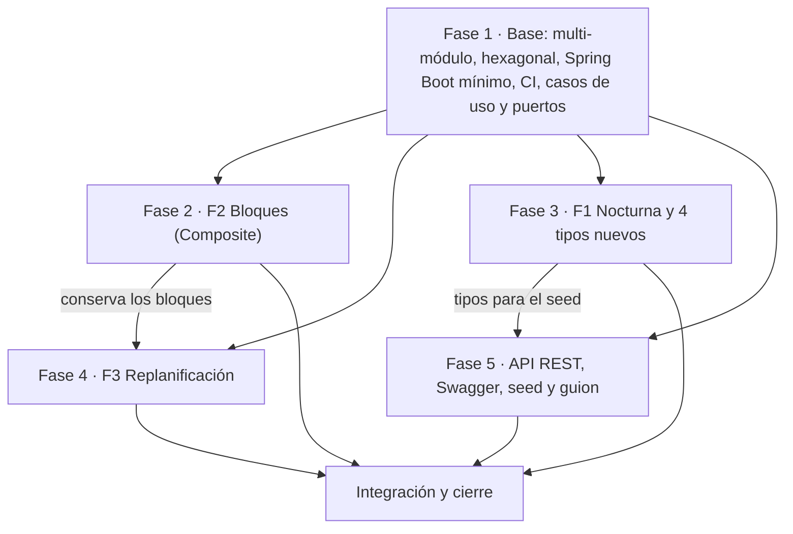
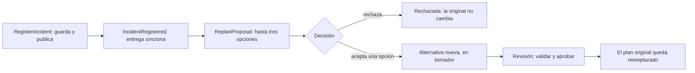

# Plan de implementación — Entrega 2 FieldOps

11/10/2026 · Complementa `docs/entrega-2-decisiones.md`.

## Resumen

La Entrega 2 se reparte en cinco fases, una por integrante: una base que se mergea primero (Fase 1) y cuatro que avanzan en paralelo sobre ella. Cada fase termina con su PR en verde, sus tests y sus entradas de `DESIGN.md` escritas en el mismo PR.

| Fase | Qué entrega | Entradas de `DESIGN.md` | Responsable |
| --- | --- | --- | --- |
| 1. Base | Hexagonal, multi-módulo Maven, Spring Boot mínimo, CI, y los casos de uso y puertos que la API necesita | D35 a D38 | Sin asignar |
| 2. F2 Bloques | Bloques secuenciales y paralelos con Composite | D39 a D41 | Sin asignar |
| 3. F1 Nocturna | Actividad nocturna con Decorator, los cuatro tipos de actividad que faltan y el registro de tipos | D42 a D44 | Sin asignar |
| 4. F3 Replanificación | Evento de dominio, propuestas con varias opciones, decisión y auditoría | D45 a D48 | Sin asignar |
| 5. API y demo | API REST, Swagger, seed, guion de demo, README e integración final | D49 a D52 | Sin asignar |

El plan original repartía los endpoints de F1, F2 y F3 entre sus dueños, sobre el esqueleto que publicaba la Fase 5, para que cada funcionalidad quedara "implementada, probada y documentada" por una sola persona. **No se cumplió:** las fases 2, 3 y 4 mergearon con su sección "API" pendiente. Esos endpoints los absorbe la Fase 5 (ver su alcance acordado).

Supuestos del plan, tomados de las decisiones del 11/10:

- La persistencia sigue en memoria. Los tests de repositorio se escriben como contrato reutilizable, para correrlos después contra JPA.
- El frontend queda fuera del plan hasta que se defina.
- Se conservan los nombres de paquete actuales (`business.*`) al pasar a módulos, para que los rebases de las otras fases sean triviales.

## Punto de partida

El repo es hoy un solo módulo Maven (`field-ops`, JDK 25) con el dominio de la Entrega 1: 282 tests (11 parametrizados), `DESIGN.md` con D1 a D34 y `Main.wire()` como composition root. No tiene Spring, API ni `.github/`.

| Requisito de la consigna | Qué hay hoy | Qué falta | Fase |
| --- | --- | --- | --- |
| Arquitectura hexagonal | Paquetes `business` y `providers` en un módulo | Módulos, puertos nombrados, adaptadores | 1 |
| Integración continua | Nada | Workflow y regla de protección de `main` | 1 |
| Casos de uso | `CreateExpedition`, `ApproveExpedition`, `ReplanExpedition`, `FinishExpedition`. Agendar, asignar, cambiar de estado y seguir se llaman directo sobre `Expedition` | Casos de uso para esas operaciones y para consultar | 1 |
| Catálogo de recursos | `ResourceCatalog` sin búsqueda por id y sin instancia compartida en `Main.wire()`. No hay almacén de zonas | Búsqueda por id, puerto de zonas, `findAll` de expediciones | 1 |
| F2 Bloques | `Itinerary` es una lista plana de `ItineraryItem` ordenada por inicio. `ExpeditionEstimator` suma todas las duraciones | Composite, duración por tipo de bloque, conflicto en paralelo | 2 |
| F1 Nocturna | Strategy `ActivityRules` con dos tipos. `ActivityRules` no conoce permisos y `RiskLevel` tiene tres niveles | Decorator, permiso por actividad, nivel de riesgo extra | 3 |
| Seis tipos de actividad | `DivingRules` y `SampleCollectionRules` | Cuatro tipos y un registro para crearlos por nombre | 3 |
| F3 Replanificación | `Expedition.reportIncident` solo guarda el incidente. `ExpeditionReplanner` exige original aprobada o suspendida y actividad afectada sin empezar | Evento, propuestas, decisión, auditoría | 4 |
| API REST y contratos | Nada | Controllers, DTOs, errores, OpenAPI | 5 |
| Tests de repositorio y de API | Un test del repositorio en memoria | Contrato de repositorios (Fase 1) y tests de API (todas) | 1 y 5 |
| Datos de demostración | Fixtures de test | Seed en archivos, cargador y guion | 5 |
| README ejecutable | Alcance de la Entrega 1 | Cómo compilar, ejecutar, probar y correr la demo | 5 |

## Dependencias y orden de merge



La Fase 1 abre con un PR chico (módulos y CI) que se mergea antes de que las demás abran los suyos. Las otras fases pueden empezar hoy sobre `main`: como los paquetes no cambian de nombre, el rebase solo mueve rutas.

Hay dos dependencias cruzadas. La Fase 4 rebasea sobre la Fase 2, porque la alternativa replanificada tiene que conservar los bloques. El seed de la Fase 5 necesita el registro de tipos de la Fase 3.

### Contratos que se acuerdan el primer día

| Contrato | Lo define | Lo usan | Qué se fija |
| --- | --- | --- | --- |
| Módulos y paquetes | Fase 1 | Todas | Qué va en `domain`, `app` y `web` |
| Nodo del itinerario | Fase 2 | Fases 4 y 5 | La interfaz común entre actividad y bloque. `Itinerary.getItems()` sigue devolviendo las hojas |
| `ActivityRules` ampliada y registro de tipos | Fase 3 | Fase 5 | Permisos y certificación que exige la actividad; nombre y parámetros de cada tipo |
| `Incident` ampliado y propuesta | Fase 4 | Fase 5 | Qué actividad y qué recurso afecta un incidente |
| Convenciones de la API | Fase 5 | Fases 2, 3 y 4 | Prefijo `/api`, formato de error, DTOs y dónde van los controllers |

### Archivos que tocan varias fases

| Archivo | Fases | Cómo se evita el conflicto |
| --- | --- | --- |
| `Expedition`, `ExpeditionBuilder` | 2 y 4 | La Fase 2 entra primero (agendar bloques). La Fase 4 solo cambia el registro del incidente |
| `ExpeditionReplanner` | 2 y 4 | La Fase 2 deja la forma de copiar la estructura de bloques. La Fase 4 la usa |
| `ApprovalPolicy.MANDATORY_RULES` | 2 y 3 | Cada fase agrega una línea |
| `ExpeditionReporter`, `ExpeditionReport` | 2 y 4 | Se agregan campos al final, sin reordenar |
| `DESIGN.md` | Todas | Números reservados. Cada fase edita solo sus entradas y su subsección |
| Configuración de beans en `web` | 1, 4 y 5 | Una clase `@Configuration` por área |

Se trabaja con una rama por fase y PR chicos, sin push directo a `main`.

## Fase 1: base hexagonal, módulos y CI

Deja el repo en multi-módulo hexagonal con CI, sin cambiar comportamiento, y completa los casos de uso y puertos que la API necesita. Son dos PR: el primero bloquea a todos y tiene que ser corto.

### Estructura propuesta

| Módulo | Contiene | Depende de |
| --- | --- | --- |
| `domain` | Todo `business.*`: modelo, reglas, validaciones, servicios, casos de uso (puertos de entrada) y `business.providers` (puertos de salida) | Nada de frameworks |
| `app` | `adapters.driven`: repositorios en memoria, publicador de eventos en memoria, cargador del seed | `domain` |
| `web` | Spring Boot, `adapters.driving.rest`, clases `@Configuration` que reemplazan a `Main.wire()`, springdoc | `domain` y `app` |

Punto a cerrar antes del PR: el diagrama de la clase 7 separa la interfaz del puerto de entrada (`domain.ports`) de su implementación (`application`). La decisión del 11/10 dice que los casos de uso son los puertos de entrada. Si se separan, las implementaciones van a `app`; si no, queda como alternativa descartada en D35. **Resuelto:** no se separan, quedó descartado en D35.

### PR 1a: módulos y CI (bloqueante)

**Estado (rama `assignment-2-phase-1a`, PR abierto):** todo hecho salvo la regla de protección de `main`. Commits: LF en los finales de línea, división en módulos, módulo `web` con Spring Boot, CI, `DESIGN.md` y README.

Cambios respecto del plan:

- `Main` y `FieldOps` se borraron. El armado lo hace `FieldOpsConfig` en `web`.
- `ExpeditionLifecycleIntegrationTest` recibe los casos de uso inyectados con `@SpringBootTest` y `@DirtiesContext` por test, porque el repositorio y las reservas son beans compartidos.
- `CreateExpeditionTest`, `ReplanExpeditionTest` y `ApproveAlternativeTest` (domain) usaban `InMemoryExpeditionRepository`, que ahora está en `app`. Para evitar un ciclo `domain` <-> `app` pasaron a `SequentialExpeditionRepository`. Solo cambió el import y el tipo.
- El enforcer de `domain` prohíbe `org.springframework*` (directo y transitivo).
- Se agregó `.gitattributes` con `* text=auto eol=lf`.
- D35, D36 y D37 escritas en `DESIGN.md`, con las filas de Clean Architecture y DDD en patrones no aplicados. La separación entre la interfaz del caso de uso y su implementación quedó **descartada** en D35: los casos de uso siguen siendo clases concretas en `domain`.
- README actualizado (módulos, compilar, ejecutar, CI). Para `mvn spring-boot:run -pl web` hace falta un `mvn install -DskipTests` previo.

- [x] Convertir el `pom.xml` raíz en parent (`packaging pom`) con `dependencyManagement`, enforcer de JDK 25, compiler y Lombok. Declarar los módulos `domain`, `app` y `web`.
- [x] Mover `business.*` y sus tests a `domain`, sin renombrar paquetes. Verificar que su `pom` no trae Spring.
- [x] Mover `InMemoryExpeditionRepository` a `app` como adaptador driven.
- [x] Publicar los fixtures de test de `domain` (`ExpeditionFixtures`, `SequentialExpeditionRepository`) como `test-jar`, para que `app` y `web` los reutilicen.
- [x] Mover `ExpeditionLifecycleIntegrationTest` al módulo que tenga el wiring. Hoy depende de `Main.wire()`.
- [x] En `web`: importar el BOM `spring-boot-dependencies` (la clase 8 usa 4.1.1), `spring-boot-starter-web`, clase `@SpringBootApplication` y los beans actuales de `FieldOps` en una `@Configuration`.
- [x] Test `@SpringBootTest` que levanta el contexto.
- [x] `.github/workflows/ci.yml`: en cada pull request y push a `main`, JDK 25 (Temurin), caché de Maven y `mvn -B verify`.
- [ ] Regla de protección de `main` en GitHub: PR obligatorio y check de CI requerido. La configura quien administra el repo. **Pendiente:** esperando permisos de admin; el check `verify` ya corrió en el PR.
- [x] Confirmar que los 282 tests siguen en verde desde la raíz. Corren 321 invocaciones (314 domain, 4 app, 3 web), las mismas que en `main`: el 282 cuenta métodos y no las invocaciones parametrizadas. Con el test de contexto de Spring son 322.

### PR 1b: casos de uso y puertos que faltan

**Estado (rama `assignment-2-phase-1b`, apilada sobre la 1a):** todo hecho. `mvn -B clean verify` pasa con 361 tests (346 domain, 11 app, 4 web). Falta abrir el PR; depende de que se mergee la 1a.

Qué hay y dónde (módulo `domain` salvo que se indique):

- **Casos de uso nuevos** (`business.usecases`): `ScheduleActivity`, `AssignResources` (personal, equipo y consumible), `TransitionExpedition` (enviar a revisión, devolver a borrador, iniciar, suspender, reanudar), `TrackActivity` (iniciar, finalizar actividad, observar), `QueryExpeditions`, `ValidateExpedition`, `EstimateExpedition`, `ReportExpedition` y `FindAssignmentCandidates`.
- **Comandos** (`record`): `CreateExpeditionCommand`, `ScheduleActivityCommand`, `WarningAcceptance`.
- **Variantes por id** de los casos de uso existentes: `ApproveExpedition.approve(id, aceptaciones)`, `FinishExpedition.finish(id)`, `ReplanExpedition.replan(id, actividad, motivo)` y `CreateExpedition.create(comando)`. Las variantes que reciben el objeto siguen existiendo.
- **Puertos y búsquedas:** `ExpeditionRepository.findAll()`, `ZoneRepository` (adaptador `InMemoryZoneRepository` en `app`), `ResourceCatalog.findStaff/findEquipment/findSupply` y listados, `Itinerary.itemFor(ActivityId)` y `NotFoundException`.
- **`web`:** `FieldOpsConfig` expone todos los beans nuevos y un único `ResourceCatalog`.
- **Tests:** `ExpeditionRepositoryContract` y `ZoneRepositoryContract` (clases abstractas en el `test-jar` de `domain`) con sus subclases en `app`; unitarios con Mockito en `TransitionExpeditionTest` (parametrizado), `CreateExpeditionCommandTest`, `ItineraryUseCasesTest` y `ExpeditionByIdTest`.

Cambios respecto del plan y cosas que las otras fases tienen que saber:

- **Cambian los constructores:** `CreateExpedition(repository, zones, catalog)`, `ApproveExpedition(reglas, reservas, repository, catalog)` y `FinishExpedition(reservas, repository)`. Quien los use al rebasear tiene que adaptar la llamada. En los tests de `domain` hay un helper, `ExpeditionFixtures.createExpeditionOn(repository)`.
- **`ScheduleActivityCommand` recibe la `Activity` ya armada.** Armarla por tipo y parámetros es del registro de tipos de la Fase 3; hasta entonces lo hace quien llama.
- **Aceptar una advertencia que la expedición no levanta falla** con `NotFoundException`, en vez de ignorarse.
- **No se hizo:** `reportIncident` como caso de uso (es de la Fase 4) ni un `save` en el repositorio (hará falta con persistencia real).
- **Reglas adicionales:** `ApproveExpedition` y `ValidateExpedition` reciben cada uno su lista; ambas son `List.of()` en `FieldOpsConfig`.
- **Para la Fase 5:** los errores de "no existe" son `NotFoundException` (404 en el mapeo de errores). El resto de las excepciones de dominio no cambió.
- D38 escrita en `DESIGN.md`, con una nota en D28. El README menciona los puertos y casos de uso nuevos.

- [x] Casos de uso para lo que hoy se llama directo sobre `Expedition`: agendar actividad, asignar personal, equipo y consumible, enviar a revisión, devolver a borrador, iniciar, suspender, reanudar, iniciar y finalizar actividad, registrar observación.
- [x] Consultas: obtener y listar expediciones, validar sin aprobar (con `ApprovalPolicy`), estimar, informe y candidatos de asignación del catálogo.
- [x] Entrada por comandos con ids (`record`), para que el adaptador REST no construya objetos de dominio. Hoy `CreateExpedition` recibe un `ExpeditionBuilder` ya armado.
- [x] `ExpeditionRepository.findAll()`.
- [x] Búsqueda por id en el catálogo (`ResourceCatalog` hoy solo consulta por requisito) y una única instancia compartida.
- [x] Puerto de salida para zonas, con su adaptador en memoria.
- [x] Búsqueda de un ítem del itinerario por `ActivityId`.

### Tests

- [x] Unitarios de cada caso de uso nuevo, con Mockito para los puertos de salida.
- [x] Contrato de repositorio: una clase abstracta de test por puerto, que hoy corre contra el adaptador en memoria y después contra JPA.
- [x] Parametrizado de las transiciones de estado expuestas por los casos de uso.

### `DESIGN.md`

- D35: arquitectura hexagonal. Tabla de correspondencia entre los paquetes de la Entrega 1 y puertos y adaptadores. Alternativas descartadas: Clean Architecture y DDD.
- D36: multi-módulo Maven para que el compilador haga cumplir la dependencia. Alternativa descartada: un módulo con paquetes y un test de arquitectura.
- D37: Spring solo en `web`; la `@Configuration` es el composition root que reemplaza a `Main.wire()`.
- D38: casos de uso con comandos por id. Amplía D28.
- El README documenta el workflow y la regla de protección de rama, que no queda en el código.

**Terminado cuando:** `mvn verify` pasa desde la raíz, un PR con un test roto no se puede mergear y `web` arranca. Hoy se cumple todo salvo el segundo punto, que espera la regla de protección de `main`.

## Fase 2: F2, bloques secuenciales y paralelos

Convierte el itinerario plano en un árbol con Composite: una actividad agendada es la hoja y un bloque es el compuesto. Validación, estimación e informes recorren el árbol sin preguntar de qué tipo es cada nodo.

**Estado (rama `assignment-2-phase-2`, apilada sobre la 1b):** dominio hecho, con sus tests y sus entradas de `DESIGN.md`. `mvn -B clean verify` pasa con 412 tests (397 domain, 11 app, 4 web); antes eran 361 y los 346 de `domain` siguen pasando sin tocarlos. Falta la parte de API (el endpoint y su test), que espera el esqueleto de la Fase 5.

Qué hay y dónde (módulo `domain`):

- **Nodo del itinerario:** `ItineraryNode` (`business.interfaces.itinerary`) con período agendado, duración estimada, riesgo, consumibles requeridos, si terminó, sus hojas, `runsInParallel` y `planKeepingStructure`. `ItineraryItem` es la hoja; `SequentialBlock` y `ParallelBlock` (sobre la base abstracta `ItineraryBlock`) son los compuestos.
- **Declarar un bloque:** `PlannedNode.sequential(...)`, `parallel(...)` y `activity(actividad, horario)`. Se agenda con `Expedition.schedule(PlannedNode)`, con `ExpeditionBuilder.addNode` o con el caso de uso `ScheduleBlock` (`ScheduleBlockCommand`).
- **Itinerario:** `getNodes()` devuelve las raíces y `getItems()` las hojas, las dos ordenadas por inicio. `runInParallel(a, b)` dice si dos actividades están en ramas distintas de un mismo paralelo.
- **Estimación:** `ExpeditionEstimator` agrega sobre las raíces.
- **Validación:** `ResourceOverlapValidation` reporta también el recurso compartido entre ramas paralelas.
- **Replanificación:** `ExpeditionReplanner` conserva los bloques con `Itinerary.planKeepingStructure`.
- **Tests:** `ItineraryBlocksTest` e `ItineraryWithoutBlocksRegressionTest` (nuevos), y casos nuevos en `ExpeditionEstimatorTest` (con el parametrizado de duración), `ResourceOverlapValidationTest`, `ApprovalPolicyTest`, `ExpeditionReplannerTest`, `ExpeditionReporterTest`, `ExpeditionBuilderTest` e `ItineraryUseCasesTest`.

Cambios respecto del plan y cosas que las otras fases tienen que saber:

- **El conflicto en paralelo no es una regla nueva:** se amplió `ResourceOverlapValidation` (D41). `ApprovalPolicy.MANDATORY_RULES` no cambió, así que la Fase 3 agrega su línea sin conflicto.
- **Dos ramas paralelas no comparten un recurso reutilizable aunque sus horarios no se pisen.** Tampoco puede haber una dependencia entre actividades de ramas paralelas: se rechaza al agendar. Esto último no estaba en el plan (D40).
- **En un secuencial se admiten huecos** y el orden es el declarado: no se reordena por horario (D40).
- **`PlannedNode` no estaba en el plan.** Hace falta porque un `ItineraryItem` no puede existir fuera de una expedición (D3), así que un bloque se declara y la expedición lo arma.
- **Caso de uso `ScheduleBlock`:** tampoco estaba en el plan. Recibe el `PlannedNode` con las actividades ya armadas, igual que `ScheduleActivityCommand` (D38). `FieldOpsConfig` lo expone como bean, que es el único cambio de esta fase en `web`.
- **`ExpeditionBuilder` agenda en el orden en que se le agregan las cosas.** Antes agendaba primero los terminados. `addFinishedItem` sigue existiendo como atajo; `Expedition.addFinishedCopyOf` e `Itinerary.addFinishedCopyOf` se eliminaron (notas en D3 y D33).
- **`Itinerary.getItems()` devuelve una copia no modificable**, no una vista viva de la lista interna (nota en D6).
- **No se agregaron campos a `ExpeditionReport`**, aunque la tabla de archivos compartidos lo preveía. El informe refleja los bloques a través del estimador (D24); la Fase 4 puede agregar los suyos al final sin conflicto.
- **Para la Fase 4:** `ExpeditionReplanner.planAlternative` no cambió de firma y ya conserva los bloques. La alternativa se agenda en el orden en que se agendó la original, no por horario. Cancelar la única actividad de un bloque elimina el bloque. Un `Delay` que deja a la actividad pisando al hermano siguiente de su secuencial falla con `InvalidScheduleException`: no corre a los hermanos. Está anotado como deuda técnica de F2 y la reprogramación de F3 lo va a necesitar.
- **Para la Fase 5:** `ItineraryNode` no expone los hijos ni el tipo de nodo. Cómo se muestra el árbol en la respuesta del itinerario se define con el endpoint. El "paralelo dentro de un secuencial" del seed se arma con `PlannedNode`.
- En el README solo cambió la línea de `interfaces`, que ahora nombra `ItineraryNode`.

### Diseño

- [x] Interfaz común del nodo (por ejemplo `ItineraryNode`): período agendado, duración estimada, riesgo, consumo, si terminó y sus hojas.
- [x] `ItineraryItem` la implementa como hoja y delega en su `Activity`, como hoy.
- [x] Dos compuestos, `SequentialBlock` y `ParallelBlock`, en vez de un bloque con un `enum` de modo y un `if`. Duración: suma en secuencial, máximo en paralelo. Riesgo: el más alto. Consumo: suma.
- [x] Un bloque admite actividades y otros bloques como hijos.
- [x] `Itinerary` guarda los nodos raíz. `getItems()` sigue devolviendo las hojas ordenadas por inicio, así las validaciones, las reservas y el informe actuales no cambian.
- [x] Agendar un bloque entra por `Expedition`, igual que una actividad (D19). `ExpeditionBuilder` suma la forma de declarar un bloque.
- [x] Invariantes al armar el bloque, con el criterio de D21: en un secuencial cada hijo empieza cuando terminó el anterior; el período del bloque envuelve a sus hijos y queda dentro del período de la expedición. El período se calcula a partir de los hijos, así que los envuelve por construcción.
- [x] `ExpeditionEstimator` pasa a sumar la duración de los nodos raíz. Hoy suma todas las actividades y contaría de más un bloque paralelo.
- [x] Conflicto en paralelo: dos ramas de un `ParallelBlock` no comparten un recurso reutilizable.
- [x] Dejar en el itinerario la forma de copiar la estructura de bloques a otra expedición. `ExpeditionReplanner` reconstruye la alternativa actividad por actividad y hoy la perdería.

Dos puntos a decidir y documentar:

- Dónde vive el conflicto en paralelo: ampliar `ResourceOverlapValidation` o una regla nueva en `ApprovalPolicy`. En los dos casos el mismo conflicto se reporta una sola vez (D32 identifica un resultado por regla y sujeto). **Resuelto:** se amplió `ResourceOverlapValidation` (D41).
- Si dos ramas de un paralelo con horarios que no se pisan pueden compartir un recurso. Recomendación: no, porque el bloque declara que pueden correr a la vez. **Resuelto:** no pueden (D41).

### API

- [ ] Endpoint para agendar un bloque con su árbol de hijos, sobre el esqueleto de la Fase 5. **Pendiente:** el caso de uso `ScheduleBlock` ya existe y está expuesto como bean; faltan el controller y los DTOs.
- [ ] La respuesta del itinerario muestra el árbol. **Pendiente.**

### Tests

- [x] Parametrizado de duración: secuencial, paralelo, paralelo dentro de secuencial y secuencial dentro de paralelo.
- [x] Un test por criterio de aceptación: itinerario con un paralelo dentro de un secuencial; suma y máximo; conflicto de recursos entre actividades paralelas del mismo bloque.
- [x] Regresión: un itinerario sin bloques valida, estima e informa igual que antes.
- [x] Invariantes: bloque vacío, hijo fuera del período, secuencial con hijos solapados.
- [x] La alternativa de una replanificación conserva los bloques, y el informe de una expedición con bloques usa la duración de cada bloque.
- [ ] Test de API del endpoint de bloques. **Pendiente**, con el endpoint.

### `DESIGN.md`

- D39: Composite en el itinerario. Alternativas descartadas: `enum` de modo con condicionales, bloque como subtipo de `Activity`, lista plana con un id de grupo.
- D40: qué se rechaza al armar un bloque y qué detecta la validación. Extiende D21.
- D41: conflicto de recursos en bloques paralelos.
- Marcar como revisadas D4 (la duración ya no es una suma plana) y D6 (el itinerario pasa de colección ordenada a árbol).
- Subsección F2: clases agregadas, clases modificadas (`Itinerary`, `ItineraryItem`, `Expedition`, `ExpeditionBuilder`, `ExpeditionEstimator`, la validación de superposición), refactorizaciones y deuda técnica. Candidatas a deuda: dependencias entre bloques, mover una actividad de un bloque a otro.

Todo escrito: D39, D40 y D41; notas "Revisado en D39" en D3, D4, D6 y D33, y "Revisado en D40" en D21; las filas del `enum` de modo y de Visitor en patrones no aplicados; la sección "Funcionalidades nuevas de la Entrega 2" con la subsección de F2, y cinco supuestos nuevos. La deuda técnica suma el retraso dentro de un secuencial, que no corre a los hermanos siguientes.

**Terminado cuando:** los tres criterios de aceptación tienen test con su nombre, no hay `instanceof` ni `switch` sobre el tipo de nodo, y la Fase 4 puede replanificar sin perder bloques. Hoy se cumple todo en el dominio; queda el endpoint.

## Fase 3: F1, actividad nocturna y tipos de actividad

Agrega la variante nocturna como un Decorator de `ActivityRules` que envuelve las reglas de cualquier tipo, y completa los seis tipos base que pide la demostración. Ningún validador, estimador ni informe pregunta si una actividad es nocturna.

**Estado (rama `assignment-2-phase-3`, sobre `main` con las fases 1 y 2 mergeadas):** dominio y casos de uso hechos, con sus tests y sus entradas de `DESIGN.md`. `mvn -B clean verify` pasa con 524 tests (509 domain, 11 app, 4 web); antes eran 412 y los 397 de `domain` siguen pasando sin tocarlos. Falta la parte de API (el alta de actividad por tipo, el endpoint que lista los tipos y su test), que espera el esqueleto de la Fase 5.

Qué hay y dónde (módulo `domain`):

- **Decorador:** `ActivityRulesDecorator` (base abstracta que delega todos los métodos) y `NightOperationRules`, en `business.rules`. Suma un equipo de categoría `Lighting`, la certificación `Night operations` para todo el personal y el permiso de la zona, y sube un nivel el riesgo.
- **`ActivityRules` ampliada:** `requiredCertificationsForAllStaff()` y `requiredPermitsIn(Zone)`, vacíos por defecto. `Activity` los expone (`requiredCertificationsForAllStaff`, `requiredPermits`) y responde `admits(persona)` y `missingPermits(concedidos)`.
- **Riesgo:** `RiskLevel.EXTREME` y `RiskLevel.next()`, que se queda en el máximo.
- **Permiso especial:** `Zone.specialPermitFor(operación)`. El de operación nocturna de la zona `z-1` se llama `night operations in zone z-1`.
- **Validación:** `MissingCertificationsValidation` reporta además a cada persona asignada sin la certificación (sujeto actividad + persona). `MissingPermitsValidation` reporta además los permisos de cada actividad pendiente (sujeto actividad).
- **Tipos nuevos:** `DroneSurveyRules(areaHectares)`, `WildlifeObservationRules(observationPoints)`, `WaterQualityMeasurementRules(stationCount)` y `TransferRules(distanceKilometers)`.
- **Registro:** `ActivityTypeRegistry.rulesFor(nombre, parámetros, nocturna)`, con `ActivityType`, `ActivityTypeName`, `ActivityParameters`, `UnknownActivityTypeException` e `InvalidActivityParametersException`. Cada regla publica su tipo en una constante `TYPE`.
- **Casos de uso:** `QueryActivityTypes` lista los tipos con sus parámetros. `FindAssignmentCandidates` ofrece solo personal que la actividad admite.
- **`web`:** `FieldOpsConfig` expone `ActivityTypeRegistry` y `QueryActivityTypes` como beans. Es el único cambio de esta fase fuera de `domain`.
- **Tests:** `NightOperationRulesTest`, `RiskLevelTest`, `ActivityTypeNameTest`, `ActivityTypeRegistryTest`, `QueryActivityTypesTest` y uno por tipo nuevo (`DroneSurveyRulesTest`, `WildlifeObservationRulesTest`, `WaterQualityMeasurementRulesTest`, `TransferRulesTest`). Casos nuevos, sin tocar los existentes, en `MissingCertificationsValidationTest`, `MissingPermitsValidationTest`, `MissingResourcesValidationTest`, `ApprovalPolicyTest`, `ExpeditionEstimatorTest`, `ExpeditionReporterTest`, `ItineraryBlocksTest`, `CreateExpeditionTest`, `ItineraryUseCasesTest`, `ActivityTest` y `ZoneTest`. `ExpeditionFixtures` suma `NIGHT_OPERATIONS`, `nightSampling`, `nightDiving`, `nightPermit` y `assignLighting`.

Cambios respecto del plan y cosas que las otras fases tienen que saber:

- **La certificación nocturna no se suma a cada `StaffRequirement`**, como decía el plan. Se exige a cada persona asignada con una pregunta nueva de `ActivityRules`, y la validación reporta una crítica por persona (D43). Con las dos cosas a la vez, la misma falta habría salido reportada dos veces.
- **`ApprovalPolicy.MANDATORY_RULES` no cambió**, aunque la tabla de archivos compartidos preveía una línea de esta fase. Se ampliaron `MissingCertificationsValidation` y `MissingPermitsValidation`; las reglas obligatorias siguen siendo siete.
- **`ScheduleActivityCommand` sigue recibiendo la `Activity` ya armada.** El registro existe, pero que el comando reciba tipo, parámetros e indicador de nocturna queda **pendiente para la API**: además de las reglas hay que resolver por id la zona y las dependencias, y eso se define con el endpoint (nota en D38 y consecuencia de D44).
- **`FindAssignmentCandidates` cambió y no estaba en el plan:** filtra el personal con `Activity.admits`, para no proponer en una actividad nocturna gente que la validación después rechaza.
- **Los parámetros del registro son enteros** (`Map<String, Integer>`) y sus nombres se comparan tal cual (`maxDepthMeters`). El nombre del tipo sí se normaliza como en D34.
- **Tampoco estaban en el plan:** `ActivityTypeName`, `ActivityParameters`, `SingleParameterActivityType` y las dos excepciones del registro (D44).
- **Para la Fase 5 (seed, API y demo):**
  - Los nombres de los tipos y de sus parámetros están en la tabla de D44 y los devuelve `QueryActivityTypes`.
  - Una actividad nocturna necesita en el catálogo un equipo de categoría `Lighting` y personas con la certificación `Night operations`, y en la expedición el permiso `night operations in zone <id>` (se puede obtener con `zone.specialPermitFor("night operations")`).
  - Excepciones nuevas para el mapeo de errores: `UnknownActivityTypeException` e `InvalidActivityParametersException`. Las dos son un pedido mal formado (400).
  - `RiskLevel` tiene un valor más para serializar: `EXTREME`.
  - Los candidatos de la demo siguen valiendo: el crítico es el permiso nocturno faltante, y la advertencia, el riesgo. Un buceo nocturno de hasta 30 metros es `HIGH` y supera una tolerancia `MEDIUM`.
  - El dominio no dice si una actividad es nocturna ni de qué tipo es. Si la respuesta de la API lo tiene que mostrar, el dato viaja aparte.
- **Para la Fase 4:** la alternativa de una replanificación conserva la variante nocturna y su permiso sin hacer nada, porque el replanificador reutiliza la misma `Activity` y copia los permisos concedidos.
- D42, D43 y D44 escritas en `DESIGN.md`, con notas en D1, D10, D11, D13 y D38, la subsección de F1 y seis supuestos nuevos. En el README cambiaron las líneas de `interfaces`, `rules` y `usecases`.

### Diseño del decorador

- [x] `NightOperationRules` implementa `ActivityRules` y envuelve otra `ActivityRules`. Una clase base que delega todo evita olvidar un método.
- [x] Personal: la certificación de operación nocturna se exige a cada persona asignada. **Cambiado respecto del plan:** no se suma a cada `StaffRequirement` de la regla base (D43).
- [x] Equipamiento: suma un `ReusableRequirement` de iluminación.
- [x] Riesgo: sube un nivel el de la regla base. Duración y consumibles se delegan sin cambios.

Tres huecos del modelo actual que esta fase tiene que cerrar:

- **Permiso por zona.** `ActivityRules` no conoce permisos: hoy solo los exige `Zone`, y `MissingPermitsValidation` mira las zonas de la expedición. Propuesta: que la regla declare los permisos que exige en la zona de su actividad (vacío por defecto, el permiso nocturno de esa zona en el decorador) y que la validación los sume. **Resuelto** así; el permiso lo nombra la zona con `specialPermitFor` (D43).
- **Todo el personal asignado.** `MissingCertificationsValidation` cuenta calificados contra el `headcount`, así que una persona extra sin la certificación pasaría. Hace falta que la regla pueda declarar certificaciones exigidas a cada asignado. **Resuelto** con `requiredCertificationsForAllStaff()` y `Activity.admits` (D43).
- **Riesgo ya en el máximo.** `RiskLevel` termina en `HIGH`. Un buceo profundo nocturno no reflejaría el factor salvo que se agregue un nivel por encima. **Resuelto:** se agregó `EXTREME` (D42).

### Tipos de actividad y registro

- [x] Cuatro implementaciones nuevas de `ActivityRules`, cada una con su parámetro propio como `DivingRules` con la profundidad. **Confirmados:** relevamiento con dron, observación de fauna, medición de calidad de agua y traslado.
- [x] Registro de tipos en el dominio: nombre del tipo y sus parámetros a una `ActivityRules`, sin `switch`. Lo usan la API y el cargador del seed. La variante nocturna se pide con un indicador y el registro envuelve la regla base.
- [x] Certificación y categoría nuevas (operación nocturna, iluminación), normalizadas como define D34.

### API

- [ ] El alta de actividad recibe tipo, parámetros e indicador de nocturna. **Pendiente:** el registro ya existe; falta que `ScheduleActivityCommand` reciba tipo y parámetros en vez de la `Activity` armada, y el controller con sus DTOs.
- [ ] Endpoint que lista los tipos disponibles y sus parámetros. **Pendiente:** el caso de uso `QueryActivityTypes` ya existe y está expuesto como bean.

### Tests

- [x] Parametrizado: el decorador sobre cada uno de los seis tipos base suma certificación, iluminación y permiso.
- [x] Parametrizado: riesgo resultante por cada nivel base.
- [x] Tests propios de cada tipo nuevo, con el estilo de `DivingRulesTest`.
- [x] Un test por criterio de aceptación: expedición con una actividad nocturna; crítico sin certificación; crítico sin permiso; la estimación refleja el factor.
- [x] El informe de una expedición con actividad nocturna sale de `ExpeditionReporter` sin modificarlo.
- [x] Registro: cada tipo por nombre, la variante nocturna, tipo desconocido y parámetro faltante o inválido. Una actividad nocturna dentro de un bloque se valida y se estima igual que suelta.
- [ ] Test de API del alta de una actividad nocturna. **Pendiente**, con el endpoint.

### `DESIGN.md`

- D42: Decorator sobre `ActivityRules`. Alternativas descartadas: una clase nocturna por tipo (duplica cada tipo), un booleano en `Activity` con condicionales, herencia.
- D43: permisos y certificaciones que exige la actividad. Extiende D10 y D13.
- D44: registro de tipos y los cuatro tipos nuevos. Extiende D1.
- Actualizar la tabla de patrones no aplicados: la fila de Decorator sigue valiendo para las advertencias aceptadas, pero el patrón ya se usa en F1.
- Supuestos: los valores de los tipos nuevos son ilustrativos. La actividad se declara nocturna; no se infiere de su horario.
- Subsección F1: clases agregadas, clases modificadas (`ActivityRules`, `Activity`, `RiskLevel`, las dos validaciones), refactorizaciones y deuda técnica. Candidata a deuda: nada impide envolver dos veces la misma regla.

Todo escrito: D42, D43 y D44; notas "Revisado en D44" en D1 y "Revisado en D43" en D10, D11 y D13; la nota de pendiente en la consecuencia de D38; la fila de Decorator actualizada en patrones no aplicados; la subsección de F1 antes de la de F2, y seis supuestos nuevos. La deuda técnica suma que `ScheduleActivityCommand` no usa el registro, que una actividad no dice que es nocturna, que el permiso especial es una convención de nombre, que los parámetros son enteros y que el horario de una actividad nocturna no se verifica.

**Terminado cuando:** los cuatro criterios de aceptación tienen test, y agregar la nocturna no sumó ningún condicional por tipo en validaciones, estimación ni informes. Hoy se cumple todo en el dominio; queda la API.

## Fase 4: F3, replanificación automática

Registrar un incidente publica un evento de dominio y, al volver la llamada, ya existe una propuesta con varias opciones. El responsable acepta una o rechaza, y el plan original, el incidente y la decisión quedan consultables.



Aceptar no reemplaza el plan en el acto: crea la alternativa en borrador, que pasa por revisión y aprobación como define D33.

**Estado (rama `assignment-2-phase-4`, sobre `main` con las fases 1, 2 y 3 mergeadas):** dominio, adaptadores y wiring hechos, con sus tests y sus entradas de `DESIGN.md`. `mvn -B clean verify` pasa con 607 tests (582 domain, 20 app, 5 web); antes eran 524. Falta la parte de API (endpoints y su test), que espera el esqueleto de la Fase 5.

Qué hay y dónde:

- **Incidente:** `Incident` con id (`IncidentId(expedición, número)`), actividad afectada, y recurso y retraso opcionales. Se informa con `IncidentReport.of(descripción, fecha).affecting(recurso).delayingBy(retraso)`. La expedición guarda la bitácora (`registerIncident`, `getIncidents`); `reportIncident` y los incidentes de `ActivityTracking` se eliminaron.
- **Evento:** `DomainEvent`, `EventSubscriber<E>`, `IncidentRegistered`, puerto `EventPublisher` y adaptador `InMemoryEventPublisher` (en `app`), síncrono.
- **Propuesta:** `ReplanProposal` (pendiente, aceptada, rechazada, `SUPERSEDED`), `ReplanOption(motivo, resumen)` numeradas desde 1, `ReplanDecision`. Puerto `ReplanProposalRepository` con `InMemoryReplanProposalRepository` (en `app`) y su contrato.
- **Generadores:** `RescheduleOptions` (si el incidente trae retraso), `ResourceReplacementOptions` (si nombra un recurso; hasta tres candidatos del catálogo) y `CancellationOptions` (siempre, en cascada). Solo se ofrecen las que `ExpeditionReplanner.canPlan` puede armar.
- **Casos de uso:** `RegisterIncident` (devuelve la propuesta), `ProposeReplan` (el suscriptor), `DecideReplanProposal` (`accept`, `reject`) y `QueryReplanProposals`.
- **`web`:** `ReplanningConfig` con los beans de F3; el `ExpeditionReplanner` pasó a ser un bean en `FieldOpsConfig`.

Cambios respecto del plan y cosas que las otras fases tienen que saber:

- **La deuda de F2 quedó resuelta:** un retraso corre por el mismo tiempo lo que viene después en sus secuenciales y lo que depende de la actividad. Cancelar cancela en cascada lo que depende de ella. Vale también para `ReplanExpedition` manual (D46).
- **La actividad afectada puede haber empezado.** Para aceptar hay que cerrarla antes con su resultado real; la alternativa la rehace según la opción (D47).
- **Nuevo motivo `ResourceReplaced`** y `ResourceAssignment`; `ReplannedActivity` suma `additions`.
- **La alternativa hereda los incidentes** de la original (D48).
- **Para la Fase 5:**
  - Endpoints a escribir: registrar un incidente (devuelve la propuesta), consultar una propuesta y las de una expedición, aceptar una opción por número y rechazar. Aceptar y rechazar reciben responsable por id, justificación y fecha (`ReplanDecisionCommand`).
  - Excepciones nuevas para el mapeo de errores: `NotAResponsibleException` (403 o 422, a definir), `ProposalAlreadyDecidedException` (409), `DuplicateReplanProposalException` (409). Una opción o propuesta inexistente es `NotFoundException` (404). Registrar un incidente inválido es `InvalidTrackingException` (400).
  - Para la demo: registrar el incidente con retraso o recurso para que la propuesta tenga más de una opción.
- D45 a D48 escritas en `DESIGN.md`, con notas en D15, D20, D23, D24, D25, D33 y D40, la subsección de F3, dos filas en patrones no aplicados (Event Sourcing y entrega asíncrona) y seis supuestos nuevos.

### Diseño

- [x] `Incident` suma qué afecta: la actividad y, si corresponde, el recurso. Hoy solo tiene descripción y fecha.
- [x] Evento `IncidentRegistered` y puerto de salida `EventPublisher` en el dominio. Las entidades no publican: lo hace el caso de uso `RegisterIncident`, después de guardar el incidente en la expedición.
- [x] Adaptador driven `InMemoryEventPublisher` en `app`, con entrega síncrona a los suscriptores que registra la configuración.
- [x] Suscriptor que arma y guarda la propuesta.
- [x] `ReplanProposal`: expedición original, incidente, actividad afectada, opciones, estado (pendiente, aceptada, rechazada) y decisión (responsable, opción elegida, justificación, fecha).
- [x] Puerto `ReplanProposalRepository` y su adaptador en memoria.
- [x] Un generador por tipo de opción, en una lista inyectada, para que sumar un tipo sea sumar una clase. Cada opción envuelve un `ReplanReason` existente: reprogramación con `Delay`, reemplazo de recurso a partir de `ResourceWithdrawn`, cancelación parcial con `Cancellation`.
- [x] Casos de uso para aceptar y rechazar. Aceptar verifica que quien decide sea responsable de la expedición y ejecuta `ReplanExpedition` con el motivo de la opción elegida.
- [x] Consultas de auditoría: propuesta por id y propuestas de una expedición. El vínculo entre original y alternativa ya existe (`getReplacement`, `getReplacedExpedition`).
- [x] La alternativa conserva los bloques de la original, con lo que deja la Fase 2.

El código actual choca con el criterio de aceptación en cuatro lugares. Hay que resolverlos y documentarlos como revisión de D33:

- **Expedición en ejecución.** `ExpeditionReplanner` exige una original aprobada o suspendida y sin actividades en curso. Recomendación: la propuesta se genera en ejecución, y aceptar suspende la expedición antes de replanificar.
- **Actividad afectada.** `reportIncident` exige una actividad ya iniciada, y el replanificador exige una actividad sin empezar. Hay que definir si un incidente puede apuntar a una actividad pendiente y cómo se interrumpe una en curso, que hoy solo se cierra con resultado.
- **Candidatos de reemplazo.** D33 descartó elegir el reemplazo automáticamente. Ahora se ofrecen los candidatos de `ResourceCatalog` para el requisito que cubría el recurso: definir cuántos y en qué orden. `ResourceWithdrawn` hoy retira el recurso pero no asigna otro.
- **Opciones que no se pueden armar.** Un `Delay` que saca la actividad de su ventana y una cancelación con dependientes agendados hoy fallan con `InvalidScheduleException`. Esas opciones no se ofrecen. Falta definir cuánto se corre una reprogramación.

**Resueltos:** la propuesta se genera en ejecución y aceptar suspende (D47); el incidente puede afectar a una actividad pendiente o en curso, y la en curso se cierra antes de aceptar y se rehace (D47); una opción por candidato del catálogo, hasta tres, en orden del catálogo (D46); el retraso lo informa el incidente, corre a hermanos y dependientes, y cancelar cae en cascada; lo que igual no se puede armar no se ofrece (D46).

### API

- [ ] Registrar un incidente sobre una actividad. La respuesta incluye la propuesta generada. **Pendiente:** `RegisterIncident` ya existe y está expuesto como bean.
- [ ] Consultar las propuestas de una expedición y una propuesta por id. **Pendiente:** `QueryReplanProposals`.
- [ ] Aceptar una opción y rechazar la propuesta. **Pendiente:** `DecideReplanProposal`.

### Tests

- [x] Unitarios con Mockito: `RegisterIncident` publica el evento; el suscriptor guarda la propuesta.
- [x] Integración con el publicador real: al volver de `RegisterIncident` la propuesta ya existe.
- [x] Parametrizado: qué opciones se generan según lo que afecta el incidente y el estado del itinerario.
- [x] Un test por criterio de aceptación: el incidente genera la propuesta; aceptar; rechazar; original, incidente y decisión consultables después.
- [x] Contrato de repositorio para `ReplanProposalRepository`.
- [ ] Test de API del flujo completo. **Pendiente**, con los endpoints.

### `DESIGN.md`

- D45: evento de dominio y `EventPublisher` síncrono. Alternativas descartadas: que `RegisterIncident` llame directo al replanificador, usar el publicador de Spring dentro del dominio, entrega asíncrona.
- D46: propuesta con varias opciones y un generador por tipo. Revisa el último punto de D33 y define los candidatos del catálogo.
- D47: ciclo de vida de la propuesta y qué pasa con la expedición al aceptar. Revisa D33.
- D48: auditoría. Alternativa descartada: Event Sourcing, que va a la tabla de patrones no aplicados.
- Subsección F3: clases agregadas, clases modificadas (`Incident`, `Expedition`, `ExpeditionReplanner`, `ResourceWithdrawn`, `ExpeditionReporter`), refactorizaciones y deuda técnica. Candidatas a deuda: entrega sin reintentos ni transacción, un solo incidente por propuesta.

**Terminado cuando:** los tres criterios de aceptación tienen test, y después de aceptar o rechazar se pueden consultar el plan original, el incidente y la decisión. Hoy se cumple todo en el dominio; queda la API.

## Fase 5: API REST, demo y documentación

Expone los casos de uso por REST, deja la demostración reproducible y cierra la entrega.

**Estado (12/10/2026, antes de empezar):** nada escrito. `web` tiene solo `FieldOpsApplication`, `FieldOpsConfig` y `ReplanningConfig`: no hay paquete `adapters.driving.rest`, ni DTOs, ni `@RestControllerAdvice`, ni springdoc en el `pom`, ni carpeta `demo/`. `DESIGN.md` llega hasta D48 y el README dice que el proyecto todavía no expone endpoints. Las fases 1 a 4 están mergeadas en `main` (último commit `1baba60`).

### Alcance acordado (12/10/2026)

| Punto | Decisión |
| --- | --- |
| Endpoints pendientes de F1, F2 y F3 | **Los absorbe la Fase 5**, con sus tests de API y los cambios de dominio que habilitan. Son siete: agendar bloque, itinerario en árbol, alta de actividad por tipo, listar tipos, registrar incidente, consultar propuestas y decidir |
| Alta del catálogo | **Casos de uso nuevos** en `business.usecases`. El controller no arma objetos de dominio, como fija D38 (D52) |
| Guion de la demo | **`demo.http`**, el cliente HTTP de IntelliJ. La repetibilidad en la CI la cubre el test de API que recorre el mismo guion |
| Frontend | **Fuera del alcance de la fase.** Queda anotado como pendiente del grupo en el README y en `DESIGN.md`; Swagger UI no lo reemplaza |
| Persistencia | Sigue en memoria, como decidió el grupo el 11/10. D51 la registra como deuda técnica |

Absorber los endpoints de las otras fases cambia el tamaño de la fase: pasa de "exponer lo que ya existe" a ser el último tramo de la entrega. Si hay que recortar, el orden es el del cierre de este documento: primero el camino que recorre la demo, después el resto del PR 5b.

### Cambios de dominio que la API necesita

El dominio quedó cerrado para tres cosas que un adaptador REST no puede resolver solo. Son trabajo de esta fase, en el módulo `domain`, y se documentan como revisión de las decisiones que tocan.

1. **Alta de actividad por tipo.** `ScheduleActivityCommand(ExpeditionId, Activity, TimePeriod)` recibe la `Activity` ya construida, y `new Activity(...)` pide `Zone`, `List<Activity>` de dependencias y `ActivityRules`. Hace falta un comando con `zoneId`, ids de dependencias, nombre del tipo, parámetros e indicador de nocturna, y que el caso de uso resuelva la zona con `ZoneRepository`, las dependencias en el itinerario y las reglas con `ActivityTypeRegistry`. Es la deuda que anotó la Fase 3 (nota en D38).
2. **Alta de bloque.** `ScheduleBlockCommand(ExpeditionId, PlannedNode)` tiene el mismo problema un nivel más arriba: `PlannedNode.activity(...)` también recibe `Activity` armadas. El DTO es un árbol y se traduce con el mismo resolver del punto 1. **No estaba anotado en ninguna fase**; salió al definir este alcance.
3. **Itinerario en árbol.** `ItineraryNode` no expone los hijos ni el tipo de nodo, y la Fase 2 cerró con el criterio de que no haya `instanceof` ni `switch` sobre el tipo de nodo. Para serializar el árbol hay que elegir: sumar a la interfaz un accesor de hijos y un nombre de tipo, o un Visitor (que la Fase 2 descartó en la tabla de patrones no aplicados). **A decidir en el PR 5a y documentar en D49.**

Y una decisión que queda abierta: **el dominio no dice de qué tipo es una actividad ni si es nocturna** (lo anotó la Fase 3). Si la respuesta del itinerario lo tiene que mostrar, el dato viaja aparte o se guarda. Se resuelve junto con el punto 3.

### PR 5a: esqueleto de la API

- [x] Paquete `adapters.driving.rest` en `web`, con un controller por recurso.
- [x] DTOs de entrada y salida como `record`, separados del dominio, con sus mappers. Ninguna entidad se serializa directo.
- [x] Un `@RestControllerAdvice` que traduce las excepciones de dominio a HTTP con un formato de error único (`ProblemDetail`).
- [x] springdoc para generar OpenAPI y Swagger UI. Verificar la versión compatible con el Spring Boot del proyecto.
- [x] Un endpoint completo de punta a punta como ejemplo del resto, con su test de API.
- [x] Prefijo `/api`, y convención para las operaciones que no son CRUD: son sub-recursos en `POST` (`/approval`, `/suspension`), no verbos en la URL. Queda en D49.

Mapeo de errores, con las dieciocho excepciones que hay hoy en `business.exceptions`:

| Excepción de dominio | HTTP |
| --- | --- |
| Argumento inválido (`IllegalArgumentException`, `NullPointerException` de los constructores), `InvalidScheduleException`, `InvalidTrackingException`, `UnknownActivityTypeException`, `InvalidActivityParametersException` | 400 |
| `NotFoundException` (recurso, zona, expedición, actividad agendada, propuesta u opción inexistente) | 404 |
| `InvalidStatusTransitionException`, `ExpeditionNotEditableException`, `ActivitiesInProgressException`, `ResourceUnavailableException`, `DuplicateExpeditionException`, `DuplicateResourceException`, `DuplicateZoneException`, `DuplicateReplanProposalException`, `ProposalAlreadyDecidedException` | 409 |
| `ExpeditionNotApprovableException` (con la lista de críticos en el cuerpo), `UnacceptedWarningException`, `InsufficientStockException`, `NotAResponsibleException` | 422 |

`NotAResponsibleException` quedó en 422 y no en 403: resuelto en el PR 5a, el porqué está en D49.

**Estado (rama `assignment-2-phase-5`, sobre `main` con las fases 1 a 4 mergeadas):** esqueleto hecho. `mvn -B clean verify` pasa con 638 tests (582 domain, 20 app, 36 web); antes eran 607 y los 582 de `domain` y los 20 de `app` siguen pasando sin tocarlos. Lo que quedó:

- `web/src/main/java/ar/edu/itba/dps/fieldops/adapters/driving/rest/` con `ExpeditionController`, `DomainExceptionHandler`, `OpenApiConfig`, el subpaquete `dtos` (`CreateExpeditionRequest`, `ExpeditionResponse`, `PeriodDto`, `RestrictionsDto`) y el subpaquete `mappers` (`ExpeditionMapper`). D49 documenta las decisiones.
- Tests: `ExpeditionApiTest` (7, con el contexto completo, los adaptadores en memoria y `@DirtiesContext`, reusando los fixtures del `test-jar` de `domain`), `DomainExceptionHandlerTest` (22: el parametrizado de las veinte entradas del mapeo, el 500 de una excepción sin clasificar y uno que falla si aparece una excepción en `business.exceptions` sin fila en la tabla) y `OpenApiDocumentationTest` (2).
- Dependencias nuevas en `web/pom.xml`: `springdoc-openapi-starter-webmvc-ui` 3.1.1 y, en tests, `spring-boot-webmvc-test`, que es donde Spring Boot 4 mudó `@AutoConfigureMockMvc` (ya no está en `spring-boot-test-autoconfigure`).

Qué cambió respecto del plan:

- **`-parameters` en el compilador de `web`.** Spring resuelve `@PathVariable` por el nombre del parámetro y javac no lo conserva por defecto; como el build no hereda de `spring-boot-starter-parent`, nadie lo había puesto. Sin el flag, `GET /api/expeditions/{id}` devolvía 400. Está en `web/pom.xml`, no toca a los otros módulos.
- **La lista de críticos de `ExpeditionNotApprovableException` viaja en el mensaje, no como un arreglo en el cuerpo.** La excepción solo guarda el texto ya unido; para exponerla estructurada tiene que conservar los `ValidationResult`, que es un cambio en `domain`. Queda para el PR que escribe `POST /api/expeditions/{id}/approval`.
- **La convención de sub-recursos está decidida y escrita en D49, pero todavía no hay ningún endpoint que no sea CRUD**: los cinco de estados, el de aprobación, el de cierre y los dos de decisión de propuesta son del PR 5b.
- **El README se corrigió solo donde quedaba falso** (decía que el proyecto no expone endpoints). La reescritura completa sigue siendo del cierre de la fase.

### PR 5b: endpoints de los requisitos funcionales

Inventario completo, con el caso de uso que hay detrás de cada uno. Los marcados **(nuevo)** son casos de uso que hay que escribir; los marcados **(dominio)** dependen de los cambios de la sección anterior; los marcados **(F1/F2/F3)** son los que absorbemos de las otras fases.

| Capacidad | Endpoint | Caso de uso |
| --- | --- | --- |
| Catálogo | `POST` y `GET /api/staff`, `/api/equipment`, `/api/supplies` | `RegisterStaff`, `RegisterEquipment`, `RegisterSupply`, `QueryCatalog` **(nuevos)** |
| Catálogo | `POST /api/{recurso}/{id}/unavailabilities` | `MarkResourceUnavailable` **(nuevo)** |
| Zonas | `POST /api/zones`, `GET /api/zones`, `GET /api/zones/{id}` | `RegisterZone`, `QueryZones` **(nuevos)** |
| Expediciones | `POST /api/expeditions`, `GET /api/expeditions`, `GET /api/expeditions/{id}` | `CreateExpedition.create(command)`, `QueryExpeditions` |
| Itinerario | `POST /api/expeditions/{id}/activities` | `ScheduleActivity` **(dominio, F1)** |
| Itinerario | `POST /api/expeditions/{id}/blocks` | `ScheduleBlock` **(dominio, F2)** |
| Itinerario | `GET /api/expeditions/{id}/itinerary` | `QueryExpeditions.get` + mapeo del árbol **(dominio, F2)** |
| Itinerario | `GET /api/activity-types` | `QueryActivityTypes` **(F1)** |
| Asignación | `POST /api/expeditions/{id}/activities/{activityId}/staff`, `/equipment`, `/supplies` | `AssignResources` |
| Asignación | `GET /api/expeditions/{id}/activities/{activityId}/candidates` | `FindAssignmentCandidates` |
| Validación y estimación | `GET /api/expeditions/{id}/validation`, `/estimate` | `ValidateExpedition`, `EstimateExpedition` |
| Informes | `GET /api/expeditions/{id}/report` | `ReportExpedition` |
| Estados | `POST /api/expeditions/{id}/review`, `/draft`, `/execution`, `/suspension`, `/resumption` | `TransitionExpedition` |
| Aprobación | `POST /api/expeditions/{id}/approval` (cuerpo: advertencias aceptadas) | `ApproveExpedition.approve(id, acceptances)` |
| Cierre | `POST /api/expeditions/{id}/completion` | `FinishExpedition.finish(id)` |
| Seguimiento | `POST /api/expeditions/{id}/activities/{activityId}/start`, `/completion`, `/observations` | `TrackActivity` |
| Incidentes | `POST /api/expeditions/{id}/incidents` (devuelve la propuesta) | `RegisterIncident` **(F3)** |
| Propuestas | `GET /api/expeditions/{id}/replan-proposals`, `GET /api/replan-proposals/{id}` | `QueryReplanProposals` **(F3)** |
| Propuestas | `POST /api/replan-proposals/{id}/acceptance` (número de opción + responsable, justificación y fecha), `/rejection` | `DecideReplanProposal` **(F3)** |

Son unos treinta endpoints sobre diecisiete casos de uso existentes y seis nuevos. `ReplanExpedition` (la replanificación manual, sin incidente) **no se expone**: la consigna pide la replanificación por incidente y el caso de uso manual ya tiene cobertura unitaria. Queda anotado en D49.

### PR 5c: demo

- [ ] Seed como datos: `demo/catalog.json` y `demo/expedition.json`, más un único cargador genérico que corre con el perfil `demo`. Usa los builders y el registro de tipos de la Fase 3. No hay clases Java propias de la demo.
- [ ] Guion contra la API en `demo.http`: crear la expedición, intentar aprobar y ver el crítico, corregir, aceptar la advertencia, aprobar, ejecutar, registrar el incidente y elegir una opción.
- [ ] El escenario cubre lo que sugiere la consigna: diez o más actividades, seis tipos y la nocturna, un paralelo dentro de un secuencial, un recurso compartido, un error crítico, una advertencia aceptable y la replanificación.
- [ ] Candidatos naturales: el crítico es el permiso nocturno faltante, y la advertencia es el riesgo por encima de la tolerancia, que `RiskToleranceValidation` ya emite como advertencia.

### Tests

- [ ] Tests de API con el contexto completo y los adaptadores reales en memoria, sin mocks: un caso feliz por capacidad.
- [ ] Parametrizado: cada excepción de dominio devuelve su código HTTP.
- [ ] Unitarios de los casos de uso nuevos del catálogo, con Mockito, como el resto de la Fase 1.
- [ ] Tests de API de lo que absorbemos: agendar un bloque con su árbol, alta de una actividad nocturna por tipo, listar tipos, y el flujo completo de F3 (incidente, propuesta, aceptar y rechazar).
- [ ] Test del cargador del seed: los archivos de `demo/` cargan sin errores.
- [ ] Un test de API que recorre el mismo guion de `demo.http`, para que la CI avise si la demo se rompe.

### README y cierre

- [ ] Reescribir el README: requisitos, cómo compilar, ejecutar y probar, estructura de módulos, cómo correr la demo, contratos de la API (tabla de endpoints y enlace a Swagger UI), CI y regla de protección de rama. Hoy dice que el proyecto no expone endpoints.
- [ ] Revisión final de `DESIGN.md`: numeración, referencias cruzadas, párrafo de modelo de dominio, tabla de patrones no aplicados y supuestos.
- [ ] Completar las subsecciones de F1, F2 y F3 con los endpoints que agregamos, porque cada funcionalidad las tiene abiertas por su parte de API.
- [ ] Correr la demo completa desde un clon limpio.
- [ ] Anotar la URL del repo y el hash del commit de entrega.
- [ ] Recordarle al grupo los dos pendientes que no son de esta fase y están en el checklist: la regla de protección de `main` (falta permiso de admin) y el frontend mínimo.

### `DESIGN.md`

- D49: la API como adaptador driving, con DTOs propios y el mapeo de errores fuera del dominio. Alternativas descartadas: serializar entidades, anotar excepciones de dominio con códigos HTTP. Se escribe en el PR 5a y se le agrega después cómo se serializa el árbol del itinerario sin condicionales por tipo de nodo, y por qué no se expone la replanificación manual.
- D50: seed como datos con un cargador genérico. Alternativas descartadas: clases Java de demo, `data.sql` antes de tener persistencia.
- D51: persistencia en memoria detrás de los puertos y tests de repositorio como contrato. Se registra como deuda técnica de la entrega.
- D52: casos de uso de alta del catálogo y de zonas. Extiende D38. Alternativa descartada: que el controller llame directo a `ResourceCatalog` y `ZoneRepository` y construya los objetos de dominio.
- Revisión de D38: los comandos de agendar actividad y bloque pasan a recibir ids, tipo y parámetros, que es lo que la Fase 1 dejó anotado como pendiente y la Fase 3 como deuda.
- Patrones no aplicados: JPA en esta entrega, y Visitor si el árbol del itinerario se resuelve de otra forma.

**Terminado cuando:** un clon limpio compila, pasa los tests, arranca con el perfil `demo` y el guion de `demo.http` corre de principio a fin.

## `DESIGN.md`: qué escribe cada fase

Cada fase escribe sus entradas en el mismo PR que el código, con numeración reservada para que no haya choques. La consigna pide dos cosas distintas: las decisiones (patrón, dónde, por qué, alternativas, patrones no aplicados) y, por cada funcionalidad nueva, clases agregadas y modificadas, refactorizaciones y deuda técnica.

### Numeración reservada

| Entrada | Tema | Fase |
| --- | --- | --- |
| D35 | Arquitectura hexagonal: puertos y adaptadores | 1 |
| D36 | Multi-módulo Maven | 1 |
| D37 | Spring solo en `web` y composition root | 1 |
| D38 | Casos de uso con comandos por id | 1 |
| D39 | Composite en el itinerario | 2 |
| D40 | Invariantes de los bloques | 2 |
| D41 | Conflicto de recursos en bloques paralelos | 2 |
| D42 | Decorator para la actividad nocturna | 3 |
| D43 | Permisos y certificaciones que exige la actividad | 3 |
| D44 | Registro de tipos y tipos nuevos | 3 |
| D45 | Evento de dominio y `EventPublisher` | 4 |
| D46 | Propuesta con varias opciones | 4 |
| D47 | Ciclo de vida de la propuesta | 4 |
| D48 | Auditoría de la replanificación | 4 |
| D49 | API REST como adaptador driving | 5 |
| D50 | Seed como datos | 5 |
| D51 | Persistencia en memoria y contrato de repositorios | 5 |
| D52 | Casos de uso de alta del catálogo y de zonas | 5 |

Si una fase necesita una entrada más, toma desde D53 y avisa al resto.

### Formato de cada decisión

Se mantiene el de D1 a D34: patrón o principio, dónde, por qué, alternativas descartadas y consecuencia. Una decisión que cambia otra anterior no la reescribe: se agrega una línea "Revisado en Dnn" en la vieja, como ya se hizo en D25 con D33.

| Decisión existente | La revisa | Por qué |
| --- | --- | --- |
| D1 | Fase 3 | Hay seis tipos y un registro |
| D4 | Fase 2 | La duración ya no es una suma plana |
| D6 y D21 | Fase 2 | El itinerario pasa a ser un árbol con invariantes de bloque |
| D10 y D13 | Fase 3 | La actividad puede exigir permisos y certificaciones a todo el personal |
| D25 y D33 | Fase 4 | Replanificación desde una expedición en ejecución y candidatos de reemplazo |
| D28 | Fase 1 | Más casos de uso y entrada por comandos |

### Sección nueva por funcionalidad

Se agrega la sección "Funcionalidades nuevas de la Entrega 2" después de las decisiones, con una subsección por F1, F2 y F3 que sigue esta plantilla:

```markdown
### F2 — Bloques de actividades secuenciales y paralelos

- **Decisiones:** D39, D40, D41.
- **Clases agregadas:** nombre y paquete de cada una, con una línea de para qué.
- **Clases modificadas:** cuál y qué cambió.
- **Refactorizaciones realizadas:** qué se reestructuró sin cambiar comportamiento y por qué hizo falta.
- **Deuda técnica que se decidió no resolver:** qué queda, por qué se aceptó y qué señal obligaría a resolverla.
- **Criterios de aceptación:** cada criterio con el test que lo cubre.
```

### Secciones compartidas

- **Patrones que decidimos no aplicar.** Cada fase agrega sus filas. Como mínimo: Clean Architecture y DDD (Fase 1), el modo del bloque como `enum` y Visitor para recorrer el árbol (Fase 2), la fila de Decorator actualizada (Fase 3), Event Sourcing (Fase 4), JPA en esta entrega (Fase 5).
- **Supuestos.** Cada fase agrega los suyos al final de la lista.
- **Modelo de dominio.** El párrafo inicial lo actualiza la Fase 5 al cierre, cuando ya están los bloques, la nocturna y las propuestas.

## Pendientes, riesgos y cierre

La fecha de entrega es el pendiente que más condiciona el plan: el calendario de la clase 8 marca el martes 13/10 y hoy es 11/10. Hay que confirmarla con el docente antes de repartir.

### Decisiones que faltan

| Pendiente | Quién lo cierra | Bloquea a |
| --- | --- | --- |
| Fecha de entrega | El grupo con el docente | Todo el plan |
| ~~Separar o no la interfaz de los casos de uso de su implementación~~ | Resuelto en la Fase 1: no se separa (D35). Reabrir si algún adaptador necesita sustituir un caso de uso | PR 1a |
| ~~Los cuatro tipos de actividad~~ | Resuelto en la Fase 3: relevamiento con dron, observación de fauna, medición de calidad de agua y traslado (D44) | Seed de la demo |
| ~~Nivel de riesgo por encima de `HIGH`~~ | Resuelto en la Fase 3: se agregó `EXTREME` (D42) | F1 |
| ~~Dónde vive el conflicto en paralelo~~ | Resuelto en la Fase 2: en `ResourceOverlapValidation`, sin regla nueva (D41) | F2 |
| ~~Incidente sobre una actividad en curso o pendiente~~ | Resuelto en la Fase 4: las dos; una en curso se cierra antes de aceptar y la alternativa la rehace (D47) | F3 |
| ~~Formato del guion (`demo.http` o `demo.sh`)~~ | Resuelto en la Fase 5: `demo.http`, y un test de API que recorre el mismo guion | Demo |
| ~~Quién escribe los endpoints de F1, F2 y F3~~ | Resuelto el 12/10: los absorbe la Fase 5, con sus tests y los cambios de dominio que habilitan | Fase 5 |
| Cómo se serializa el árbol del itinerario | Fase 5, en el PR que escribe el endpoint del itinerario. Se agrega a D49 ahí; el 5a no lo necesita | Endpoint del itinerario |
| ~~Si `NotAResponsibleException` es 403 o 422~~ | Resuelto en el PR 5a: 422, porque hoy quién decide llega como un id en el cuerpo y no de una credencial (D49) | Endpoints de decisión de F3 |
| Persistencia real | El grupo | Tests de repositorio |
| Frontend mínimo | El grupo. **Fuera del alcance de la Fase 5**, que entrega API, Swagger y guion | Entregable de frontend y checklist |

### Riesgos

- **Persistencia en memoria.** La consigna pide pruebas reales de persistencia y dice que los mocks no las reemplazan. Un adaptador en memoria puede leerse como insuficiente. El contrato de repositorios deja listo el cambio a JPA, pero conviene consultarlo con el docente.
- **Frontend.** La consigna pide lo mínimo indispensable y hoy no hay nada definido. Swagger UI permite operar la API, pero no es un frontend.
- **PR 1a demorado.** Mientras no mergee, nadie tiene módulos ni CI. Tiene que ser lo primero y no mezclar otros cambios.
- **F3 depende de F2.** Si los bloques se demoran, la Fase 4 avanza sobre el itinerario plano y suma la copia de bloques al final.
- **Calendario de clases.** Rest API se dicta el 20/10 y Spring Data el 27/10. Si la entrega es antes, la API se hace sin esa clase.
- **La Fase 5 quedó cargada.** Al absorber los endpoints de F1, F2 y F3 (12/10), la fase pasó a ser unos treinta endpoints, seis casos de uso nuevos, tres cambios de dominio, el seed, el guion, los tests de API y el cierre de la documentación. Es la única fase que queda abierta y la más grande. Si la fecha de entrega es el 13/10 no entra: hay que recortar por el orden de abajo o pedir que alguien tome el PR 5b.

Si la fecha es el 13/10, el orden de recorte recomendado es: primero el dominio de F1, F2 y F3 con sus tests y su `DESIGN.md`, después la API de los flujos que usa la demo, y al final el resto de los endpoints.

### Checklist de entrega

- [ ] URL del repositorio y hash del último commit.
- [ ] Código organizado en dominio, casos de uso, infraestructura y API REST según la arquitectura hexagonal.
- [ ] F1, F2 y F3 implementadas, con test por criterio de aceptación y su subsección en `DESIGN.md`.
- [ ] Tests unitarios, parametrizados, de repositorio y de API corriendo en la CI.
- [ ] La CI bloquea el merge de un PR que falla.
- [ ] Datos de demostración repetibles: seed y guion.
- [ ] README con instrucciones para compilar, ejecutar y probar, y los contratos de la API.
- [ ] `DESIGN.md` con D35 a D51, patrones no aplicados, supuestos y la sección por funcionalidad.
- [ ] Frontend mínimo, cuando se defina.
