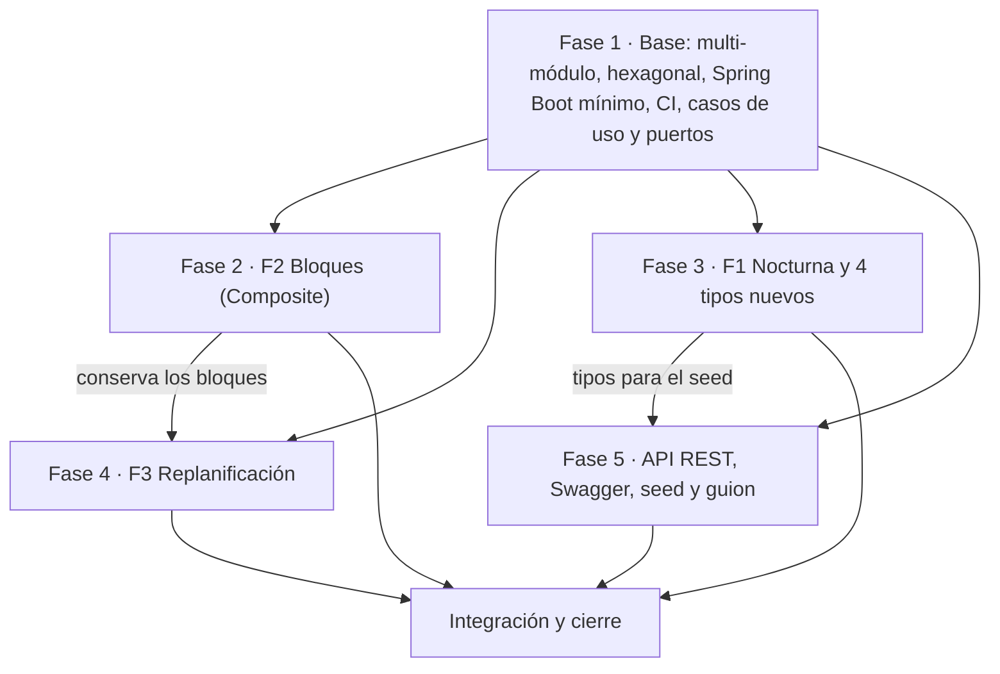
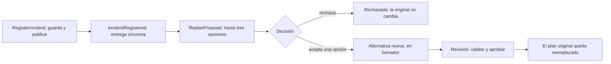

# Plan de implementación — Entrega 2 FieldOps

11/10/2026 · Complementa `claude/entrega-2-decisiones.md`.

## Resumen

La Entrega 2 se reparte en cinco fases, una por integrante: una base que se mergea primero (Fase 1) y cuatro que avanzan en paralelo sobre ella. Cada fase termina con su PR en verde, sus tests y sus entradas de `../../../../Downloads/DESIGN.md` escritas en el mismo PR.

| Fase | Qué entrega | Entradas de `DESIGN.md` | Responsable |
| --- | --- | --- | --- |
| 1. Base | Hexagonal, multi-módulo Maven, Spring Boot mínimo, CI, y los casos de uso y puertos que la API necesita | D35 a D38 | Sin asignar |
| 2. F2 Bloques | Bloques secuenciales y paralelos con Composite | D39 a D41 | Sin asignar |
| 3. F1 Nocturna | Actividad nocturna con Decorator, los cuatro tipos de actividad que faltan y el registro de tipos | D42 a D44 | Sin asignar |
| 4. F3 Replanificación | Evento de dominio, propuestas con varias opciones, decisión y auditoría | D45 a D48 | Sin asignar |
| 5. API y demo | API REST, Swagger, seed, guion de demo, README e integración final | D49 a D51 | Sin asignar |

Los dueños de F1, F2 y F3 escriben también los endpoints y los tests de API de su funcionalidad, sobre el esqueleto que publica la Fase 5. Así cada funcionalidad nueva queda "implementada, probada y documentada" por una sola persona, como pide la consigna.

Supuestos del plan, tomados de las decisiones del 11/10:

- La persistencia sigue en memoria. Los tests de repositorio se escriben como contrato reutilizable, para correrlos después contra JPA.
- El frontend queda fuera del plan hasta que se defina.
- Se conservan los nombres de paquete actuales (`business.*`) al pasar a módulos, para que los rebases de las otras fases sean triviales.

## Punto de partida

El repo es hoy un solo módulo Maven (`field-ops`, JDK 25) con el dominio de la Entrega 1: 282 tests (11 parametrizados), `../../../../Downloads/DESIGN.md` con D1 a D34 y `Main.wire()` como composition root. No tiene Spring, API ni `.github/`.

| Requisito de la consigna | Qué hay hoy | Qué falta | Fase |
| --- | --- | --- | --- |
| Arquitectura hexagonal | Paquetes `business` y `providers` en un módulo | Módulos, puertos nombrados, adaptadores | 1 |
| Integración continua | Nada | Workflow y regla de protección de `main` | 1 |
| Casos de uso | `CreateExpedition`, `ApproveExpedition`, `ReplanExpedition`, `FinishExpedition`. Agendar, asignar, cambiar de estado y seguir se llaman directo sobre `Expedition` | Casos de uso para esas operaciones y para consultar | 1 |
| Catálogo de recursos | `ResourceCatalog` sin búsqueda por id y sin instancia compartida en `Main.wire()`. No hay almacén de zonas | Búsqueda por id, puerto de zonas, `findAll` de expediciones | 1 |
| F2 Bloques | `Itinerary` es una lista plana de `ItineraryItem` ordenada por inicio. `ExpeditionEstimator` suma todas las duraciones | Composite, duración por tipo de bloque, conflicto en paralelo | 2 |
| F1 Nocturna | Strategy `ActivityRules` con dos tipos. `ActivityRules` no conoce permisos y `RiskLevel` tiene tres niveles | Decorator, permiso por actividad, nivel de riesgo extra | 3 |
| Seis tipos de actividad | `DivingRules` y `SampleCollectionRules` | Cuatro tipos y un registro para crearlos por nombre | 3 |
| F3 Replanificación | `Expedition.reportIncident` solo guarda el incidente. `ExpeditionReplanner` exige original aprobada o suspendida y actividad afectada sin empezar | Evento, propuestas, decisión, auditoría | 4 |
| API REST y contratos | Nada | Controllers, DTOs, errores, OpenAPI | 5 |
| Tests de repositorio y de API | Un test del repositorio en memoria | Contrato de repositorios (Fase 1) y tests de API (todas) | 1 y 5 |
| Datos de demostración | Fixtures de test | Seed en archivos, cargador y guion | 5 |
| README ejecutable | Alcance de la Entrega 1 | Cómo compilar, ejecutar, probar y correr la demo | 5 |

## Dependencias y orden de merge



La Fase 1 abre con un PR chico (módulos y CI) que se mergea antes de que las demás abran los suyos. Las otras fases pueden empezar hoy sobre `main`: como los paquetes no cambian de nombre, el rebase solo mueve rutas.

Hay dos dependencias cruzadas. La Fase 4 rebasea sobre la Fase 2, porque la alternativa replanificada tiene que conservar los bloques. El seed de la Fase 5 necesita el registro de tipos de la Fase 3.

### Contratos que se acuerdan el primer día

| Contrato | Lo define | Lo usan | Qué se fija |
| --- | --- | --- | --- |
| Módulos y paquetes | Fase 1 | Todas | Qué va en `domain`, `app` y `web` |
| Nodo del itinerario | Fase 2 | Fases 4 y 5 | La interfaz común entre actividad y bloque. `Itinerary.getItems()` sigue devolviendo las hojas |
| `ActivityRules` ampliada y registro de tipos | Fase 3 | Fase 5 | Permisos y certificación que exige la actividad; nombre y parámetros de cada tipo |
| `Incident` ampliado y propuesta | Fase 4 | Fase 5 | Qué actividad y qué recurso afecta un incidente |
| Convenciones de la API | Fase 5 | Fases 2, 3 y 4 | Prefijo `/api`, formato de error, DTOs y dónde van los controllers |

### Archivos que tocan varias fases

| Archivo | Fases | Cómo se evita el conflicto |
| --- | --- | --- |
| `Expedition`, `ExpeditionBuilder` | 2 y 4 | La Fase 2 entra primero (agendar bloques). La Fase 4 solo cambia el registro del incidente |
| `ExpeditionReplanner` | 2 y 4 | La Fase 2 deja la forma de copiar la estructura de bloques. La Fase 4 la usa |
| `ApprovalPolicy.MANDATORY_RULES` | 2 y 3 | Cada fase agrega una línea |
| `ExpeditionReporter`, `ExpeditionReport` | 2 y 4 | Se agregan campos al final, sin reordenar |
| `../../../../Downloads/DESIGN.md` | Todas | Números reservados. Cada fase edita solo sus entradas y su subsección |
| Configuración de beans en `web` | 1, 4 y 5 | Una clase `@Configuration` por área |

Se trabaja con una rama por fase y PR chicos, sin push directo a `main`.

## Fase 1: base hexagonal, módulos y CI

Deja el repo en multi-módulo hexagonal con CI, sin cambiar comportamiento, y completa los casos de uso y puertos que la API necesita. Son dos PR: el primero bloquea a todos y tiene que ser corto.

### Estructura propuesta

| Módulo | Contiene | Depende de |
| --- | --- | --- |
| `domain` | Todo `business.*`: modelo, reglas, validaciones, servicios, casos de uso (puertos de entrada) y `business.providers` (puertos de salida) | Nada de frameworks |
| `app` | `adapters.driven`: repositorios en memoria, publicador de eventos en memoria, cargador del seed | `domain` |
| `web` | Spring Boot, `adapters.driving.rest`, clases `@Configuration` que reemplazan a `Main.wire()`, springdoc | `domain` y `app` |

Punto a cerrar antes del PR: el diagrama de la clase 7 separa la interfaz del puerto de entrada (`domain.ports`) de su implementación (`application`). La decisión del 11/10 dice que los casos de uso son los puertos de entrada. Si se separan, las implementaciones van a `app`; si no, queda como alternativa descartada en D35.

### PR 1a: módulos y CI (bloqueante)

- [ ] Convertir el `../pom.xml` raíz en parent (`packaging pom`) con `dependencyManagement`, enforcer de JDK 25, compiler y Lombok. Declarar los módulos `domain`, `app` y `web`.
- [ ] Mover `business.*` y sus tests a `domain`, sin renombrar paquetes. Verificar que su `pom` no trae Spring.
- [ ] Mover `InMemoryExpeditionRepository` a `app` como adaptador driven.
- [ ] Publicar los fixtures de test de `domain` (`ExpeditionFixtures`, `SequentialExpeditionRepository`) como `test-jar`, para que `app` y `web` los reutilicen.
- [ ] Mover `ExpeditionLifecycleIntegrationTest` al módulo que tenga el wiring. Hoy depende de `Main.wire()`.
- [ ] En `web`: importar el BOM `spring-boot-dependencies` (la clase 8 usa 4.1.1), `spring-boot-starter-web`, clase `@SpringBootApplication` y los beans actuales de `FieldOps` en una `@Configuration`.
- [ ] Test `@SpringBootTest` que levanta el contexto.
- [ ] `.github/workflows/ci.yml`: en cada pull request y push a `main`, JDK 25 (Temurin), caché de Maven y `mvn -B verify`.
- [ ] Regla de protección de `main` en GitHub: PR obligatorio y check de CI requerido. La configura quien administra el repo.
- [ ] Confirmar que los 282 tests siguen en verde desde la raíz.

### PR 1b: casos de uso y puertos que faltan

- [ ] Casos de uso para lo que hoy se llama directo sobre `Expedition`: agendar actividad, asignar personal, equipo y consumible, enviar a revisión, devolver a borrador, iniciar, suspender, reanudar, iniciar y finalizar actividad, registrar observación.
- [ ] Consultas: obtener y listar expediciones, validar sin aprobar (con `ApprovalPolicy`), estimar, informe y candidatos de asignación del catálogo.
- [ ] Entrada por comandos con ids (`record`), para que el adaptador REST no construya objetos de dominio. Hoy `CreateExpedition` recibe un `ExpeditionBuilder` ya armado.
- [ ] `ExpeditionRepository.findAll()`.
- [ ] Búsqueda por id en el catálogo (`ResourceCatalog` hoy solo consulta por requisito) y una única instancia compartida.
- [ ] Puerto de salida para zonas, con su adaptador en memoria.
- [ ] Búsqueda de un ítem del itinerario por `ActivityId`.

### Tests

- [ ] Unitarios de cada caso de uso nuevo, con Mockito para los puertos de salida.
- [ ] Contrato de repositorio: una clase abstracta de test por puerto, que hoy corre contra el adaptador en memoria y después contra JPA.
- [ ] Parametrizado de las transiciones de estado expuestas por los casos de uso.

### `../../../../Downloads/DESIGN.md`

- D35: arquitectura hexagonal. Tabla de correspondencia entre los paquetes de la Entrega 1 y puertos y adaptadores. Alternativas descartadas: Clean Architecture y DDD.
- D36: multi-módulo Maven para que el compilador haga cumplir la dependencia. Alternativa descartada: un módulo con paquetes y un test de arquitectura.
- D37: Spring solo en `web`; la `@Configuration` es el composition root que reemplaza a `Main.wire()`.
- D38: casos de uso con comandos por id. Amplía D28.
- El README documenta el workflow y la regla de protección de rama, que no queda en el código.

**Terminado cuando:** `mvn verify` pasa desde la raíz, un PR con un test roto no se puede mergear y `web` arranca.

## Fase 2: F2, bloques secuenciales y paralelos

Convierte el itinerario plano en un árbol con Composite: una actividad agendada es la hoja y un bloque es el compuesto. Validación, estimación e informes recorren el árbol sin preguntar de qué tipo es cada nodo.

### Diseño

- [ ] Interfaz común del nodo (por ejemplo `ItineraryNode`): período agendado, duración estimada, riesgo, consumo, si terminó y sus hojas.
- [ ] `ItineraryItem` la implementa como hoja y delega en su `Activity`, como hoy.
- [ ] Dos compuestos, `SequentialBlock` y `ParallelBlock`, en vez de un bloque con un `enum` de modo y un `if`. Duración: suma en secuencial, máximo en paralelo. Riesgo: el más alto. Consumo: suma.
- [ ] Un bloque admite actividades y otros bloques como hijos.
- [ ] `Itinerary` guarda los nodos raíz. `getItems()` sigue devolviendo las hojas ordenadas por inicio, así las validaciones, las reservas y el informe actuales no cambian.
- [ ] Agendar un bloque entra por `Expedition`, igual que una actividad (D19). `ExpeditionBuilder` suma la forma de declarar un bloque.
- [ ] Invariantes al armar el bloque, con el criterio de D21: en un secuencial cada hijo empieza cuando terminó el anterior; el período del bloque envuelve a sus hijos y queda dentro del período de la expedición.
- [ ] `ExpeditionEstimator` pasa a sumar la duración de los nodos raíz. Hoy suma todas las actividades y contaría de más un bloque paralelo.
- [ ] Conflicto en paralelo: dos ramas de un `ParallelBlock` no comparten un recurso reutilizable.
- [ ] Dejar en el itinerario la forma de copiar la estructura de bloques a otra expedición. `ExpeditionReplanner` reconstruye la alternativa actividad por actividad y hoy la perdería.

Dos puntos a decidir y documentar:

- Dónde vive el conflicto en paralelo: ampliar `ResourceOverlapValidation` o una regla nueva en `ApprovalPolicy`. En los dos casos el mismo conflicto se reporta una sola vez (D32 identifica un resultado por regla y sujeto).
- Si dos ramas de un paralelo con horarios que no se pisan pueden compartir un recurso. Recomendación: no, porque el bloque declara que pueden correr a la vez.

### API

- [ ] Endpoint para agendar un bloque con su árbol de hijos, sobre el esqueleto de la Fase 5.
- [ ] La respuesta del itinerario muestra el árbol.

### Tests

- [ ] Parametrizado de duración: secuencial, paralelo, paralelo dentro de secuencial y secuencial dentro de paralelo.
- [ ] Un test por criterio de aceptación: itinerario con un paralelo dentro de un secuencial; suma y máximo; conflicto de recursos entre actividades paralelas del mismo bloque.
- [ ] Regresión: un itinerario sin bloques valida, estima e informa igual que antes.
- [ ] Invariantes: bloque vacío, hijo fuera del período, secuencial con hijos solapados.
- [ ] Test de API del endpoint de bloques.

### `../../../../Downloads/DESIGN.md`

- D39: Composite en el itinerario. Alternativas descartadas: `enum` de modo con condicionales, bloque como subtipo de `Activity`, lista plana con un id de grupo.
- D40: qué se rechaza al armar un bloque y qué detecta la validación. Extiende D21.
- D41: conflicto de recursos en bloques paralelos.
- Marcar como revisadas D4 (la duración ya no es una suma plana) y D6 (el itinerario pasa de colección ordenada a árbol).
- Subsección F2: clases agregadas, clases modificadas (`Itinerary`, `ItineraryItem`, `Expedition`, `ExpeditionBuilder`, `ExpeditionEstimator`, la validación de superposición), refactorizaciones y deuda técnica. Candidatas a deuda: dependencias entre bloques, mover una actividad de un bloque a otro.

**Terminado cuando:** los tres criterios de aceptación tienen test con su nombre, no hay `instanceof` ni `switch` sobre el tipo de nodo, y la Fase 4 puede replanificar sin perder bloques.

## Fase 3: F1, actividad nocturna y tipos de actividad

Agrega la variante nocturna como un Decorator de `ActivityRules` que envuelve las reglas de cualquier tipo, y completa los seis tipos base que pide la demostración. Ningún validador, estimador ni informe pregunta si una actividad es nocturna.

### Diseño del decorador

- [ ] `NightOperationRules` implementa `ActivityRules` y envuelve otra `ActivityRules`. Una clase base que delega todo evita olvidar un método.
- [ ] Personal: suma la certificación de operación nocturna a cada `StaffRequirement` de la regla base.
- [ ] Equipamiento: suma un `ReusableRequirement` de iluminación.
- [ ] Riesgo: sube un nivel el de la regla base. Duración y consumibles se delegan sin cambios.

Tres huecos del modelo actual que esta fase tiene que cerrar:

- **Permiso por zona.** `ActivityRules` no conoce permisos: hoy solo los exige `Zone`, y `MissingPermitsValidation` mira las zonas de la expedición. Propuesta: que la regla declare los permisos que exige en la zona de su actividad (vacío por defecto, el permiso nocturno de esa zona en el decorador) y que la validación los sume.
- **Todo el personal asignado.** `MissingCertificationsValidation` cuenta calificados contra el `headcount`, así que una persona extra sin la certificación pasaría. Hace falta que la regla pueda declarar certificaciones exigidas a cada asignado.
- **Riesgo ya en el máximo.** `RiskLevel` termina en `HIGH`. Un buceo profundo nocturno no reflejaría el factor salvo que se agregue un nivel por encima.

### Tipos de actividad y registro

- [ ] Cuatro implementaciones nuevas de `ActivityRules`, cada una con su parámetro propio como `DivingRules` con la profundidad. Sugerencia a confirmar: relevamiento con dron, observación de fauna, medición de calidad de agua y traslado.
- [ ] Registro de tipos en el dominio: nombre del tipo y sus parámetros a una `ActivityRules`, sin `switch`. Lo usan la API y el cargador del seed. La variante nocturna se pide con un indicador y el registro envuelve la regla base.
- [ ] Certificación y categoría nuevas (operación nocturna, iluminación), normalizadas como define D34.

### API

- [ ] El alta de actividad recibe tipo, parámetros e indicador de nocturna.
- [ ] Endpoint que lista los tipos disponibles y sus parámetros.

### Tests

- [ ] Parametrizado: el decorador sobre cada uno de los seis tipos base suma certificación, iluminación y permiso.
- [ ] Parametrizado: riesgo resultante por cada nivel base.
- [ ] Tests propios de cada tipo nuevo, con el estilo de `DivingRulesTest`.
- [ ] Un test por criterio de aceptación: expedición con una actividad nocturna; crítico sin certificación; crítico sin permiso; la estimación refleja el factor.
- [ ] El informe de una expedición con actividad nocturna sale de `ExpeditionReporter` sin modificarlo.
- [ ] Test de API del alta de una actividad nocturna.

### `../../../../Downloads/DESIGN.md`

- D42: Decorator sobre `ActivityRules`. Alternativas descartadas: una clase nocturna por tipo (duplica cada tipo), un booleano en `Activity` con condicionales, herencia.
- D43: permisos y certificaciones que exige la actividad. Extiende D10 y D13.
- D44: registro de tipos y los cuatro tipos nuevos. Extiende D1.
- Actualizar la tabla de patrones no aplicados: la fila de Decorator sigue valiendo para las advertencias aceptadas, pero el patrón ya se usa en F1.
- Supuestos: los valores de los tipos nuevos son ilustrativos. La actividad se declara nocturna; no se infiere de su horario.
- Subsección F1: clases agregadas, clases modificadas (`ActivityRules`, `Activity`, `RiskLevel`, las dos validaciones), refactorizaciones y deuda técnica. Candidata a deuda: nada impide envolver dos veces la misma regla.

**Terminado cuando:** los cuatro criterios de aceptación tienen test, y agregar la nocturna no sumó ningún condicional por tipo en validaciones, estimación ni informes.

## Fase 4: F3, replanificación automática

Registrar un incidente publica un evento de dominio y, al volver la llamada, ya existe una propuesta con varias opciones. El responsable acepta una o rechaza, y el plan original, el incidente y la decisión quedan consultables.



Aceptar no reemplaza el plan en el acto: crea la alternativa en borrador, que pasa por revisión y aprobación como define D33.

### Diseño

- [ ] `Incident` suma qué afecta: la actividad y, si corresponde, el recurso. Hoy solo tiene descripción y fecha.
- [ ] Evento `IncidentRegistered` y puerto de salida `EventPublisher` en el dominio. Las entidades no publican: lo hace el caso de uso `RegisterIncident`, después de guardar el incidente en la expedición.
- [ ] Adaptador driven `InMemoryEventPublisher` en `app`, con entrega síncrona a los suscriptores que registra la configuración.
- [ ] Suscriptor que arma y guarda la propuesta.
- [ ] `ReplanProposal`: expedición original, incidente, actividad afectada, opciones, estado (pendiente, aceptada, rechazada) y decisión (responsable, opción elegida, justificación, fecha).
- [ ] Puerto `ReplanProposalRepository` y su adaptador en memoria.
- [ ] Un generador por tipo de opción, en una lista inyectada, para que sumar un tipo sea sumar una clase. Cada opción envuelve un `ReplanReason` existente: reprogramación con `Delay`, reemplazo de recurso a partir de `ResourceWithdrawn`, cancelación parcial con `Cancellation`.
- [ ] Casos de uso para aceptar y rechazar. Aceptar verifica que quien decide sea responsable de la expedición y ejecuta `ReplanExpedition` con el motivo de la opción elegida.
- [ ] Consultas de auditoría: propuesta por id y propuestas de una expedición. El vínculo entre original y alternativa ya existe (`getReplacement`, `getReplacedExpedition`).
- [ ] La alternativa conserva los bloques de la original, con lo que deja la Fase 2.

El código actual choca con el criterio de aceptación en cuatro lugares. Hay que resolverlos y documentarlos como revisión de D33:

- **Expedición en ejecución.** `ExpeditionReplanner` exige una original aprobada o suspendida y sin actividades en curso. Recomendación: la propuesta se genera en ejecución, y aceptar suspende la expedición antes de replanificar.
- **Actividad afectada.** `reportIncident` exige una actividad ya iniciada, y el replanificador exige una actividad sin empezar. Hay que definir si un incidente puede apuntar a una actividad pendiente y cómo se interrumpe una en curso, que hoy solo se cierra con resultado.
- **Candidatos de reemplazo.** D33 descartó elegir el reemplazo automáticamente. Ahora se ofrecen los candidatos de `ResourceCatalog` para el requisito que cubría el recurso: definir cuántos y en qué orden. `ResourceWithdrawn` hoy retira el recurso pero no asigna otro.
- **Opciones que no se pueden armar.** Un `Delay` que saca la actividad de su ventana y una cancelación con dependientes agendados hoy fallan con `InvalidScheduleException`. Esas opciones no se ofrecen. Falta definir cuánto se corre una reprogramación.

### API

- [ ] Registrar un incidente sobre una actividad. La respuesta incluye la propuesta generada.
- [ ] Consultar las propuestas de una expedición y una propuesta por id.
- [ ] Aceptar una opción y rechazar la propuesta.

### Tests

- [ ] Unitarios con Mockito: `RegisterIncident` publica el evento; el suscriptor guarda la propuesta.
- [ ] Integración con el publicador real: al volver de `RegisterIncident` la propuesta ya existe.
- [ ] Parametrizado: qué opciones se generan según lo que afecta el incidente y el estado del itinerario.
- [ ] Un test por criterio de aceptación: el incidente genera la propuesta; aceptar; rechazar; original, incidente y decisión consultables después.
- [ ] Contrato de repositorio para `ReplanProposalRepository`.
- [ ] Test de API del flujo completo.

### `../../../../Downloads/DESIGN.md`

- D45: evento de dominio y `EventPublisher` síncrono. Alternativas descartadas: que `RegisterIncident` llame directo al replanificador, usar el publicador de Spring dentro del dominio, entrega asíncrona.
- D46: propuesta con varias opciones y un generador por tipo. Revisa el último punto de D33 y define los candidatos del catálogo.
- D47: ciclo de vida de la propuesta y qué pasa con la expedición al aceptar. Revisa D33.
- D48: auditoría. Alternativa descartada: Event Sourcing, que va a la tabla de patrones no aplicados.
- Subsección F3: clases agregadas, clases modificadas (`Incident`, `Expedition`, `ExpeditionReplanner`, `ResourceWithdrawn`, `ExpeditionReporter`), refactorizaciones y deuda técnica. Candidatas a deuda: entrega sin reintentos ni transacción, un solo incidente por propuesta.

**Terminado cuando:** los tres criterios de aceptación tienen test, y después de aceptar o rechazar se pueden consultar el plan original, el incidente y la decisión.

## Fase 5: API REST, demo y documentación

Expone los casos de uso por REST, deja la demostración reproducible y cierra la entrega. Publica primero un esqueleto con las convenciones, para que las fases 2, 3 y 4 agreguen sus endpoints sin esperar.

### PR 5a: esqueleto de la API (apenas mergea el PR 1a)

- [ ] Paquete `adapters.driving.rest` en `web`, con un controller por recurso.
- [ ] DTOs de entrada y salida como `record`, separados del dominio, con sus mappers. Ninguna entidad se serializa directo.
- [ ] Un `@RestControllerAdvice` que traduce las excepciones de dominio a HTTP con un formato de error único (`ProblemDetail`).
- [ ] springdoc para generar OpenAPI y Swagger UI. Verificar la versión compatible con el Spring Boot del proyecto.
- [ ] Un endpoint completo de punta a punta como ejemplo para las otras fases, con su test de API.

Mapeo de errores propuesto:

| Excepción de dominio | HTTP |
| --- | --- |
| Argumento inválido, `InvalidScheduleException`, `InvalidTrackingException` | 400 |
| Recurso, zona, expedición o propuesta inexistente | 404 |
| `InvalidStatusTransitionException`, `ExpeditionNotEditableException`, `ActivitiesInProgressException`, `Duplicate*`, `ResourceUnavailableException` | 409 |
| `ExpeditionNotApprovableException` (con la lista de críticos), `UnacceptedWarningException`, `InsufficientStockException` | 422 |

### PR 5b: endpoints de los requisitos funcionales

| Capacidad | Endpoints |
| --- | --- |
| Catálogo | Alta y consulta de personas, vehículos, instrumentos y consumibles; registrar indisponibilidad; alta y consulta de zonas |
| Expediciones | Crear, listar, obtener |
| Itinerario | Agendar actividad, asignar personal, equipo y consumible, candidatos de asignación |
| Validación y estimación | Validar sin aprobar, estimar |
| Aprobación y estados | Enviar a revisión, devolver a borrador, aprobar con advertencias aceptadas, iniciar, suspender, reanudar, finalizar |
| Seguimiento | Iniciar y finalizar actividad, registrar observación |
| Informes | Informe de la expedición |

Los endpoints de bloques, de actividad nocturna y de incidentes y propuestas los escriben las fases 2, 3 y 4.

### PR 5c: demo

- [ ] Seed como datos: `demo/catalog.json` y `demo/expedition.json`, más un único cargador genérico que corre con el perfil `demo`. Usa los builders y el registro de tipos de la Fase 3. No hay clases Java propias de la demo.
- [ ] Guion contra la API (`demo.http` o `demo.sh`, a definir): crear la expedición, intentar aprobar y ver el crítico, corregir, aceptar la advertencia, aprobar, ejecutar, registrar el incidente y elegir una opción.
- [ ] El escenario cubre lo que sugiere la consigna: diez o más actividades, seis tipos y la nocturna, un paralelo dentro de un secuencial, un recurso compartido, un error crítico, una advertencia aceptable y la replanificación.
- [ ] Candidatos naturales: el crítico es el permiso nocturno faltante, y la advertencia es el riesgo por encima de la tolerancia, que `RiskToleranceValidation` ya emite como advertencia.

### Tests

- [ ] Tests de API con el contexto completo y los adaptadores reales en memoria, sin mocks: un caso feliz por capacidad.
- [ ] Parametrizado: cada excepción de dominio devuelve su código HTTP.
- [ ] Test del cargador del seed: los archivos de `demo/` cargan sin errores.
- [ ] Un test de API que recorre el mismo guion de la demo, para que la CI avise si la demo se rompe.

### README y cierre

- [ ] Reescribir el README: requisitos, cómo compilar, ejecutar y probar, estructura de módulos, cómo correr la demo, contratos de la API (tabla de endpoints y enlace a Swagger UI), CI y regla de protección de rama.
- [ ] Revisión final de `../../../../Downloads/DESIGN.md`: numeración, referencias cruzadas, párrafo de modelo de dominio, tabla de patrones no aplicados y supuestos.
- [ ] Correr la demo completa desde un clon limpio.
- [ ] Anotar la URL del repo y el hash del commit de entrega.

### `../../../../Downloads/DESIGN.md`

- D49: la API como adaptador driving, con DTOs propios y el mapeo de errores fuera del dominio. Alternativas descartadas: serializar entidades, anotar excepciones de dominio con códigos HTTP.
- D50: seed como datos con un cargador genérico. Alternativas descartadas: clases Java de demo, `data.sql` antes de tener persistencia.
- D51: persistencia en memoria detrás de los puertos y tests de repositorio como contrato. Se registra como deuda técnica de la entrega.

**Terminado cuando:** un clon limpio compila, pasa los tests, arranca con el perfil `demo` y el guion corre de principio a fin.

## `../../../../Downloads/DESIGN.md`: qué escribe cada fase

Cada fase escribe sus entradas en el mismo PR que el código, con numeración reservada para que no haya choques. La consigna pide dos cosas distintas: las decisiones (patrón, dónde, por qué, alternativas, patrones no aplicados) y, por cada funcionalidad nueva, clases agregadas y modificadas, refactorizaciones y deuda técnica.

### Numeración reservada

| Entrada | Tema | Fase |
| --- | --- | --- |
| D35 | Arquitectura hexagonal: puertos y adaptadores | 1 |
| D36 | Multi-módulo Maven | 1 |
| D37 | Spring solo en `web` y composition root | 1 |
| D38 | Casos de uso con comandos por id | 1 |
| D39 | Composite en el itinerario | 2 |
| D40 | Invariantes de los bloques | 2 |
| D41 | Conflicto de recursos en bloques paralelos | 2 |
| D42 | Decorator para la actividad nocturna | 3 |
| D43 | Permisos y certificaciones que exige la actividad | 3 |
| D44 | Registro de tipos y tipos nuevos | 3 |
| D45 | Evento de dominio y `EventPublisher` | 4 |
| D46 | Propuesta con varias opciones | 4 |
| D47 | Ciclo de vida de la propuesta | 4 |
| D48 | Auditoría de la replanificación | 4 |
| D49 | API REST como adaptador driving | 5 |
| D50 | Seed como datos | 5 |
| D51 | Persistencia en memoria y contrato de repositorios | 5 |

Si una fase necesita una entrada más, toma desde D52 y avisa al resto.

### Formato de cada decisión

Se mantiene el de D1 a D34: patrón o principio, dónde, por qué, alternativas descartadas y consecuencia. Una decisión que cambia otra anterior no la reescribe: se agrega una línea "Revisado en Dnn" en la vieja, como ya se hizo en D25 con D33.

| Decisión existente | La revisa | Por qué |
| --- | --- | --- |
| D1 | Fase 3 | Hay seis tipos y un registro |
| D4 | Fase 2 | La duración ya no es una suma plana |
| D6 y D21 | Fase 2 | El itinerario pasa a ser un árbol con invariantes de bloque |
| D10 y D13 | Fase 3 | La actividad puede exigir permisos y certificaciones a todo el personal |
| D25 y D33 | Fase 4 | Replanificación desde una expedición en ejecución y candidatos de reemplazo |
| D28 | Fase 1 | Más casos de uso y entrada por comandos |

### Sección nueva por funcionalidad

Se agrega la sección "Funcionalidades nuevas de la Entrega 2" después de las decisiones, con una subsección por F1, F2 y F3 que sigue esta plantilla:

```markdown
### F2 — Bloques de actividades secuenciales y paralelos

- **Decisiones:** D39, D40, D41.
- **Clases agregadas:** nombre y paquete de cada una, con una línea de para qué.
- **Clases modificadas:** cuál y qué cambió.
- **Refactorizaciones realizadas:** qué se reestructuró sin cambiar comportamiento y por qué hizo falta.
- **Deuda técnica que se decidió no resolver:** qué queda, por qué se aceptó y qué señal obligaría a resolverla.
- **Criterios de aceptación:** cada criterio con el test que lo cubre.
```

### Secciones compartidas

- **Patrones que decidimos no aplicar.** Cada fase agrega sus filas. Como mínimo: Clean Architecture y DDD (Fase 1), el modo del bloque como `enum` y Visitor para recorrer el árbol (Fase 2), la fila de Decorator actualizada (Fase 3), Event Sourcing (Fase 4), JPA en esta entrega (Fase 5).
- **Supuestos.** Cada fase agrega los suyos al final de la lista.
- **Modelo de dominio.** El párrafo inicial lo actualiza la Fase 5 al cierre, cuando ya están los bloques, la nocturna y las propuestas.

## Pendientes, riesgos y cierre

La fecha de entrega es el pendiente que más condiciona el plan: el calendario de la clase 8 marca el martes 13/10 y hoy es 11/10. Hay que confirmarla con el docente antes de repartir.

### Decisiones que faltan

| Pendiente | Quién lo cierra | Bloquea a |
| --- | --- | --- |
| Fecha de entrega | El grupo con el docente | Todo el plan |
| Separar o no la interfaz de los casos de uso de su implementación | Fase 1 con el grupo | PR 1a |
| Los cuatro tipos de actividad | Fase 3 con Fase 5 | Seed de la demo |
| Nivel de riesgo por encima de `HIGH` | Fase 3 | F1 |
| Dónde vive el conflicto en paralelo | Fase 2 | F2 |
| Incidente sobre una actividad en curso o pendiente | Fase 4 con el grupo | F3 |
| Formato del guion (`demo.http` o `demo.sh`) | Fase 5 | Demo |
| Persistencia real y frontend | El grupo | Tests de repositorio y entregable de frontend |

### Riesgos

- **Persistencia en memoria.** La consigna pide pruebas reales de persistencia y dice que los mocks no las reemplazan. Un adaptador en memoria puede leerse como insuficiente. El contrato de repositorios deja listo el cambio a JPA, pero conviene consultarlo con el docente.
- **Frontend.** La consigna pide lo mínimo indispensable y hoy no hay nada definido. Swagger UI permite operar la API, pero no es un frontend.
- **PR 1a demorado.** Mientras no mergee, nadie tiene módulos ni CI. Tiene que ser lo primero y no mezclar otros cambios.
- **F3 depende de F2.** Si los bloques se demoran, la Fase 4 avanza sobre el itinerario plano y suma la copia de bloques al final.
- **Calendario de clases.** Rest API se dicta el 20/10 y Spring Data el 27/10. Si la entrega es antes, la API se hace sin esa clase.

Si la fecha es el 13/10, el orden de recorte recomendado es: primero el dominio de F1, F2 y F3 con sus tests y su `../../../../Downloads/DESIGN.md`, después la API de los flujos que usa la demo, y al final el resto de los endpoints.

### Checklist de entrega

- [ ] URL del repositorio y hash del último commit.
- [ ] Código organizado en dominio, casos de uso, infraestructura y API REST según la arquitectura hexagonal.
- [ ] F1, F2 y F3 implementadas, con test por criterio de aceptación y su subsección en `../../../../Downloads/DESIGN.md`.
- [ ] Tests unitarios, parametrizados, de repositorio y de API corriendo en la CI.
- [ ] La CI bloquea el merge de un PR que falla.
- [ ] Datos de demostración repetibles: seed y guion.
- [ ] README con instrucciones para compilar, ejecutar y probar, y los contratos de la API.
- [ ] `../../../../Downloads/DESIGN.md` con D35 a D51, patrones no aplicados, supuestos y la sección por funcionalidad.
- [ ] Frontend mínimo, cuando se defina.
