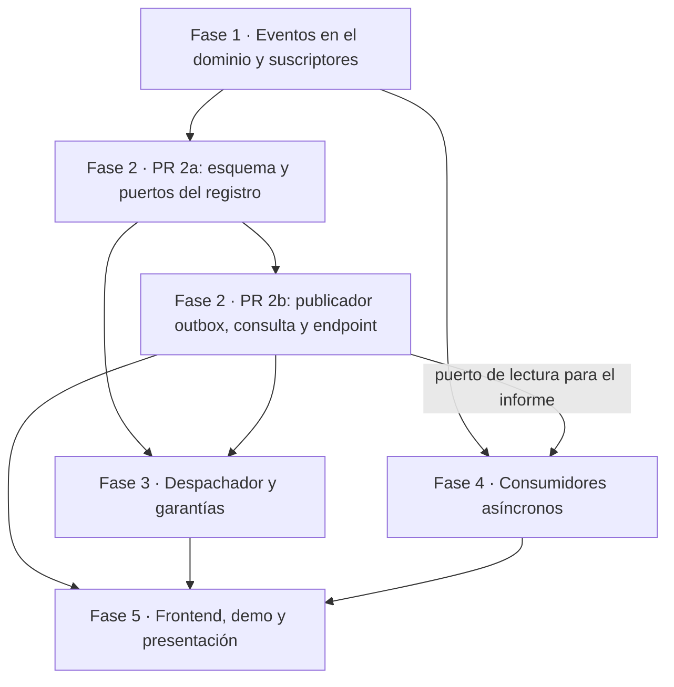
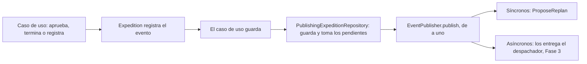

# Plan de implementación — Entrega 3 FieldOps

03/11/2026 · Complementa `docs/entrega-3-decisiones.md`. Consigna: `docs/fieldops-entrega-3.md`. Entrega: lunes 09/11/2026.

## Resumen

La Entrega 3 suma la propuesta de valor, una arquitectura orientada a eventos, y la presentación en video. Se reparte en cinco fases, una por integrante. Primero se mergea una base de dominio (Fase 1). Después avanzan en paralelo el registro, el despachador y los consumidores, y la Fase 5 integra el frontend, la demo y la presentación. Cada fase cierra con su PR en verde, sus tests y sus entradas de `DESIGN.md` en el mismo PR.

| Fase                              | Qué entrega                                                                                                                                                                                                                                           | Entradas de `DESIGN.md` | Responsable                                     |
| --------------------------------- | ------------------------------------------------------------------------------------------------------------------------------------------------------------------------------------------------------------------------------------------------------ | ------------------------- | ----------------------------------------------- |
| 1. Eventos en el dominio          | Los tres eventos, la entidad que los acumula, las dos interfaces de suscriptor y `RegisterIncident` desacoplado                                                                                                                                      | D70 a D73                 | Valentina · ✅ mergeada (PR #13, 04/11)        |
| 2. Outbox y registro              | Tablas de eventos y entregas, publicador que guarda en la misma transacción, consulta del registro y su endpoint                                                                                                                                      | D74 a D76                 | Matías · ✅ mergeada (PR #14 y #15, 04/11)   |
| 3. Despachador y garantías       | `@Scheduled`, orden, reintentos, `FAILED` y deduplicación                                                                                                                                                                                         | D77 y D78                 | Matías Romanato · ✅ mergeada (PR #16, 04/11) |
| 4. Consumidores asíncronos       | Notificaciones, avance del informe y eventos en el informe, con sus endpoints                                                                                                                                                                          | D79 y D80                 | Julieta · ✅ mergeada (PR #17, 04/11)          |
| 5. Frontend, demo y presentación | Seguimiento en el itinerario, secciones nuevas del frontend, **mejoras generales del frontend**, `demo.http`, README, cierre de `DESIGN.md`, la presentación y **la organización de la demo y su video, que se graba con los cinco** | D81                       | Tobías                                         |

**Lección de la Entrega 2:** el plan anterior dejaba los endpoints a la fase de API, las fases 2 a 4 mergearon sin ellos y la Fase 5 quedó sobrecargada. Acá **cada fase escribe los endpoints de lo que construye**, con su test de API. La Fase 5 solo suma el frontend y lo que la demo necesita.

Supuestos del plan, tomados de las decisiones del 02/11:

- Outbox en la misma base PostgreSQL. Sin broker.
- La aplicación corre en una sola instancia.
- La propuesta de replanificación sigue síncrona.
- Las correcciones de la Entrega 2 ya están en `main` (#11). El plan arranca desde ahí.

## Convenciones de trabajo

Las mismas de la Entrega 2. Se repiten acá para que nadie tenga que buscarlas.

- **Idioma:** código, tests, mensajes de excepción y README en inglés. `DESIGN.md` y estos documentos en español.
- **Sin comentarios** en Java ni en los `pom` (se sacaron todos en `aac8518`).
- **Ramas:** `assignment-3-phase-N` (o `-phase-2a`, `-phase-2b`), una por fase, con PR a `main` y CI en verde. Sin push directo a `main`. Cada PR lo revisa otro integrante.
- **Paquetes:** los de siempre. Puertos de entrada en `business.ports.in`, puertos de salida en `business.providers`, interfaces del dominio en `business.interfaces.*`, modelos en `business.models.*`, vistas de los puertos en `business.models.responses` (D64), adaptadores driven en `app` (`adapters.driven.*`) y driving, configuración y `@Scheduled` en `web`.
- **Wiring:** los casos de uso de escritura se envuelven en `TransactionalUseCases.writing`, los de lectura en `.reading`, y se exponen por su puerto (D63, D68).
- **`DESIGN.md`:** una entrada por decisión, con el formato de siempre (patrón o principio, dónde, por qué, alternativas descartadas y consecuencia). Una decisión que cambia otra no la reescribe: suma la línea "Revisado en Dnn" en la vieja. Se escriben solo decisiones ya implementadas, sin anunciar pasos futuros.
- **Antes de abrir el PR:** `mvn -B verify` desde la raíz (necesita Docker por Testcontainers), y `mvn test -pl domain` para iterar rápido sin Docker.

### Cómo se registran las decisiones de cada fase

Cada fase abre con una sección **"Decisiones de la fase"**. El responsable de la fase la lee antes de empezar y, para cada decisión:

1. Si hace falta, la consulta con el equipo (las marcadas 👥 son del equipo y no se toman solas).
2. Completa los campos `Decisión`, `Quién y cuándo` y `Por qué`, y cambia el estado: ⬜ pendiente, ✅ decidida.
3. Si contradice algo de `docs/entrega-3-decisiones.md`, lo dice en el `Por qué`.
4. La lleva a la entrada de `DESIGN.md` que indica `Se registra en`, en el mismo PR que el código.

El registro queda en este documento. El PR de la fase incluye este archivo con sus decisiones completas, así la revisión del PR también revisa qué se decidió.

Formato de cada decisión:

```markdown
#### N.M — Título · ⬜ pendiente

- **Pregunta:** qué hay que decidir.
- **Opciones:** a) …, b) …
- **Recomendación:** cuál y por qué.
- **Decisión:** _a completar_
- **Quién y cuándo:** _a completar_
- **Por qué:** _a completar_
- **Se registra en:** Dnn
```

## Comentarios de la review a resolver

La review del PR de decisiones (MatiSapino, 03/11) aprobó el documento con ocho puntos y cinco menores. **No se aplicaron a `docs/entrega-3-decisiones.md`.** Cada uno quedó en la fase que lo implementa. Los ya aceptados están como bloques `> Review`, que son informativos. Los que quedaron abiertos (2, 5 y 6) son decisiones de esa fase (1.1 y 3.1), para que el responsable las cierre y las registre ahí.

Todos los puntos se verificaron contra el código y son correctos.

| #  | Tema                                                                             | Fase  | Bloquea                        | Propuesta                                                                           | Estado        |
| -- | -------------------------------------------------------------------------------- | ----- | ------------------------------ | ----------------------------------------------------------------------------------- | ------------- |
| 1  | Ordenar por `occurredAt` no es el orden en que el sistema conoció los eventos | 2 y 3 | Esquema de la tabla de eventos | Orden por la secuencia de inserción. `occurredAt` queda solo como dato del hecho | Aceptado      |
| 2  | Sin la propuesta, no hay `Location` en el `POST /incidents`                  | 1     | Contrato de la API             | El controller compone `RegisterIncident` y la consulta de la propuesta            | Decisión 1.1 |
| 3  | El cambio revisa D58, no D45                                                     | 1     | `DESIGN.md`                  | D73 revisa D45 y D58                                                                | Aceptado      |
| 4  | Por D64, el puerto no devuelve `Incident`                                      | 1     | Firma del puerto               | Se devuelve `Incident`: D64 deja salir tal cual a los `record` sin entidades    | Revisado      |
| 5  | `demo.http` y `DemoScriptApiTest` cambian más de lo que dice el documento   | 1     | —                             | Con la opción a) de la decisión 1.1, no cambian                                   | Decisión 1.1 |
| 6  | "Por poco tiempo" no se sostiene sin acotar el backoff                           | 3     | D78                            | Fijar los valores concretos                                                         | Decisión 3.1 |
| 7  | Awaitility y `@EnableScheduling` todavía no existen                           | 3     | —                             | Se suman en la Fase 3 y se anotan en el costo del cambio                            | Aceptado      |
| 8  | Cómo se cumple "sin switch" en el JSON                                          | 2     | Formato del registro           | Guardar el nombre de la clase junto al JSON                                         | Aceptado      |
| m1 | `docs/entrega-3-plan.md` no existía                                           | —    | —                             | Resuelto con este documento                                                         | Resuelto      |
| m2 | `fieldops-entrega-3.md` no termina en newline                                  | 5     | —                             | Se corrige en el cierre                                                             | Aceptado      |
| m3 | Falta el argumento de las dependencias de `RegisterIncident`                   | 1     | —                             | Va en D73                                                                           | Aceptado      |
| m4 | La fila "Qué lleva cada evento" junta cinco decisiones                          | 1     | —                             | Se separan entre D70 y D71                                                          | Aceptado      |
| m5 | `SKIP LOCKED` como salida para varias instancias                               | 3     | —                             | Va en D77 y en los supuestos                                                        | Aceptado      |

Además de la review, el relevamiento del código para este plan encontró puntos que no estaban en las decisiones. Están marcados como **Agregado** en cada fase, y los más importantes son:

| Tema                                                          | Fase  | Por qué importa                                                             |
| ------------------------------------------------------------- | ----- | ---------------------------------------------------------------------------- |
| `IncidentRegistered` lleva el `Incident` entero           | 1     | Define qué se serializa. `ProposeReplan` lo usa directo                   |
| `ApproveExpedition` guarda dos expediciones                 | 1     | Hay que tomar los eventos de las dos                                         |
| El orden de la secuencia no es el orden de commit             | 2     | Se sostiene por el `@Version` y el `executionRevision` de la expedición |
| `app` no tiene Jackson, y el proyecto usa Jackson 3         | 2     | Dependencia nueva y cómo se mapea el `jsonb`                              |
| `clean-database.sql` no conoce las tablas nuevas            | 2 y 4 | Sin eso, los tests de `web` se contaminan entre sí                        |
| El backoff necesita un reloj inyectable                       | 3     | Si no, los tests tienen que dormir                                           |
| La falla se marca después del rollback, en otra transacción | 3     | Si se marca adentro, el intento se pierde                                    |
| `DemoScriptApiTest` no lee `demo.http`: lo replica a mano | 3 y 5 | Tiene que invocar el despachador entre pasos                                 |
| El informe ya cuenta las actividades terminadas               | 4     | La proyección del avance puede duplicar `ExpeditionReporter`              |
| La demo actual ya dispara los tres eventos                    | 5     | Los pasos nuevos son consultas, no operaciones nuevas                        |

## Punto de partida

El repo tiene tres módulos Maven (`domain`, `app` y `web`) con 886 tests: 698 en `domain`, 40 en `app` y 148 en `web`. Usa Spring Boot 4.1.1, con Jackson 3 (`tools.jackson`) y Hibernate 7.4. La persistencia es JPA sobre PostgreSQL con Flyway (`app/src/main/resources/db/migration/V1__create_schema.sql`) y `ddl-auto: validate`. Los tests de `app` y `web` levantan PostgreSQL 17 con Testcontainers, y cada test de `web` limpia la base con `web/src/test/resources/clean-database.sql`. El frontend es estático y consume la API (D69). `DESIGN.md` llega a D69 y el README lista 48 endpoints.

| Requisito de la consigna            | Qué hay hoy                                                              | Qué falta                                                                   | Fase     |
| ----------------------------------- | ------------------------------------------------------------------------- | ---------------------------------------------------------------------------- | -------- |
| Tres eventos inmutables del dominio | `IncidentRegistered(ExpeditionId, Incident)`, sin id ni momento         | `EventId` y `occurredAt`, `ExpeditionApproved` y `ActivityCompleted` | 1        |
| Publicación desacoplada            | `RegisterIncident` publica, pero busca la propuesta y falla si no está | Que el productor no conozca a los consumidores                               | 1        |
| Consumidor asíncrono               | Solo `InMemoryEventPublisher`, síncrono                                | Outbox, despachador y dos consumidores                                       | 2, 3 y 4 |
| Registro de eventos consultable     | Nada: el evento no se guarda                                              | Tablas, puerto de lectura y endpoint                                         | 2        |
| Integrado a la auditoría           | El informe reúne incidentes y advertencias (D48)                         | Eventos en el informe                                                        | 4        |
| Tests de emisión, efecto y falla   | `RegisterIncident` verifica la publicación                             | La lista de "Qué se prueba" de las decisiones                               | Todas    |
| Presentación con el flujo completo | —                                                                        | Guion, demo y respuestas preparadas                                          | 5        |

Lo que ya existe y se reusa:

| Pieza                                                                | Dónde                                                 | Para qué sirve en esta entrega                                                                                       |
| -------------------------------------------------------------------- | ------------------------------------------------------ | --------------------------------------------------------------------------------------------------------------------- |
| `EventPublisher`, `DomainEvent`, `EventSubscriber`             | `business.providers`, `business.interfaces.events` | La base de la Fase 1. No se cambia el nombre de nada                                                                  |
| `InMemoryEventPublisher`                                           | `app/.../adapters/driven`                            | Lo reemplaza el publicador del outbox                                                                                 |
| `ReplanningConfig.eventPublisher(List<EventSubscriber<?>>)`        | `web`                                                | Lo reemplaza una `EventsConfig`                                                                                     |
| `TransactionalUseCases`                                            | `web`                                                | Transacción por caso de uso. El despachador usa su propia `TransactionTemplate`                                    |
| `LoadedAggregates`                                                 | `app/.../persistence`                                | Identidad por transacción: el repositorio decorado toma los eventos de la misma instancia que guardó el caso de uso |
| `ConcurrentUpdateException` y `@Version` en `ExpeditionEntity` | `domain` y `app`                                   | Sostienen el orden por expedición (Fase 2)                                                                           |
| `HexagonalArchitectureTest` (ArchUnit)                             | `web/src/test`                                       | Los adaptadores driving no pueden depender de `business.usecases` ni de las entidades mutables                      |
| Enforcer de `domain`                                               | `domain/pom.xml`                                     | Prohíbe Spring. No prohíbe Jackson, así que eso depende de la disciplina del equipo                                |

## Dependencias y orden de merge



| Día       | Qué se cierra                                                                                                 |
| ---------- | -------------------------------------------------------------------------------------------------------------- |
| Mar 03/11  | Cerrar las decisiones 1.1 a 1.6, repartir las fases y acordar los contratos de abajo                           |
| Mié 04/11 | Mergear la Fase 1 y el PR 2a                                                                                   |
| Jue 05/11  | PR 2b, Fase 3 sobre el 2a y Fase 4 (dominio y JPA)                                                             |
| Vie 06/11  | Mergear 2b, 3 y 4. La Fase 5 arranca el frontend y el seguimiento del itinerario, que solo necesitan la Fase 1 |
| Sáb 07/11 | Fase 5: integración, `demo.http`, README y cierre de `DESIGN.md`                                          |
| Dom 08/11  | Grabación del video de la demo con los cinco, ensayo de la presentación y últimos arreglos                  |
| Lun 09/11  | Entrega: el último commit en `main` y su hash                                                               |

La Fase 1 tiene que ser corta, porque bloquea a todos. Hasta que mergee, las fases 3 y 4 pueden escribir sus consumidores y sus tests sobre la interfaz acordada, llamándolos directo, sin despachador. La Fase 3 desarrolla sobre el 2a con un publicador de prueba que inserta filas, y se rebasea cuando entra el 2b.

### Contratos que se acuerdan el primer día

| Contrato                                  | Lo define      | Lo usan     | Qué se fija                                                                                                                                             |
| ----------------------------------------- | -------------- | ----------- | -------------------------------------------------------------------------------------------------------------------------------------------------------- |
| `DomainEvent`                           | Fase 1         | Todas       | Qué expone todo evento: `id()`, `expeditionId()` y `occurredAt()`. Así el registro, el despachador y las notificaciones no preguntan por el tipo |
| Suscriptor asíncrono                     | Fase 1         | Fases 3 y 4 | Nombre de la interfaz, `eventType()`, `on(E)` y el nombre estable del consumidor que se guarda en la tabla de entregas                               |
| Esquema del registro                      | Fase 2 (PR 2a) | Fase 3      | Columnas de las dos tablas, la secuencia de orden y los estados de entrega                                                                               |
| Puerto de lectura del registro y su vista | Fase 2 (PR 2a) | Fases 4 y 5 | `RecordedEventView` con el estado de cada consumidor                                                                                                   |
| Versiones de Flyway                       | —             | Fases 2 y 4 | `V2__event_log.sql` (Fase 2) y `V3__notifications_and_progress.sql` (Fase 4)                                                                         |
| Claves de configuración                  | Fase 3         | Fase 5      | `fieldops.events.*`: intervalo, reintentos, backoff y si el despachador arranca                                                                        |
| Operación del despachador                | Fase 3         | Fases 4 y 5 | El método que se invoca a mano en los tests, por ejemplo `dispatchPending()`, y en qué bean está                                                    |
| Rutas nuevas                              | Fases 2 y 4    | Fase 5      | `GET /api/expeditions/{id}/events` y `GET /api/expeditions/{id}/notifications`, con su JSON                                                          |

### Archivos que tocan varias fases

| Archivo                                                                                      | Fases       | Cómo se evita el conflicto                                                                                                                                                                                                           |
| -------------------------------------------------------------------------------------------- | ----------- | ------------------------------------------------------------------------------------------------------------------------------------------------------------------------------------------------------------------------------------- |
| `Expedition`                                                                               | 1           | Solo la Fase 1. Las demás leen los eventos por el puerto                                                                                                                                                                             |
| `ReplanningConfig`, `FieldOpsConfig`                                                     | 1 y 2       | Una `EventsConfig` nueva en `web` para el publicador, el despachador y los suscriptores asíncronos. La Fase 2 saca de `ReplanningConfig` el bean `eventPublisher`, y cada fase agrega sus beans al final de `EventsConfig` |
| `clean-database.sql`                                                                       | 2 y 4       | Cada fase agrega sus tablas al `TRUNCATE`                                                                                                                                                                                           |
| `application.yml` de `web` (main y test)                                                 | 3           | Solo la Fase 3 agrega `fieldops.events.*`                                                                                                                                                                                           |
| `web/pom.xml`, `app/pom.xml`                                                             | 2 y 3       | La Fase 2 suma Jackson a `app` y la 3 suma Awaitility a `web` (test)                                                                                                                                                              |
| `ExpeditionReporter`, `ExpeditionReport`, `ExpeditionReportResponse`, `ReportMapper` | 4           | Solo la Fase 4. Se agregan campos al final                                                                                                                                                                                            |
| `ScheduledActivityResponse`, `ItineraryMapper`                                           | 5           | Solo la Fase 5                                                                                                                                                                                                                        |
| `IncidentController`, `QueryReplanProposalsPort`                                         | 1           | Solo la Fase 1, según la decisión 1.1                                                                                                                                                                                               |
| `demo.http`, `DemoScriptApiTest`                                                         | 1 y 5       | La Fase 1 solo si cambia el `POST /incidents` (decisión 1.1). Los pasos nuevos son de la Fase 5                                                                                                                                    |
| `web/src/main/resources/static/js/*`                                                       | 5           | La Fase 5 hace todo el frontend, incluido `approval.js`                                                                                                                                                                             |
| `DomainExceptionHandler` y su test                                                         | Cualquiera  | Si una fase suma una excepción del dominio, suma su fila. El parametrizado falla si falta                                                                                                                                            |
| `DESIGN.md`                                                                                | Todas       | Números reservados. Cada fase edita solo sus entradas, su parte de la sección nueva y sus filas en las tablas compartidas                                                                                                           |
| `README.md`                                                                                | 2, 3, 4 y 5 | Cada fase agrega sus endpoints a la tabla. La Fase 5 cierra el texto y la cantidad de tests                                                                                                                                           |

## Fase 1: eventos en el dominio

Los tres hechos pasan a ser eventos del dominio que la expedición registra cuando ocurren. Los casos de uso solo guardan la expedición: el repositorio decorado (`PublishingExpeditionRepository`, decisión 1.5) publica lo que la expedición registró, sin que el caso de uso sepa qué eventos hubo ni quién los escucha. El publicador sigue siendo `InMemoryEventPublisher`: el outbox llega en la Fase 2 sin tocar el dominio.

**Estado (03/11/2026, rama `assignment-3-phase-1`): la fase está completa.** Siete commits: `EventId`, la publicación al guardar (`PublishingExpeditionRepository`), `IncidentRegistered`, `ActivityCompleted`, `AsyncEventSubscriber`, `ExpeditionApproved` y `RegisterIncident` desacoplado. Las decisiones 1.1 a 1.5 están cerradas, y la 1.6 quedó decidida para que la implemente la Fase 4. `DESIGN.md` suma D70 a D73. `mvn -B verify` pasa con 912 tests. La API, el frontend y `demo.http` no cambiaron.



### Decisiones de la fase

Todas se cierran el martes 03/11, antes de arrancar, porque la fase bloquea al resto.

#### 1.1 — Qué responde `POST /incidents` (review, puntos 2 y 5) · 👥 · ✅ decidida

- **Pregunta:** hoy `IncidentController` (línea 40) responde `ResponseEntity.created(Locations.replanProposal(proposal.id().value()))`. Si `RegisterIncident` devuelve el incidente, el adaptador se queda sin el id de la propuesta. Además, D58 descartó apuntar el `Location` al incidente ("no existe ese endpoint").
- **Opciones:**
  - a) El controller compone `RegisterIncidentPort` con una consulta nueva, `QueryReplanProposalsPort.ofIncident(IncidentId)`, implementada con el `findByIncident` que el repositorio ya tiene. La respuesta y el `Location` quedan como en D58.
  - b) 201 con el `IncidentView` y sin `Location`. Rompe la convención de D49 y D58.
  - c) 204, y el cliente consulta las propuestas aparte.
- **Recomendación:** a).
  - La consigna pide que **el productor del hecho** no conozca a sus consumidores, y eso se cumple: `RegisterIncident` ya no sabe que existe una propuesta.
  - Que la respuesta HTTP traiga la propuesta es una decisión del contrato de la API (D58), y componer dos puertos es trabajo de un adaptador driving. `HexagonalArchitectureTest` lo permite, porque el controller depende de puertos y no de `business.usecases`.
  - Conserva el argumento de D58 de que el criterio de F3 se ve en una sola llamada. b) y c) lo pierden, y las decisiones no lo registran como costo.
  - Costo: el controller sabe que la propuesta es síncrona. Si pasara a asíncrona, `ofIncident` devolvería vacío. Se registra como acoplamiento aceptado en el adaptador.
  - La review descartaba la a) porque "mueve el acoplamiento al adaptador".
- **Consecuencia si no es a) (punto 5):** el paso 31 de `demo.http` hace los asserts (`status === "PENDING"`, `options.length === 5`) y el `client.global.set("proposal", response.body.id)`, y su comentario dice "La respuesta YA TRAE LA PROPUESTA… El `Location` apunta a la propuesta". El paso 32 no tiene handler. Hay que mover los asserts y el `set` al 32, reescribir el comentario y ajustar `DemoScriptApiTest` y `ReplanningApiTest`, todo en el PR de esta fase.
- **Decisión:** a). `RegisterIncidentPort.register` devuelve el `Incident` (no un `IncidentView`, ver el punto 4), y `IncidentController` busca la propuesta con `QueryReplanProposalsPort.ofIncident`.
- **Quién y cuándo:** Valentina, 03/11/2026.
- **Por qué:** el productor deja de conocer a su consumidor y la respuesta de D58 no cambia, así que `demo.http`, el frontend y los tests de API quedan igual. El costo es que el controller sabe que la propuesta es síncrona.
- **Se registra en:** D73 (revisa D45 y D58)

#### 1.2 — De dónde sale el `occurredAt` de la aprobación · 👥 · ✅ decidida

- **Pregunta:** el dominio no tiene ninguna fuente de tiempo (no hay `now()` ni `Clock`). Todos los timestamps los manda el cliente: `StartActivityRequest.at`, `FinishActivityRequest.at` y `RegisterIncidentRequest.occurredAt`. La aprobación no tiene ninguno.
- **Opciones:**
  - a) Un `approvedAt` en el body del request, que manda el cliente. Cambia `ApprovalRequest`, `ApprovalMapper`, `approval.js`, los pasos de aprobación de `demo.http`, `DemoScriptApiTest` y los tests de API de aprobación.
  - b) Un reloj (`Clock` o un puerto propio) inyectado en `ApproveExpedition`. No cambia la API, pero mete la primera fuente de tiempo del dominio.
  - c) Un `approvedAt` en el comando de aprobar (`ApproveExpeditionPort`), que el adaptador REST completa con la hora del servidor al recibir el pedido. No cambia la API, y el dominio sigue sin reloj.
- **Recomendación inicial:** a). Se revisó al ver el código.
- **Decisión:** c). El controller llama a `LocalDateTime.now()`, sin un bean `Clock`.
- **Quién y cuándo:** Valentina, 03/11/2026.
- **Por qué:**
  - Inicio, fin e incidente son hechos del campo que se informan después, por eso traen la hora del cliente. La aprobación es un acto del sistema: ocurre cuando se aprueba, así que su momento lo pone el servidor y el cliente no lo puede inventar.
  - El dominio sigue recibiendo el tiempo como dato, igual que en los otros eventos, y no tiene reloj.
  - La API, `approval.js` y `demo.http` no cambian.
  - Cumple lo que dicen las decisiones ("un `approvedAt` nuevo en el comando de aprobar").
  - Costo: la firma de `ApproveExpeditionPort` y de `Expedition.approve` cambia, y los tests suman un momento fijo (`ExpeditionFixtures.APPROVED_AT`). El test de punta a punta verifica un rango de tiempo, no un valor exacto.
- **Se registra en:** D71

#### 1.3 — Quién genera el `EventId` · ✅ decidida

- **Pregunta:** el id del evento lo crea la entidad o un proveedor.
- **Opciones:**
  - a) La entidad, con `UUID.randomUUID()` (por ejemplo, `EventId.generate()`).
  - b) Un proveedor, como `ExpeditionIdProvider`.
- **Recomendación:** a). b) suma un colaborador a los tres casos de uso que publican, sin una variante real. Los tests comparan los eventos por tipo y por datos, no por id.
- **Decisión:** a). La expedición crea el id con `EventId.generate()`, que usa `UUID.randomUUID()`.
- **Quién y cuándo:** Valentina, 03/11/2026.
- **Por qué:**
  - Un proveedor, como `ExpeditionIdProvider` (D60), sumaría un colaborador a los tres casos de uso que publican, sin una variante real que lo justifique.
  - Los tests comparan los eventos por tipo y por datos, no por id, así que no necesitan controlar el valor.
- **Se registra en:** D71

#### 1.4 — Qué lleva `IncidentRegistered` · ✅ decidida

- **Pregunta:** hoy lleva el `Incident` entero (un `record` con `IncidentId`, `ActivityId`, descripción, `occurredAt`, `Optional<ResourceId>` y `Optional<Duration>`), y `ProposeReplan.on` lo usa directo. Eso define qué se serializa en la Fase 2.
- **Opciones:**
  - a) Dejarlo así: se serializa entero, y Jackson 3 maneja records y `Optional`.
  - b) Achicarlo a `IncidentId` más `occurredAt`. `ProposeReplan` relee el incidente de la expedición, con un `Expedition.incident(IncidentId)` nuevo.
- **Recomendación:** a). El `Incident` es un value object inmutable, y achicarlo suma un método y una búsqueda sin un problema real. Si el test de ida y vuelta de la Fase 2 falla con el `Optional`, se reconsidera.
- **Decisión:** a). `IncidentRegistered(id, expeditionId, incident)`, y su `occurredAt()` sale del incidente.
- **Quién y cuándo:** Valentina, 03/11/2026.
- **Por qué:** `ProposeReplan` lo sigue usando sin releerlo, y el momento del hecho no se guarda dos veces.
- **Se registra en:** D71

#### 1.5 — Quién publica los eventos y con qué firma · ✅ decidida

- **Pregunta:** quién toma los eventos de la entidad y se los pasa al publicador, y cómo los recibe el publicador.
- **Opciones:**
  - a) Cada caso de uso, después de guardar, con `publish(List<DomainEvent>)`.
  - b) Cada caso de uso, después de guardar, con `publish(DomainEvent)` de a uno.
  - c) Un Decorator del repositorio, `PublishingExpeditionRepository`, que guarda y después publica de a uno con `publish(DomainEvent)`. El puerto no cambia.
- **Recomendación inicial:** a). Se revisó al ver el código.
- **Decisión:** c).
- **Quién y cuándo:** Valentina, 03/11/2026.
- **Por qué:**
  - Con a) o b), un caso de uso que guarda sin publicar pierde los eventos sin ningún error. Con c), toda expedición que se guarda publica lo que registró.
  - Los casos de uso dejan de conocer a `EventPublisher`, y el adaptador JPA no cambia.
  - La lista no hacía falta: el único que recorre los pendientes es el decorador.
  - Costo: el bean `expeditionRepository` arma el JPA adentro del decorador y lo envuelve con `TransactionalUseCases.writing`, porque el `@Transactional` del adaptador solo aplica a beans. Recibe el publicador con `@Lazy`, para cortar el ciclo publicador → `ProposeReplan` → repositorio. Además, leyendo un caso de uso no se ve que se publica.
- **Se registra en:** D70

#### 1.6 — Resumen en palabras de cada evento (con la Fase 4) · ✅ decidida, se implementa en la Fase 4

- **Pregunta:** las notificaciones de la Fase 4 necesitan un texto por evento, y no puede salir de un `switch` sobre el tipo. Como la respuesta toca `DomainEvent`, se decide acá.
- **Opciones:**
  - a) `DomainEvent` expone un `summary()` y cada evento escribe el suyo, como hace `OptionSummaries` con las opciones.
  - b) Cada consumidor resuelve el texto con un mapa de tipo a función, registrado en la configuración.
- **Recomendación:** a). El hecho sabe describirse, y sumar un evento sigue siendo sumar una clase.
- **Decisión:** a), pero **la implementa la Fase 4**, junto con las notificaciones, que son su primer uso. En la Fase 1 nadie la usaría, y agregarla antes sería código sin uso. Así, quien escribe las notificaciones ajusta el texto a lo que necesita mostrar.
- **Quién y cuándo:** Valentina, 03/11/2026.
- **Por qué:** evita el `switch` en el consumidor sin escribir código "por las dudas". El contrato de `DomainEvent` de la Fase 1 (`id()`, `expeditionId()` y `occurredAt()`) no cambia, y la Fase 4 le suma `summary()`.
- **Se registra en:** D71 (lo completa la Fase 4) y D79

### Diseño

- [X] `EventId` (value object, `record`) en `business.models.events`.
- [X] `DomainEvent` expone `id()`, `expeditionId()` y `occurredAt()`. Para respetar la consigna ("objetos inmutables del dominio"), los eventos son `record` con value objects, sin colecciones mutables.
- [X] Los eventos:
  - `ExpeditionApproved(EventId id, ExpeditionId expeditionId, LocalDateTime occurredAt)`.
  - `ActivityCompleted(EventId id, ExpeditionId expeditionId, ActivityId activity, LocalDateTime occurredAt, String result)`.
  - `IncidentRegistered`, que ya existe, suma `id` y `occurredAt`. Su campo `expedition` pasa a llamarse `expeditionId` para cumplir con `DomainEvent`.
- [X] `Expedition` acumula sus eventos en `approve(...)`, `finishActivity(...)` y `registerIncident(...)`, siempre después de que la operación ya validó todo. Así, una operación que falla no deja eventos (por ejemplo, el paso 20 de la demo, el 422).
- [X] `Expedition` tiene un método que toma los eventos pendientes y los vacía, por ejemplo `pullEvents()`. Los pendientes no entran en `snapshot()` ni en `restore()`.
- [X] `PublishingExpeditionRepository` en `business.services` (decisión 1.5): guarda y después publica los pendientes de a uno. `FieldOpsConfig` lo expone como el `ExpeditionRepository` de la aplicación. Con eso:
  - `ApproveExpedition`, que guarda la aprobada y, si era una alternativa, también la reemplazada, publica los eventos de las dos sin hacer nada.
  - `TrackActivity.finish` y `RegisterIncident.register` tampoco publican: solo guardan.
  - `start` y `observe` no generan eventos, y ningún otro caso de uso tampoco.
- [X] Interfaz nueva para los suscriptores asíncronos en `business.interfaces.events`, junto a `EventSubscriber`, que sigue siendo el síncrono. `AsyncEventSubscriber<E>`, con `eventType()`, `on(E)` y `consumerName()`, que devuelve un `ConsumerName` (value object). El nombre se guarda en la base, así que no puede ser `getClass().getName()`: un refactor dejaría entregas huérfanas. No hereda de `EventSubscriber`: si lo hiciera, Spring lo sumaría a la lista del publicador en proceso y lo entregaría síncrono.
- [X] `InMemoryEventPublisher` entrega solo a los `EventSubscriber`. En esta fase, los asíncronos no tienen quién los entregue: eso lo construyen las fases 2 y 3.
- [X] `RegisterIncident` deja de depender de `ReplanProposalRepository` y devuelve el `Incident` (punto 4).
- [X] `POST /incidents` según la decisión 1.1. Si es la a), las dos llamadas del controller corren en transacciones distintas, pero como la propuesta se confirmó junto con el incidente, la segunda siempre la encuentra.

> **Review, punto 3 — Revisa D58, no D45.** D58 (`DESIGN.md:1135`) es la que decidió "201 con la propuesta y `Location`", y la tabla de endpoints está en D58 y D49. D73 dice "revisa D58 y D64", y D45 solo recibe una nota, por el cambio en quién genera los eventos (D70). Si la decisión 1.1 es la a), D58 cambia una línea: de dónde saca la propuesta el adaptador.
>
> **Estado:** aceptado, se aplica en D73.

> **Review, punto 4 — El puerto devuelve `IncidentView`, no `Incident`.** `RegisterIncidentPort.register` devuelve un `IncidentView` nuevo en `business.models.responses`, con el `of(Incident)` de las otras vistas, por D64. Hoy devuelve `ReplanProposalView`.
>
> **Revisión al implementar:** D64 pide no devolver entidades mutables, y deja salir tal cual a los `record` sin entidades adentro (como `ExpeditionEstimate` y `ApprovalResult`). `Incident` es un `record` inmutable hecho solo de value objects, y `ReplanProposalView` ya lo devolvía. Un `IncidentView` copiaría los mismos campos sin agregar nada, así que el puerto devuelve `Incident`. Queda explicado en D73, como respuesta a la review.
>
> **Estado:** revisado: se devuelve `Incident`.

> **Review, menor m3 — El argumento más fuerte del desacople.** `RegisterIncident` pasa de tres dependencias a dos (sin `ReplanProposalRepository`) y desaparece el `IllegalStateException` "no replan proposal was made for the incident". Va en el "Por qué" de D73.

> **Review, menor m4 — Una decisión por entrada.** La fila "Qué lleva cada evento" se divide:
>
> - D70: quién genera el evento.
> - D71: qué lleva cada evento: `EventId` como VO, `occurredAt` del hecho, `approvedAt` y los datos mínimos. Cada uno con su descarte.
> - D75 (Fase 2): el JSON en el adaptador y sin versión de esquema.

### Archivos

- Nuevos: `business/models/events/EventId.java`, `ExpeditionApproved.java`, `ActivityCompleted.java`, `business/services/PublishingExpeditionRepository.java`, `business/interfaces/events/AsyncEventSubscriber.java` y `business/models/events/ConsumerName.java`.
- Modificados: `DomainEvent`, `IncidentRegistered`, `Expedition`, `RegisterIncident` (pierde `EventPublisher`), `RegisterIncidentPort`, `ProposeReplan` (por el nombre del campo), `InMemoryEventPublisher` (solo síncronos), `FieldOpsConfig` (el repositorio decorado) y `ReplanningConfig` (el constructor de `RegisterIncident`).
- Según la decisión 1.1: `IncidentController` y `QueryReplanProposalsPort`/`QueryReplanProposals`.
- Según la decisión 1.2: `ApproveExpeditionPort`, `ApproveExpedition`, `Expedition.approve`, `ExpeditionLifecycleController` y las llamadas de los tests (`ExpeditionFixtures.APPROVED_AT`).

### API

- [X] `POST /api/expeditions/{id}/incidents`: según la decisión 1.1.
- [X] `POST .../approval` no cambia: el controller completa el momento con la hora del servidor (decisión 1.2). Un test de punta a punta verifica que el evento lleva esa hora.

### Tests

- [X] Unitarios de `Expedition`: aprobar registra `ExpeditionApproved`, terminar una actividad registra `ActivityCompleted` y registrar un incidente registra `IncidentRegistered`, cada uno con los datos del hecho.
- [X] Una operación que falla no deja eventos: aprobar con críticas, terminar sin haber iniciado o un incidente sobre una actividad terminada.
- [X] `pullEvents()` vacía, y una expedición restaurada no trae eventos.
- [X] La alternativa que arma `ExpeditionReplanner` hereda los incidentes (`builder.addInheritedIncident`) **sin** emitir `IncidentRegistered`.
- [X] `PublishingExpeditionRepositoryTest`: publica lo que la expedición registró después de guardarla (con `save` y con `add`), en orden. Si guardar falla, no toma ni publica nada, y las lecturas pasan directo.
- [X] Con el repositorio decorado, aprobar una alternativa publica los eventos de las dos expediciones que se guardan, y `RegisterIncident` ya no consulta propuestas.
- [X] `InMemoryEventPublisher` no entrega a los asíncronos.
- [X] `ReplanningApiTest`, `DemoScriptApiTest` y `HexagonalArchitectureTest` siguen en verde.

### `DESIGN.md`

- D70: la expedición registra sus eventos y un decorador del repositorio los publica al guardarla. Revisa D45, que lo había descartado porque no había `save`.
- D71: qué lleva cada evento.
- D72: dos interfaces de suscriptor y qué garantía tiene cada una.
- D73: publicación desacoplada de `RegisterIncident`. Revisa D45 y D58, y aplica la regla de D64 para devolver `Incident`.
- Nota en D45: `IncidentRegistered` es el `IncidentReported` de la consigna.
- Supuesto nuevo: los timestamps del hecho los manda el cliente.

**Terminado cuando:** las tres operaciones emiten su evento con test, `RegisterIncident` no conoce la propuesta y la API de F3 responde como antes (o como diga la decisión 1.1), con la CI en verde.

## Fase 2: outbox y registro de eventos

El evento se guarda en la misma transacción que el cambio, con una entrega pendiente por cada consumidor asíncrono, y el registro se puede consultar por expedición. Son dos PR: el 2a desbloquea a la Fase 3 y tiene que ser corto.

### Decisiones de la fase

La 2.1 y la 2.3 quedaron decididas el 04/11, antes de abrir el 2a. **La 2.2 se adelanta al 2a y se prueba antes de escribir `V2__event_log.sql`**: el tipo de `payload` es una columna de esa migración, y con `ddl-auto: validate` la entidad JPA tiene que coincidir columna por columna. Probarla en el 2b, como decía este plan, obligaría a una migración nueva para cambiar el tipo, con la Fase 3 ya construyendo sobre el esquema del 2a.

#### 2.1 — Dónde vive el serializador y Jackson en `app` · ✅ decidida

- **Pregunta:** el proyecto usa Jackson 3 (`tools.jackson.databind`, por Spring Boot 4.1.1), y solo `web` lo tiene en el classpath. `app` tiene JPA y Flyway, pero no Jackson.
- **Opciones:**
  - a) Sumar `tools.jackson.core:jackson-databind` a `app/pom.xml`, con la versión del BOM, y que el serializador viva en el adaptador del outbox.
  - b) Dejar el serializador en `web` y pasárselo al publicador por una interfaz del adaptador.
- **Recomendación:** a). El serializador es parte del adaptador del outbox. Jackson 3 trae de fábrica los records, `java.time` y `Optional`, así que no hacen falta módulos, y lo confirma el test de ida y vuelta.
- **Decisión:** a). `tools.jackson.core:jackson-databind` en `app/pom.xml`, sin `<version>`, y el serializador en el adaptador del outbox.
- **Quién y cuándo:** Matías, 04/11/2026.
- **Por qué:**
  - El `spring-boot-dependencies` que ya importa `app` maneja la versión: agregada sin `<version>`, `dependency:tree` resuelve `tools.jackson.core:jackson-databind:3.1.5` y solo arrastra `jackson-core`, sin autoconfiguración de Spring ni Jackson 2. Probado el 04/11 y revertido, porque la dependencia entra con el serializador.
  - **Corregido el 04/11 al probar la 2.2, en dos puntos.** La pregunta decía que `app` no tenía Jackson, y sí lo tiene: entra transitivo por `flyway-database-postgresql` → `flyway-core`, y no se puede excluir sin romper el bean `flyway`. Y el mapeo `jsonb` de la 2.2 lo usa, así que la dependencia **se declara en el PR 2a**, con el esquema, y no en el 2b con el serializador. La decisión no cambia: se declara igual, sin `<version>`, y el serializador sigue siendo del adaptador del outbox en el 2b.
  - El serializador es parte del adaptador del outbox: dejarlo en `web` (opción b) obligaría a un puerto más solo para que el adaptador de `app` pueda escribir su propia columna.
  - `domain` no se toca, así que el enforcer que le prohíbe Spring sigue igual y los eventos siguen sin anotaciones (punto 8 de la review).
- **Se registra en:** D75

#### 2.2 — Tipo de la columna `payload` · ✅ decidida

- **Pregunta:** cómo se guarda el JSON. Con Hibernate 7.4 y Jackson 3, el mapeo de `jsonb` no está probado en el proyecto.
- **Opciones:**
  - a) `jsonb`, con un `String` y `@JdbcTypeCode(SqlTypes.JSON)`, o con `@ColumnTransformer(write = "?::jsonb")`.
  - b) `text`.
- **Recomendación:** a) si funciona en la primera prueba con una inserción real. Si no, b): el payload no se consulta por SQL, así que no se pierde nada.
- **Qué probar, y en este orden, antes de escribir la migración:** una inserción real contra el PostgreSQL de Testcontainers con la entidad del registro y un `String` de payload. Las dos variantes de a) se prueban por separado, porque no cuestan lo mismo: `@JdbcTypeCode(SqlTypes.JSON)` puede pedir un `FormatMapper` de JSON en el classpath de `app` —y entonces la 2.1 entra ya en el 2a y no en el 2b—, mientras que `@ColumnTransformer(write = "?::jsonb")` escribe un `String` y no depende de Jackson. Si las dos fallan, b) y listo.
- **Decisión:** a), con `@JdbcTypeCode(SqlTypes.JSON)`. La columna es `payload JSONB NOT NULL` y la entidad tiene un `String` con esa única anotación.
- **Quién y cuándo:** Matías, 04/11/2026, probado contra el PostgreSQL 17.11 de Testcontainers (Hibernate 7.4.5, Spring Boot 4.1.1) antes de escribir `V2__event_log.sql`.
- **Por qué:**
  - **`@JdbcTypeCode(SqlTypes.JSON)` funcionó a la primera.** Pasa `ddl-auto: validate` —Hibernate mapea `SqlTypes.JSON` a `jsonb`, que reporta `Types#OTHER`, y coincide— e inserta y lee con una sola anotación y sin tocar el `pom`.
  - **`@ColumnTransformer(write = "?::jsonb")` queda dominada.** Sola no arranca el contexto: el `@ColumnTransformer` no participa de la validación de esquema, así que Hibernate compara un `String` contra la columna y falla con `wrong column type encountered in column [payload]: found [jsonb (Types#OTHER)], but expecting [varchar(255) (Types#VARCHAR)]`. Hay que sumarle `@Column(columnDefinition = "jsonb")`, y recién ahí funciona (sin `read`: el driver devuelve el `jsonb` por `getString()`). Son dos anotaciones y un cast escrito a mano para llegar a lo mismo que la otra hace con una.
  - **`text` también funciona**, sin ninguna anotación, y es la única que devuelve el string tal cual. Se descarta igual: con `jsonb` la base valida que el payload sea JSON, y si alguna vez hace falta consultar adentro del payload están los operadores y los índices GIN.
  - **La pregunta de Jackson de la 2.1 se contesta sola, y con una corrección.** `jsonb` sí pasa por un `FormatMapper` de JSON, incluso con un campo `String`: con un `FormatMapper` que falla a propósito (`hibernate.type.json_format_mapper`), la inserción revienta. El que usa es `Jackson3JsonFormatMapper`, que Hibernate 7.4 elige solo porque Jackson 3 ya está en el classpath.
  - **Corrección a la 2.1: `app` ya tenía Jackson.** `tools.jackson.core:jackson-databind:3.1.5` está en el classpath de compilación de `app`, transitivo por `flyway-database-postgresql` → `flyway-core`, y no se puede sacar: excluyéndolo, el bean `flyway` falla con `NoClassDefFoundError: tools/jackson/databind/ObjectMapper`. Por eso la dependencia de la 2.1 **se declara en el 2a y no en el 2b**: es el mapeo de esta columna el que la necesita, y depender de un transitivo de Flyway para eso es frágil. Declararla no cambia nada de lo resuelto: sigue siendo la misma 3.1.5 que maneja el BOM.
- **Costo:** `jsonb` normaliza lo que guarda —reordena las claves del objeto y mete un espacio después de cada `:` y `,`—, así que el string que vuelve no es el que entró. El test de ida y vuelta del 2b compara JSON parseado o el evento deserializado, nunca strings. `JpaEventLogTest.keepsThePayloadOfTheEventAsJson` ya lo hace así.
- **Se registra en:** D74

#### 2.3 — Qué pasa con `InMemoryEventPublisher` · ✅ decidida

- **Pregunta:** el publicador del outbox lo reemplaza en el wiring. Hay que ver si el viejo sigue sirviendo para algo.
- **Opciones:**
  - a) Borrarlo, si ningún test lo usa.
  - b) Dejarlo para los tests de `domain` que necesiten un publicador real sin base.
- **Recomendación:** a). Un adaptador sin uso es código muerto, y los tests de `domain` usan Mockito.
- **Decisión:** a). Se borra en el PR 2b, junto con `InMemoryEventPublisherTest`, cuando `OutboxEventPublisher` lo reemplace en el wiring.
- **Quién y cuándo:** Matías, 04/11/2026.
- **Por qué:**
  - Después del 2b nadie lo usa: hoy sus únicos usos son `ReplanningConfig:46`, que el 2b reemplaza por `EventsConfig`, y `InMemoryEventPublisherTest`, que es su propio test. Ningún test de `domain` lo usa, porque `domain` no lo ve: vive en `app`.
  - **Condición para borrarlo:** `OutboxEventPublisherTest` tiene que cubrir primero lo que hoy cubre `InMemoryEventPublisherTest`, porque son garantías del paso 1 del publicador nuevo y no del viejo: entrega solo a los suscriptores cuyo `eventType()` coincide, los recorre en orden, deja subir la excepción del suscriptor que falla (de eso depende D68) y no entrega a los asíncronos.
  - `AsyncSubscribersAreNotDeliveredInProcessTest` (en `web`) no se borra, pero en el 2b cambia de sujeto: la garantía pasa a ser que el publicador del outbox le deja una entrega `PENDING` al asíncrono en vez de llamarlo. Conviene ajustarle el nombre y sumar esa aserción en el mismo PR.
- **Se registra en:** D74

### PR 2a: esquema y puertos (bloqueante para la Fase 3)

**Estado (04/11/2026, rama `assignment-3-phase-2a`): el PR está completo.** La decisión 2.2 se cerró con una prueba real antes de la migración, y de paso corrigió la 2.1. `mvn -B verify` pasa con 923 tests (722 en `domain`, 51 en `app` y 150 en `web`): los 11 nuevos son `JpaEventLogTest`. `DESIGN.md` suma D74 y D76 con lo que este PR implementa. La API, el frontend y `demo.http` no cambian, y el wiring de `web` tampoco: el puerto todavía no tiene consumidor, así que el bean lo arma solo `PersistenceTestApplication`.

- [X] Probar el tipo de `payload` contra PostgreSQL y cerrar la decisión 2.2, **antes** de escribir la migración.
- [X] `V2__event_log.sql`:
  - `domain_event` (inmutable): `sequence BIGSERIAL PRIMARY KEY`, `event_id` (único), `expedition_id`, `event_type` (nombre de la clase), `occurred_at`, `recorded_at` y `payload`. Índice por `(expedition_id, sequence)`.
  - `event_delivery`: `event_sequence` (FK a `domain_event`), `consumer`, `status` (`PENDING`, `DELIVERED`, `FAILED`), `attempts`, `last_error`, `next_attempt_at` y `delivered_at`. Clave `(event_sequence, consumer)` e índice por `(status, next_attempt_at)`.
  - Sin FK de `domain_event` a `expedition`: el registro no depende del ciclo de vida de la expedición.
  - **Agregado:** `next_attempt_at` quedó `NOT NULL`. Una entrega pendiente siempre tiene un momento desde el cual se la puede intentar, y la primera vez es enseguida, así que la Fase 3 la crea con un valor y su consulta no trata el caso nulo. `last_error` y `delivered_at` sí son nulos hasta que haya algo que contar.
- [X] Puerto de lectura en `business.providers`, por ejemplo `EventLog.ofExpedition(ExpeditionId)`. Devuelve `RecordedEventView` (tipo, `occurredAt`, momento de registro y una línea por consumidor con estado, intentos y último error), que vive en `business.models.responses`.
  - Quedó `RecordedEventView(EventId id, String type, LocalDateTime occurredAt, LocalDateTime recordedAt, List<EventDeliveryView> deliveries)` y `EventDeliveryView(ConsumerName consumer, DeliveryStatus status, int attempts, Optional<String> lastError)`, con `DeliveryStatus` en `business.models.events`. Se sumó el `EventId`, que el puerto necesita para correlacionar (la `Notification` de la Fase 4 guarda el id del evento que la originó). La vista **no** lleva la secuencia: el orden es parte del contrato del puerto, así que las fases 4 y 5 no ven el `BIGSERIAL`. El payload tampoco sale por el puerto.
- [X] Entidades JPA y repositorios Spring Data en `app.adapters.driven.persistence`. Con `ddl-auto: validate`, tienen que coincidir columna por columna con la migración.
  - `DomainEventEntity`, `EventDeliveryEntity` con `@EmbeddedId EventDeliveryKey`, `DomainEventJpaRepository`, `EventDeliveryJpaRepository` y el adaptador `JpaEventLog`. Son dos entidades y no un `@ElementCollection`, porque la Fase 3 necesita consultar las entregas por su cuenta, por `(status, next_attempt_at)`.
- [X] `clean-database.sql`: sumar `domain_event` y `event_delivery` al `TRUNCATE`. También el `DatabaseCleaner` de los tests de `app`, que tiene su propio `TRUNCATE`.
- [X] `tools.jackson.core:jackson-databind` en `app/pom.xml`, por la corrección de la decisión 2.1: el mapeo `jsonb` lo usa, así que la dependencia entra con el esquema y no con el serializador.

> **Review, punto 1 — El orden sale de la secuencia, no de `occurredAt`.** Los tres timestamps los manda el cliente (`StartActivityRequest(at)`, `FinishActivityRequest(at, result)` y `RegisterIncidentRequest(..., occurredAt, ...)`). Un fin de actividad cargado tarde quedaría antes de un incidente ya registrado, y el bloqueo por falla trabaría al evento equivocado. Por eso el orden es el de la columna `sequence`, y `occurredAt` es solo un dato del hecho.
>
> **Agregado:** un `BIGSERIAL` se asigna al insertar, no al commitear, así que dos transacciones concurrentes pueden commitear en otro orden que su secuencia. Para la misma expedición no pasa:
>
> - Las tres operaciones que emiten eventos cambian una columna de la fila `expedition`: `status` al aprobar y `execution_revision` al terminar una actividad o registrar un incidente.
> - Esa fila tiene `@Version`, así que de dos transacciones concurrentes sobre la misma expedición, una falla con `ConcurrentUpdateException` y se deshace junto con su evento.
>
> El orden por expedición queda garantizado y entre expediciones no se promete. Va en D78, porque es una pregunta probable en la presentación. Si algún día un evento se emite sin cambiar la fila `expedition`, esta garantía se rompe. Conviene un test que lo cubra, por ejemplo uno de concurrencia sobre `TrackActivity.finish`, o al menos dejarlo escrito como supuesto.
>
> **Estado:** aceptado, cambia el esquema. Fila propia en la tabla de garantías de D78.

### PR 2b: publicador, consulta y endpoint

**Estado (04/11/2026, rama `assignment-3-phase-2b`): el PR está completo.** Se desarrolló sobre el 2a, sin esperar su merge, con cuatro commits en el orden de menos a más acoplado a lo que la review del 2a puede discutir: serializador, publicador, wiring y consulta. `mvn -B verify` pasa con 944 tests (724 en `domain`, 64 en `app` y 156 en `web`). `DESIGN.md` cierra D74, suma D75, cierra D76 y actualiza las filas compartidas.

> **Cuando el 2a mergee:** como los últimos PRs se mergearon con squash, rebasear con `git rebase origin/main` reaplicaría los commits del 2a y conflictúa. El comando es `git rebase --onto origin/main assignment-3-phase-2a assignment-3-phase-2b`, que replaya solo lo que es del 2b.

- [X] `OutboxEventPublisher` en `app`, que reemplaza a `InMemoryEventPublisher` en el wiring:

  1. Entrega a los suscriptores síncronos.
  2. Guarda el evento.
  3. Crea una entrega `PENDING` por cada suscriptor asíncrono interesado en ese tipo.

  Todo corre dentro de la transacción del caso de uso (D68). Si el síncrono falla, no se guarda nada.

  - **Agregado:** el publicador recibe un `java.time.Clock`, con su bean en `EventsConfig`, porque es el que escribe `recorded_at` y el `next_attempt_at` de la primera entrega. La Fase 3 ya lo tiene armado: es el mismo bean que su "Agregado" del reloj inyectable pedía.
  - **Para la Fase 4 (decisión 4.2):** confirmado, el filtro es `isInstance`, igual para los síncronos y para los asíncronos, así que la opción a) —un suscriptor con `eventType()` = `DomainEvent.class`— funciona. Tiene su test, y la confirmación quedó también escrita en la decisión 4.2, que es donde la Fase 4 la va a buscar.
- [X] Serializador de eventos en el adaptador, según el punto 8.
- [X] `EventsConfig` en `web`: el bean del publicador recibe `List<EventSubscriber<?>>` y `List<AsyncEventSubscriber<?>>`. Se saca `eventPublisher` de `ReplanningConfig`.

  - **Corrección:** los asíncronos entran por `ObjectProvider<AsyncEventSubscriber<?>>` y no por `List`. Con una `List` requerida y cero candidatos —que es el contexto de producción hasta que la Fase 4 sume el primero— Spring no arranca. La Fase 4 no tiene que cambiar nada: sus beans aparecen solos.
- [X] Caso de uso de consulta en `business.usecases`, por ejemplo `QueryExpeditionEvents`, con su puerto en `business.ports.in`. Se envuelve en `transactional.reading` y devuelve 404 si la expedición no existe.
- [X] `GET /api/expeditions/{id}/events`: la línea de tiempo en orden de `sequence`, con el estado de cada consumidor. Controller, DTO y mapper propios en `adapters.driving.rest`.

  - El `type` sale sin el paquete (`IncidentRegistered`): el registro guarda el nombre completo de la clase, y acortarlo es del mapper. La Fase 5 lo muestra tal cual.
- [X] `InMemoryEventPublisher`, según la decisión 2.3. Borrado con su test, y el `AsyncSubscribersAreNotDeliveredInProcessTest` pasó a ser `AsyncSubscribersGetAPendingDeliveryTest`, que suma la aserción de la entrega `PENDING`.
- [X] **Agregado:** el README suma el endpoint, pasa de 48 a 49, y deja de nombrar a `InMemoryEventPublisher`, que ya no existe. La cantidad de tests sigue siendo de la Fase 5.

> **Review, punto 8 — JSON sin `switch`.** `domain/pom.xml` no tiene dependencias, así que no se puede anotar el evento con Jackson. Además, el enforcer solo prohíbe Spring, así que el build no lo frenaría. La forma que cumple "agregar un evento = agregar una clase" es:
>
> - Guardar `event.getClass().getName()` en `event_type`.
> - Serializar el `record` de forma genérica con un `JsonMapper` del adaptador.
> - Para leerlo, `Class.forName(event_type)` más `readValue`, y verificar que la clase implementa `DomainEvent`.
>
> **Costo a registrar en D75:** renombrar o mover una clase de evento deja ilegibles las filas viejas. Va junto a "sin versión de esquema", como consecuencia aceptada.
>
> **Estado:** aceptado.

### Tests

- [X] **(2a)** Contrato del registro contra PostgreSQL (Testcontainers), en el estilo de `ExpeditionRepositoryContract`: `JpaEventLogTest`, con los once casos que lista D76. Quedó como un `@SpringBootTest` propio de `app` y no como una clase abstracta en el test-jar de `domain`, porque el puerto es de solo lectura y hay una sola implementación: el contrato de `ExpeditionRepository` existe como abstracto porque lo corrían dos adaptadores (D51, D67), y acá un abstracto con un solo hijo pediría un gancho de siembra que el publicador del 2b hace innecesario.
- [X] **(2b)** Ida y vuelta del JSON para cada uno de los tres eventos, incluido un `IncidentRegistered` con y sin recurso y retraso: `EventSerializerTest`. Compara el evento deserializado, no strings. Jackson 3 los leyó y escribió sin ninguna anotación ni módulo.
- [X] **(2b)** Un `event_type` desconocido falla con un error claro al leer: `EventSerializerTest`, en dos casos, el tipo que no existe y el que existe pero no es un `DomainEvent`.
- [X] **(2b)** Si la transacción del caso de uso se deshace, el evento no queda registrado: `AFailingSubscriberUndoesTheEventTest`. Es el mismo caso que el de abajo, porque el suscriptor que falla es lo que deshace la transacción.
- [X] **(2b)** Si el consumidor síncrono falla, se deshace la operación y no queda ni el incidente ni el evento (D68): `AFailingSubscriberUndoesTheEventTest`, que además verifica que no queda la propuesta y que el evento anterior de la expedición sigue estando.
- [X] **(2b)** Se registra un evento aunque no tenga consumidores asíncronos: `OutboxEventPublisherTest` y `EventLogApiTest`.
- [X] **(2b)** Cada consumidor asíncrono interesado tiene su entrega `PENDING`, y los que no están interesados en ese tipo no: `OutboxEventPublisherTest`, y de punta a punta en `AsyncSubscribersGetAPendingDeliveryTest`, donde la aprobación no le deja entrega al consumidor del incidente.
- [X] **(2b)** Test de API del endpoint de eventos, más el 404 de una expedición inexistente: `EventLogApiTest`, con los tres eventos en el orden en que se registraron.
- [X] **(2b)** `DataSurvivesARestartTest` sigue en verde. **No se le sumó el registro:** ese test registra una zona, que no emite eventos, así que sumarlo pedía armar y aprobar una expedición entera con dos contextos. Que las filas sobreviven a la transacción que las escribió ya lo prueban `JpaEventLogTest` y `EventLogApiTest`, que leen en otra transacción.
- [X] **(2b) Agregado:** `OutboxEventPublisherTest` cubre lo que cubría `InMemoryEventPublisherTest`, que era la condición de la decisión 2.3 para borrarlo: entrega solo a los suscriptores cuyo `eventType()` coincide, los recorre en orden, deja subir la excepción del que falla y no entrega a los asíncronos.
- [X] **(2b) Agregado:** `QueryExpeditionEventsTest` en `domain`, con un `EventLog` falso: devuelve lo que el registro tiene y no le pregunta nada al registro si la expedición no existe.

### `DESIGN.md`

- D74: outbox en PostgreSQL, con dos tablas. Cierra la deuda de D45 y revisa la idea inicial de una sola tabla.
  - **(2a)** Escrita con lo que el 2a implementa: las dos tablas, por qué dos y no una, el orden por `sequence`, sin FK a `expedition`, la clave de la entrega, el `jsonb` de la decisión 2.2 y las consecuencias (la normalización del `jsonb`, la secuencia que se asigna al insertar, el registro que crece sin límite).
  - **(2b)** Cerrada: los tres pasos del publicador, por qué el síncrono va primero, el reloj inyectado, el `Clock` de `EventsConfig` y los descartes de publicar después del commit y de dejar los dos publicadores. El título suma "revisa D45" y D45 suma su línea "Revisado en D74 y D75".
- D75: serialización genérica por nombre de clase, en el adaptador, sin versión de esquema.
  - **(2b)** Escrita entera: el nombre de la clase como discriminador, la verificación de que sea un `DomainEvent`, por qué el dominio no se anota, por qué el tipo va en su columna y no adentro del JSON, y el costo de renombrar una clase de evento.
- D76: consulta del registro detrás de un puerto de salida y un caso de uso.
  - **(2a)** Escrita con el puerto, las dos vistas y el adaptador: por qué es un puerto de salida y no un repositorio, por qué devuelve vistas, por qué la vista no lleva la secuencia y por qué son dos consultas y no un `@OneToMany`.
  - **(2b)** Cerrada: por qué hay un caso de uso entre el puerto y el endpoint (el 404) y por qué el `type` sale sin el paquete.
- La fila de Event Sourcing de la tabla de patrones no aplicados, actualizada: ahora sí hay un registro de eventos, pero el estado no se reconstruye desde él. **(2b)** Hecha, con el argumento de por qué no es Event Sourcing: son tres hechos de negocio y no cada cambio, y si se borrara el registro la expedición responde lo mismo.
- La fila nueva de broker de mensajería. **(2b)** Hecha. Además, la fila vieja de "Entrega asíncrona de eventos (bus o cola)" suma su "Revisado en D74": la entrega síncrona no se perdió, es el paso 1 del publicador del outbox.

**Terminado cuando:** cada operación deja su evento y sus entregas pendientes en la misma transacción, y la línea de tiempo se consulta por HTTP.

## Fase 3: despachador y garantías

Un `@Scheduled` toma las entregas pendientes y se las da a cada consumidor asíncrono, con las garantías de la tabla de decisiones. Qué entregar y en qué orden se decide en un componente que se puede invocar a mano en los tests. El `@Scheduled` solo lo dispara.

**Estado (06/11/2026, rama `assignment-3-phase-3`): la fase está completa.** Se desarrolló sobre `main` con las fases 1 y 2 ya mergeadas (#13, #14 y #15). Las decisiones 3.1 y 3.2 están cerradas. `EventDispatcher` y `RetryPolicy` viven en `app`, y `EventDispatchScheduler` y `EventsProperties` en `web`. El esquema no cambió: no hay migración nueva ni cambios en `clean-database.sql`. `mvn -B clean verify` pasa con 962 tests (724 en `domain`, 68 en `app` y 170 en `web`): los 18 nuevos son `RetryPolicyTest`, `EventDispatcherTest` y `ScheduledDispatchTest`. `DESIGN.md` suma D77 y D78, la fila de Saga y el supuesto de una sola instancia, y D45 y D68 suman su línea "Revisado en". La API, el frontend, `demo.http` y el README no cambian.

### Decisiones de la fase

#### 3.1 — Valores del despachador (review, punto 6) · 👥 · ✅ decidida

- **Pregunta:** cuánto se espera entre corridas y entre reintentos, y cuántos intentos hay antes de `FAILED`. Las decisiones dicen que una falla traba a la expedición "por poco tiempo", pero la espera total es la suma del backoff, y esos valores estaban sin definir.
- **Opciones:**
  - a) Intervalo de 2 s, cinco intentos y backoff de 1, 2, 4 y 8 s, con un tope de 30 s. La espera total queda acotada a unos 15 s más los intervalos.
  - b) Otros valores que proponga el equipo.
  - c) No fijarlos, y sacar "por poco tiempo" de D78.
- **Recomendación:** a). D78 escribe el número en vez de "por poco tiempo", y la presentación lo puede decir con números.
- **Decisión:** a). `fieldops.events` en `web/src/main/resources/application.yml`: `dispatch-interval: 2s`, `max-attempts: 5`, `initial-backoff: 1s` y `max-backoff: 30s`. La espera antes del intento n+1 es `min(1 s × 2^(n−1), 30 s)`.
- **Quién y cuándo:** Matías Romanato, 06/11/2026. Si el equipo pide otros valores, cambian solo el `application.yml` y D78: el código y los tests no dependen de estos números.
- **Por qué:**
  - Con cinco intentos, las esperas son 1, 2, 4 y 8 s: 15 s de backoff en total, más hasta un intervalo de 2 s antes de cada intento. En el peor caso, un evento que falla siempre traba a los siguientes de su expedición para ese consumidor unos 25 s, y después queda `FAILED`. Eso es lo que D78 dice en vez de "por poco tiempo".
  - El tope de 30 s no se alcanza con cinco intentos: está para que subir `max-attempts` no haga crecer la espera sin límite.
  - En la demo, 2 s de intervalo alcanzan para que la consistencia eventual se vea sin hacer esperar al público.
  - Los tests no dependen de estos valores reales: el `application.yml` de test los repite (tapa al de `main`) con el despachador apagado, y adelantan un `Clock` en vez de esperar.
- **Se registra en:** D78 y `application.yml`

#### 3.2 — Método del despachador para los tests · ✅ decidida

- **Pregunta:** el contrato que usan las fases 4 y 5 para invocar el despachador a mano.
- **Opciones:**
  - a) `EventDispatcher.dispatchPending()`, que procesa todo lo que esté listo y vuelve.
  - b) `dispatchPending(int max)`, con un límite por corrida.
- **Recomendación:** a) para los tests. El límite se puede sumar adentro como configuración, sin cambiar la firma.
- **Decisión:** a). `EventDispatcher.dispatchPending()`, en `app` (`adapters.driven`), con su bean `eventDispatcher` en `EventsConfig`. En los tests el despachador está apagado (`fieldops.events.dispatcher-enabled: false`), y un test que espera un efecto asíncrono hace `@Autowired EventDispatcher` y llama a `dispatchPending()` antes de consultar.
- **Quién y cuándo:** Matías Romanato, 06/11/2026. Avisado a las fases 4 y 5 con el PR.
- **Por qué:**
  - Procesa todo lo que está listo y repite hasta que no quede nada, así que una sola llamada también entrega lo que se destraba en el camino: si el primer evento de una expedición se entrega, el segundo sale en la misma llamada. Un test no tiene que saber cuántas veces llamarlo.
  - Toma la hora una vez por llamada, así que vuelve siempre: lo que falla queda con su próximo intento después de esa hora y no se vuelve a tomar hasta la próxima llamada.
  - Ningún test necesita un límite por corrida, y si hiciera falta se suma adentro como configuración, sin cambiar la firma.
- **Se registra en:** D77

### Diseño

- [X] `EventDispatcher` en `app` (junto al outbox), con un método público, por ejemplo `dispatchPending()`:
  - Por cada par (expedición, consumidor), toma la primera entrega no `DELIVERED` en orden de `sequence`.
  - Si es `PENDING` y ya pasó su `next_attempt_at`, la entrega. Si es `FAILED`, sigue con la próxima.
  - Busca el suscriptor por `consumerName()` y deserializa el evento.
  - Quedó `EventDispatcher.dispatchPending()` (decisión 3.2). Qué está listo lo responde una consulta JPQL, `EventDeliveryJpaRepository.findReadyToDeliver(now)`: la primera `PENDING` de cada par en orden de `sequence`, si su `next_attempt_at` ya pasó. `event_delivery` no tiene la expedición, así que la consulta la une con `domain_event`. El esquema no cambió.
  - **Agregado:** repite la consulta hasta que vuelve vacía, así que en la misma llamada entrega lo que se va destrabando. Toma la hora una sola vez por llamada, y por eso la llamada siempre termina: lo que falla queda con su próximo intento después de esa hora.
- [X] Cada entrega corre en su propia transacción, con una `TransactionTemplate`: `on(event)` más la marca `DELIVERED`. Los consumidores no pasan por `TransactionalUseCases`, porque no son puertos de entrada.
  - Antes de entregar, relee la entrega y sigue solo si sigue `PENDING`. Cada intento cuenta, también el que sale bien: una entrega a la primera queda con `attempts` en 1.
- [X] **Agregado:** si el consumidor falla, esa transacción se deshace entera, y **después**, en otra transacción, se suma el intento, se guarda el error y se calcula `next_attempt_at`. No hace falta `REQUIRES_NEW`: son dos transacciones seguidas. Si el intento se marcara adentro de la que falló, el rollback lo borraría y el evento se reintentaría para siempre. Al agotar el límite, la entrega queda `FAILED`.
  - El cálculo es de `RetryPolicy` (en `app`): `min(initial-backoff × 2^(intentos − 1), max-backoff)`. `last_error` guarda el mensaje cortado a 1000 caracteres, el largo de la columna, y si la excepción no tiene mensaje, el nombre de su clase.
- [X] **Agregado:** si una entrega `PENDING` nombra un consumidor que ya no existe en el código, queda `FAILED` con ese error, para que no trabe a la expedición.
  - **Agregado:** lo mismo pasa con un evento que no se puede leer (`UnknownEventTypeException`, D75), porque reintentar tampoco lo arregla. Los dos quedan `FAILED` en el acto, con un intento, y está registrado en D78.
- [X] **Agregado:** reloj inyectable. El despachador recibe un `java.time.Clock` (un bean en `EventsConfig`) para `next_attempt_at`, `delivered_at` y `recorded_at`. Así los tests del backoff adelantan el reloj en vez de dormir. El dominio sigue sin reloj, porque esto es del adaptador.
- [X] `@EnableScheduling` y un `EventDispatchScheduler` en `web`, que llama a `dispatchPending()` cada `fieldops.events.dispatch-interval`.
  - Es una `@Configuration` con `@EnableScheduling` y un `@Scheduled(fixedDelayString = "${fieldops.events.dispatch-interval}")`. `fixedDelay` y no `fixedRate`, para que dos corridas no se pisen.
- [X] Configuración con `@ConfigurationProperties` (un `record`): `dispatch-interval`, `max-attempts`, `initial-backoff`, `max-backoff` y `dispatcher-enabled`.
  - El scheduler solo se crea si `dispatcher-enabled` es `true`, con `@ConditionalOnProperty`.
  - En `web/src/test/resources/application.yml` va `false`, y los tests invocan el despachador a mano.
  - En `web/src/main/resources/application.yml` va `true`, y lo mismo en el perfil `demo`.
  - Quedó `EventsProperties`, en `web`, registrado con `@EnableConfigurationProperties` en `EventsConfig`. El perfil `demo` no tiene archivo propio, así que hereda el `true`. **Agregado:** el `application.yml` de test tapa al de `main` en el classpath, así que repite los valores de la decisión 3.1.
- [X] La deduplicación la hace la tabla de entregas: una entrega `DELIVERED` no se vuelve a tomar, y el efecto del consumidor y la marca se confirman juntos.
- [X] Sin backfill: un consumidor que se agrega después no recibe los eventos viejos. Se anota como consecuencia en D78.
- [X] El despachador depende solo de la interfaz `AsyncEventSubscriber`, no de las clases concretas de `business.usecases`.

> **Review, punto 7 — Infraestructura nueva.** No hay ni un `@Scheduled` ni Awaitility en el proyecto. Se suman `@EnableScheduling` en `web` y `org.awaitility:awaitility` en `web/pom.xml`, con scope `test` y la versión del BOM de Spring Boot. Los dos se anotan en el costo del cambio de la sección nueva de `DESIGN.md`.
>
> **Estado:** aceptado y hecho. `@EnableScheduling` está en `EventDispatchScheduler`, y Awaitility entra sin `<version>`: el BOM resuelve la 4.3.0. Los dos están anotados en las consecuencias de D77, para que la Fase 5 los pase a la sección nueva.

> **Review, menor m5 — Varias instancias.** El supuesto de una sola instancia va con su salida: tomar las entregas con `SELECT … FOR UPDATE SKIP LOCKED`, para que dos despachadores no tomen la misma fila. Va en D77 y en los supuestos de `DESIGN.md`, listo para las preguntas.
>
> **Estado:** hecho, en las consecuencias de D77 y en "Supuestos".

> **Agregado — `DemoScriptApiTest` no lee `demo.http`.** Replica el guion a mano con `MockMvc`, con el perfil `demo` y `@Sql("/clean-database.sql")`. Con el despachador apagado en los tests, cada paso que espere un efecto asíncrono tiene que invocar `dispatchPending()` antes de consultar. La Fase 3 deja el bean accesible para inyectarlo en los tests (`@Autowired`), y la Fase 5 escribe los pasos.
>
> **Estado:** hecho. El bean es `eventDispatcher`, de `EventsConfig`, y se inyecta como `@Autowired EventDispatcher`. Lo usan así `EventDispatcherTest` y `ScheduledDispatchTest`.

### Tests

Con consumidores de prueba registrados solo en el contexto de test (uno que anota lo que recibe y otro que falla N veces), invocando el despachador a mano y con un `Clock` que se adelanta:

> Los consumidores de prueba (`RecordingConsumer` y `FlakyConsumer`), el reloj (`MutableClock`, `@Primary`) y un ayudante que aprueba una expedición por los puertos (`ApprovedExpeditions`) están en `DispatcherTestConfiguration`, en `web/src/test`, y entran solo con `@Import`. Los dos consumidores anotan lo que reciben recién en el `afterCommit` de la transacción. Así su efecto es transaccional, como el de un consumidor que escribe en la base: si la entrega se deshace, el efecto no queda. Romper el despachador a propósito para que anote la falla adentro de la transacción que falló hace fallar seis de estos tests.

- [X] Entrega lo pendiente y lo marca `DELIVERED`: `EventDispatcherTest.deliversWhatIsPendingAndMarksItDelivered`.
- [X] Un evento entregado dos veces no duplica el efecto: el despachador no vuelve a tomarlo, y una caída a mitad de la entrega (un fallo después de que el consumidor escribió) deja todo como estaba: `dispatchingAgainDoesNotRepeatTheEffect` y `aFailureAfterTheConsumerWroteLeavesNoEffectAndCountsTheAttempt`.
- [X] Un consumidor que falla reintenta, respeta `next_attempt_at`, y al agotar el límite queda `FAILED` con su error y la cantidad de intentos: `waitsTheExactBackoffBeforeEachRetry`, que verifica cada espera de 1, 2, 4 y 8 s y que un milisegundo antes no reintenta, y `exhaustingTheAttemptsLeavesItFailedWithItsErrorAndHowManyAttemptsItTook`.
- [X] La falla no deshace la operación original ni frena al otro consumidor del mismo evento: `aFailingConsumerDoesNotUndoTheOperationNorHoldBackTheOtherConsumerOfTheSameEvent`, con una aprobación real por `ApproveExpeditionPort`.
- [X] Los eventos posteriores de esa expedición esperan para ese consumidor, siguen después del `FAILED`, y los de otra expedición no esperan: `theNextEventsOfThatExpeditionWaitForThatConsumerAndArriveInOrder`, `theNextEventsOfThatExpeditionGoOnOnceTheOneHoldingThemBackFails` y `theEventsOfAnotherExpeditionDoNotWait`.
- [X] Un consumidor desconocido deja la entrega `FAILED`: `aConsumerThatNoLongerExistsLeavesItsDeliveryFailedWithoutHoldingBackTheOthers`.
- [X] Un test de punta a punta con el `@Scheduled` real, con `dispatcher-enabled=true` solo en ese test y Awaitility: `ScheduledDispatchTest`, con un intervalo de 200 ms y `@DirtiesContext`, para que su contexto no quede en la caché con el scheduler andando.
- [X] **Agregado:** un evento ilegible deja la entrega `FAILED` y los siguientes siguen (`anEventThatCannotBeReadLeavesItsDeliveryFailedAndTheNextOnesGoOn`). `last_error` guarda el nombre de la clase si la excepción no tiene mensaje, y corta el mensaje a 1000 caracteres (`keepsTheClassOfAFailureWithoutMessageAndCutsAMessageThatDoesNotFit`). Con el despachador apagado, el scheduler no existe (`theSchedulerIsOffInTheTestsSoTheyDispatchByHand`).
- [X] **Agregado:** `RetryPolicyTest` en `app`, sin base de datos: el backoff que se duplica, el tope, cuándo se agotan los intentos y los valores que se rechazan.

### `DESIGN.md`

- D77: despachador `@Scheduled` en `web`, con la lógica en `app`. Descartado: entregar al commit con el `@Scheduled` de respaldo. Supuesto: una sola instancia, con `SKIP LOCKED` como salida.
  - Hecha. También descarta `fixedRate`, que el despachador viva en `domain` y que pase por `TransactionalUseCases`, y anota la infraestructura nueva: `@EnableScheduling` y Awaitility. D68 suma "Revisado en D77" por el `@DirtiesContext` del test de punta a punta.
- D78: garantías, con una fila por tema y cada valor con su número:
  - Al-menos-una-vez.
  - Duplicados evitados por el despachador.
  - Orden por la secuencia y por qué se sostiene (punto 1).
  - Los posteriores esperan.
  - Reintentos con valores concretos (punto 6) y `FAILED`.
  - Sin backfill y sin reentrega manual de `FAILED`, como consecuencias.
  - Hecha, con una fila por tema y el test que lo prueba. Suma las filas del límite de los duplicados (un efecto fuera de la base sí se puede duplicar), del consumidor desconocido y del evento ilegible, y el supuesto de que todo evento cambia la fila `expedition`. D45 suma "Revisado en D78": los asíncronos sí tienen reintentos.
- La fila nueva de Saga en patrones no aplicados: no hay operaciones distribuidas que compensar, y la única que se deshace es la síncrona. **Hecha.**
- **Agregado:** el supuesto de una sola instancia, con `SKIP LOCKED` como salida, en la sección "Supuestos". **Hecho.**

**Terminado cuando:** los casos de "Qué se prueba" que le tocan tienen test, y la tabla de garantías de D78 dice cada valor con su número.

## Fase 4: consumidores asíncronos

Los dos interesados que justifican los eventos: avisar a los responsables y mantener el avance que muestra el informe. Sus reglas son de negocio y viven en `business`. El despachador solo les entrega.

### Decisiones de la fase

La 4.1 se cierra el miércoles 04/11, antes de arrancar el avance. El texto del aviso sin `switch` ya quedó decidido en la Fase 1 (decisión 1.6: cada evento escribe su `summary()`), y **lo implementa esta fase**.

**Estado (08/11/2026, rama `assignment-3-phase-4`): la fase está completa.** Se desarrolló sobre `main` con la Fase 3 ya mergeada (#16). Las decisiones 4.1 y 4.2 están cerradas, y se sumaron la 4.3 y la 4.4, que salieron al cotejar este plan con el código. `DESIGN.md` suma D79 y D80, completa D71 y D48, y agrega la fila de CQRS. `V3__notifications_and_progress.sql` crea las dos tablas. La API suma un endpoint (de 49 a 50), y el informe suma `timeline` y `progress` al final. El frontend y `demo.http` no cambian: son de la Fase 5.

#### 4.1 — Qué es el "avance del informe" · 👥 · ✅ decidida

- **Pregunta:** `ExpeditionReporter.reportOf` ya calcula, a partir de la expedición, `scheduledActivities`, `finishedActivities` y `actualConsumption`. Una proyección que "cuenta lo terminado" repite lo que el informe ya sabe calcular. La consigna pide que la lógica de negocio no se duplique, y el docente lo puede preguntar.
- **Opciones:**
  - a) **La proyección guarda lo que el agregado no guarda:** en qué orden supo el sistema de cada actividad terminada (la secuencia del evento), con su resultado y el momento. El informe la lee como "avance", en vez de calcularlo. Es lo que proponen las decisiones. Hay que explicar por qué no es CQRS.
  - b) **Actualización de informes, literal de la consigna:** ante cualquiera de los tres eventos, el consumidor regenera el informe con el mismo `ExpeditionReporter` y lo guarda. `GET .../report` devuelve el guardado, con "actualizado a las HH:MM". No duplica lógica y muestra la consistencia eventual en la demo, pero el informe puede estar unos segundos atrasado y cambia qué devuelve un endpoint que ya existe.
  - c) **Agregada al implementar — historial de avance:** ante `ActivityCompleted`, el consumidor le pide los números a `ExpeditionReporter` y guarda una fila con el evento, el momento y las terminadas/programadas de ese punto.
  - d) **Agregada al implementar — sin proyección:** solo notificaciones como consumidor real.
- **Recomendación:** a), si el equipo puede explicar en una frase qué agrega la proyección que el informe no tiene. Si no, b), que se defiende sola.
- **Decisión:** c).
- **Quién y cuándo:** Julieta, 08/11/2026. Es una decisión de equipo: queda para confirmar con el grupo.
- **Por qué:**
  - Pasa la condición que ponía este plan, con una frase: el informe dice dónde está la expedición, y el historial, cómo llegó ahí.
  - a) guarda datos que ya existen: el resultado y el fin están en `ActivityTracking`, y el orden en `domain_event`. Además, una alternativa hereda actividades terminadas sin evento, y su lista quedaría más corta que su `finishedActivities`.
  - b) tiene un problema concreto: `start`, `suspend`, `resume` y `review` no emiten eventos, así que el `status` del informe guardado quedaría desactualizado, y antes del primer evento no habría informe.
  - d) contradice la decisión del 02/11, y `ActivityCompleted` quedaría con un solo interesado.
  - Costo: la foto se toma al despachar, así que con actividades muy seguidas o con reintentos puede mostrar un número adelantado.
- **Se registra en:** D80, y la fila de CQRS en patrones no aplicados

#### 4.2 — Un suscriptor de notificaciones o uno por evento · ✅ decidida

- **Pregunta:** cómo se suscriben las notificaciones a los tres eventos.
- **Opciones:**
  - a) Uno solo, con `eventType()` = `DomainEvent.class`.
  - b) Uno por evento.
- **Recomendación:** a), porque la regla es la misma para los tres (un aviso por responsable). Requiere que el publicador de la Fase 2 filtre con `isInstance`, como hace hoy `InMemoryEventPublisher`: hay que confirmarlo con la Fase 2.
  - **Confirmado por la Fase 2 (Matías, 04/11/2026, PR 2b): la opción a) funciona.** `OutboxEventPublisher` filtra con `isInstance` igual para los síncronos y para los asíncronos, así que un suscriptor con `eventType()` = `DomainEvent.class` recibe los tres eventos y se le crea una entrega `PENDING` por cada uno. Lo cubre `OutboxEventPublisherTest.leavesAPendingDeliveryOfEveryEventForAConsumerThatAsksForDomainEvent`, que publica dos eventos de tipos distintos y verifica que le queda una entrega de cada uno. La precondición técnica está cumplida; la decisión entre a) y b) sigue siendo de la Fase 4.
- **Decisión:** a). `NotifyResponsibles` se suscribe a `DomainEvent`, con el nombre estable `notify-responsibles`.
- **Quién y cuándo:** Julieta, 08/11/2026.
- **Por qué:**
  - Lo único que varía entre los eventos es el texto, y lo resuelve `summary()`. La clase tiene una sola razón de cambio (SRP), y sumar un evento no la toca (OCP).
  - Conserva el orden entre tipos de evento: D78 lo garantiza por consumidor, y con tres consumidores valdría solo dentro de cada tipo.
  - Costo: leyendo la clase no se ve qué eventos notifica, y una falla frena a los siguientes de esa expedición, de cualquier tipo, hasta unos 25 s.
- **Se registra en:** D79

#### 4.3 — **Agregada:** identidad de la notificación y duplicados · ✅ decidida

- **Pregunta:** D78 dice que el despachador evita repetir una entrega y que ningún consumidor deduplica, pero este plan pide probar que un evento "despachado dos veces" no duplica el aviso. Falta decidir qué identidad tiene `Notification` y qué protege contra el duplicado.
- **Opciones:**
  - a) Identidad natural (evento y responsable) con `UNIQUE` en la tabla, sin lógica de deduplicación.
  - b) Un id propio, confiando solo en el despachador.
  - c) `UNIQUE` y un guardado que ignore el duplicado.
- **Decisión:** a).
- **Quién y cuándo:** Julieta, 08/11/2026.
- **Por qué:** la invariante queda en el esquema y un duplicado es un error visible (fail fast). D78 no cambia. c) contradice D78, que descartó deduplicar en dos lugares, y b) deja un id sin uso.
- **Se registra en:** D79

#### 4.4 — **Agregada:** dónde se integra la línea de tiempo al informe · ✅ decidida

- **Pregunta:** este plan decía que `ExpeditionReport` sumaba la línea de tiempo leyendo `EventLog`, pero `ExpeditionReporter` es un cálculo puro sobre la expedición y `RecordedEventView` es una vista de `models.responses`.
- **Opciones:**
  - a) La compone `ReportExpedition`, y los campos van en `ExpeditionReportView`.
  - b) Como decía el plan: el reporter recibe los puertos.
  - c) `reportOf` recibe los datos ya cargados.
- **Decisión:** a).
- **Quién y cuándo:** Julieta, 08/11/2026.
- **Por qué:** el reporter calcula y el caso de uso orquesta (SRP), y un modelo no depende de una vista. Con b), `TrackProgress` usaría un reporter que lee lo que él escribe. **Se aparta del plan:** `ExpeditionReport` y `ExpeditionReporter` no cambian.
- **Se registra en:** D80

### Notificaciones

- [X] `Notification` en `business.models.notifications`: expedición, responsable, id del evento que la originó, texto y `occurredAt` del hecho.
  - **Agregado:** no tiene id propio (decisión 4.3), y el responsable es un `ResourceId`, porque `PersonId` no existe en el proyecto.
- [X] Puerto `NotificationRepository` en `business.providers`.
- [X] Un suscriptor asíncrono en `business.usecases` (por ejemplo `NotifyResponsibles`) que, ante cada evento, carga la expedición y crea un aviso por cada responsable (`Expedition.getResponsibles()`). Si la expedición tiene dos responsables, son dos avisos.
- [X] El resumen en palabras de cada evento (decisión 1.6), que viene de la Fase 1:
  - `DomainEvent` suma `String summary()`, y cada evento escribe el suyo, en inglés como el resto de los mensajes. Por ejemplo: `ExpeditionApproved` → "The expedition was approved"; `IncidentRegistered` → "Incident on activity a-08: A storm flooded the station"; `ActivityCompleted` → "Activity a-08 finished: Twelve samples collected".
  - El evento nombra la actividad por su id, porque lleva ids y no entidades (D71). El nombre de la expedición lo puede sumar la notificación, que ya carga la expedición para saber a quiénes avisar.
  - Un test por evento, que verifique su resumen.
  - Para la Fase 2: `summary()` no es un componente del `record`, así que el JSON del registro no lo guarda. Se calcula cada vez.
  - D71 suma el punto "cada evento se describe en palabras", con las alternativas descartadas (un `switch` en el consumidor, un mapa de tipo a texto en la configuración).
- [X] El texto del aviso sale de `summary()`, sin `switch` sobre el tipo de evento.
- [X] La forma de suscribirse, según la decisión 4.2.
- [X] Adaptador JPA, tabla `notification` en `V3__notifications_and_progress.sql` y la tabla en `clean-database.sql`.
  - **Agregado:** también en el `DatabaseCleaner` de los tests de `app`, que tiene su propio `TRUNCATE`. El orden sale de un `BIGSERIAL` que no sale del adaptador, porque `occurredAt` lo manda el cliente (punto 1 de la review).
- [X] Caso de uso de consulta y `GET /api/expeditions/{id}/notifications`, con su test de API.

### Avance del informe

- [X] El suscriptor asíncrono, según la decisión 4.1: `TrackProgress`, de `ActivityCompleted`, con el puerto `ProgressHistory` en `business.providers`, su adaptador JPA y su tabla en `V3`, en `clean-database.sql` y en `DatabaseCleaner`.
- [X] El informe suma el avance y la línea de tiempo de eventos, que lee por el puerto `EventLog` de la Fase 2, según la decisión 4.4: los compone `ReportExpedition` en `ExpeditionReportView`. Así, los eventos quedan integrados a la auditoría existente. `ExpeditionReportResponse` y `ReportMapper` suman los campos al final, y `GET .../report` los devuelve.

### Tests

- [X] Unitarios de cada consumidor, llamando a `on(event)` directo: a quién se avisa, qué texto lleva, qué se proyecta.
- [X] Contrato de `NotificationRepository` y del puerto de la proyección contra PostgreSQL.
- [X] Integración con el despachador de la Fase 3: aprobar, terminar o registrar, invocar el despachador y ver el aviso y el avance.
- [X] Un evento despachado dos veces (simulando la reentrega) no duplica el aviso: `dispatchingAgainDoesNotNotifyTwice` y `anEventDeliveredAgainDoesNotNotifyTwiceAndTheFailureIsVisible`, que vuelve a poner la entrega en `PENDING`.
- [X] Si un consumidor real falla (por ejemplo, con un repositorio que falla en el contexto de test), queda `FAILED` y el otro consumidor del mismo evento igual recibe el suyo: `AFailingProgressConsumerTest`.
- [X] Test de API del informe con el avance y la línea de tiempo.

### `DESIGN.md`

- D79: notificaciones como consumidor asíncrono del dominio, guardadas en la base, sin mail ni servicio externo. Por qué el texto sale del evento.
- D71 (de la Fase 1) suma el resumen en palabras de cada evento (decisión 1.6).
- D80: avance del informe y eventos en la auditoría. Revisa D48.
- La fila nueva de CQRS en patrones no aplicados.
- **Agregado:** el README suma el endpoint de notificaciones (de 49 a 50) y describe los campos nuevos del informe.

**Terminado cuando:** aprobar, terminar una actividad o registrar un incidente deja, después del despacho, los avisos y el avance consultables por HTTP y en el informe.

## Fase 5: frontend, demo y presentación

Integra lo de las otras fases en lo que se muestra y prepara a los cinco para el video. El seguimiento del itinerario y el frontend pueden empezar el viernes 06/11, sobre la Fase 1. La demo y el README necesitan todo mergeado.

### Decisiones de la fase

#### 5.1 — Duración y formato de la presentación · 👥 · ✅ decidida

- **Pregunta:** cuánto dura la presentación y en qué formato se entrega. La consigna original no lo decía, y la gestión del tiempo se evalúa.
- **Decisión:** un video de YouTube sin listar, de 8 a 12 minutos, donde los cinco hablan de al menos una parte distinta del sistema.
- **Quién y cuándo:** informado por Tobías, 09/11/2026. Falta confirmar la fecha límite.
- **Por qué:** es el formato pedido, y reemplaza la presentación en clase de un integrante elegido al azar.
- **Se registra en:** este plan y `docs/entrega-3-presentacion.md`

#### 5.2 — Qué se presenta y cómo se graba · 👥 · ⬜ pendiente

- **Pregunta:** cómo se hace el video y de qué se habla.
- **Opciones:**
  - a) Una Meet grabada en la que cada uno habla de una decisión.
  - b) Grabar por separado y editar.
- **Recomendación:** a), con 5 o 6 decisiones elegidas de las 10 candidatas de `docs/entrega-3-presentacion.md`. No requiere saber editar.
- **Decisión:** _propuesta de Tobías: a). A confirmar con el equipo, junto con la lista de decisiones_
- **Quién y cuándo:** _a completar en la reunión_
- **Por qué:** _a completar_
- **Se registra en:** este plan y `docs/entrega-3-presentacion.md`

#### 5.3 — Cómo espera la demo al despachador · ✅ decidida

- **Pregunta:** En la demo, el aviso y el avance aparecen unos segundos después.
- **Opciones:**
  - a) Confiar en el intervalo de 2 s: el paso siguiente ya ve el efecto.
  - b) Agregar una nota de "esperar unos segundos" antes de cada consulta asíncrona.
- **Recomendación:** b). Es más honesto, y la espera sirve para explicar la consistencia eventual.
- **Decisión:** b). Los pasos asíncronos de `demo.http` llevan "ESPERAR" en el título, y el encabezado del guion lo explica.
- **Quién y cuándo:** Tobías, 09/11/2026
- **Por qué:** la espera se muestra como lo que se quiere explicar, la consistencia eventual, y no como un error.
- **Se registra en:** `demo.http`

#### 5.4 — Quién habla de qué en el video · 👥 · ⬜ pendiente

- **Pregunta:** qué parte presenta cada integrante, cuánto dura y cuándo se graba.
- **Recomendación:** seguir el guion y el reparto de `docs/entrega-3-presentacion.md`: dominio, decisiones y una demo corta, en unos 10:30.
- **Decisión:** _a completar en la reunión, con el reparto por integrante_
- **Quién y cuándo:** _a completar_
- **Por qué:** _a completar_
- **Se registra en:** este plan y `docs/entrega-3-presentacion.md`

#### 5.5 — Qué se mejora del frontend y hasta dónde · ✅ decidida

- **Pregunta:** el frontend se puede pulir mucho, y hay pocos días. Hay que decidir qué mejoras entran y cuánto tiempo se les da, sin que se coman la demo y la presentación.
- **Opciones:**
  - a) Una pasada acotada, de medio día como mucho: solo lo que se ve en el guion de la demo, empezando por las pantallas de la expedición, el itinerario y las secciones de eventos y notificaciones.
  - b) Una revisión completa de todas las pantallas, incluido el catálogo y las zonas.
- **Recomendación:** a). Lo que se evalúa es lo que se muestra, y el resto del frontend ya cumple el recorrido. Si sobra tiempo después del ensayo, se sigue con b).
- **Decisión:** b), sin framework. Textos humanos en vez de valores de la API, nombres en vez de ids en las pantallas de la expedición, bloques del itinerario plegables (desplegados por defecto, con un resumen de lo plegado), estilo general, y también el catálogo y el listado.
- **Quién y cuándo:** Tobías, 09/11/2026
- **Por qué:** es lo que se muestra en el video, y salía como una salida de la API (`IN_PROGRESS`, `1 people`, `p-rita`). Se descartó Svelte o React: obligaban a reescribir los módulos del frontend y a sumar Node a Maven y a la CI, y nada de lo pedido lo necesita.
- **Se registra en:** D81 y `docs/entrega-3-decisiones.md`

#### 5.6 — **Agregada:** perfiles `prod` y `demo` con H2 · ✅ decidida

- **Pregunta:** con qué base corre cada perfil, y qué pasa con los datos.
- **Opciones:**
  - a) Un solo PostgreSQL, y `demo` solo agrega el seed.
  - b) H2 en `demo`, y PostgreSQL sin perfil.
  - c) H2 en `demo` y un perfil `prod` explícito con PostgreSQL.
- **Recomendación:** a) reunía menos riesgo, porque la demo corría sobre el motor de los tests.
- **Decisión:** c), con `prod` como perfil por defecto. `demo` arranca con el seed y sus cambios son efímeros. `prod` arranca vacío y persiste en el volumen.
- **Quién y cuándo:** Tobías, 09/11/2026
- **Por qué:** la demo no depende de Docker y se descarta al reiniciar, mientras que los datos reales quedan en `prod`. Cambia lo que decía `docs/entrega-3-decisiones.md` y lo que decía este plan sobre correr la demo con `docker compose up`. El costo es que la demo no muestra la durabilidad del outbox.
- **Se registra en:** D82 y `docs/entrega-3-decisiones.md`

### Seguimiento en el itinerario

- [x] `ScheduledActivityResponse` suma el estado del seguimiento (pendiente, en curso o terminada), inicio, fin, resultado y observaciones. Se mapea en `ActivityMapper`, desde la vista nueva `ActivityTrackingView`.
- [x] Su test de API, en `ExpeditionLifecycleApiTest`, que ya recorre el seguimiento.

### Frontend

- [x] `itinerary.js`: hoy `trackingView` muestra siempre los formularios de iniciar, terminar, observar e incidente cuando la expedición está `IN_EXECUTION`. Pasa a mostrar un badge de estado y solo los botones que corresponden: iniciar si está pendiente, terminar y observar si está en curso, nada si terminó.
- [x] `expedition.js`: secciones "Eventos" (línea de tiempo con el estado de cada consumidor, y el error si quedó `FAILED`) y "Notificaciones". Las dos se recargan después de cada acción, con el mismo `refresh` que ya usa la página.
- [x] `expedition.js` (`reportView`): el avance y la línea de tiempo del informe.
- [x] Consume solo la API, como D69.

#### Mejoras generales del frontend

**La Fase 5 también se encarga de mejorar el frontend en general, no solo de sumar las secciones nuevas.** Es lo que se muestra en el video y en la presentación, así que tiene que verse prolijo y entenderse sin explicación. El frontend de la Entrega 2 (D69) es mínimo: cumple el recorrido, pero se pensó para que funcione, no para mostrarlo.

- [x] Recorrer todas las pantallas siguiendo el guion de la demo y anotar qué se ve mal, qué confunde y qué cuesta encontrar.
- [x] Priorizar la lista con la decisión 5.5. Primero lo que aparece en el video.
- [x] Candidatos a revisar, según lo que hay hoy:
  - **Navegación:** que siempre se sepa en qué expedición se está y cómo volver a la lista.
  - **Estados:** que el estado de la expedición y el de cada actividad se vean de un vistazo (badges y colores consistentes en todas las pantallas).
  - **Acciones:** que solo aparezcan las que se pueden hacer en ese estado, y que después de cada una haya una confirmación visible y no solo el refresco.
  - **Errores:** `messages.js` muestra el `detail` del `ProblemDetail`. Revisar que se lea bien y quede cerca de donde se hizo la acción. Los críticos del 422 (D58) se pueden mostrar como lista.
  - **Estados vacíos:** qué se ve cuando todavía no hay eventos, notificaciones, propuestas o actividades.
  - **Formularios:** etiquetas claras, fechas fáciles de cargar, y el bloque en JSON (D69) con un ejemplo a mano.
  - **Estilo:** una sola tipografía, espaciados y colores parejos en `styles.css`, y que se lea bien en la pantalla del proyector.
- [x] Límites:
  - Sigue sin framework ni build (D69).
  - No suma funcionalidades que no estén en la API: la consigna pide no agregar cosas ajenas a la propuesta de valor.
  - Las reglas siguen en el dominio: el frontend no valida ni decide nada que el dominio ya resuelve.
- [ ] `FrontendPagesTest` sigue en verde, y el recorrido completo se prueba a mano antes de grabar el video.
- [x] D81 registra qué se mejoró y por qué, como completa de D69.

### Demo

**El responsable de la Fase 5 organiza la demo.** Arma el guion, reparte las partes, coordina cuándo se graba y se encarga de que el video quede listo para la entrega. **El video de la demo se graba con los cinco integrantes:** cada uno presenta al menos una parte, y nadie queda afuera. Organizar no es hacerla solo, y no se puede delegar en una sola persona.

#### Demo en el video

La demo es un tramo corto del video de la presentación, no un video aparte. El formato, el guion y el reparto están en `docs/entrega-3-presentacion.md`.

- [ ] Elegir qué pasos de `demo.http` o del frontend entran en el tramo: aprobar y ver el evento, su entrega y el aviso.
- [ ] Probar el recorrido antes de grabar, con la demo corriendo desde un clon limpio.
- [ ] Revisar el video completo: que se vea y se escuche bien, que dure entre 8 y 12 minutos y que hablen los cinco.
- [ ] Subirlo a YouTube sin listar, y dejar el link en el README y en el checklist de entrega.

**Agregado:** el guion actual ya dispara los tres eventos. El paso 26 aprueba, el 34 cierra la actividad afectada, el 31 registra el incidente y el 39 aprueba la alternativa. No hacen falta operaciones nuevas: los pasos nuevos son consultas intercaladas. Ni el README ni `DESIGN.md` citan pasos por número, así que se puede renumerar.

- [x] Después del 26/27: `GET .../events` (`ExpeditionApproved`, con las entregas) y `GET .../notifications` (un aviso por responsable).
- [x] Después del 31: el `IncidentRegistered` en el registro y el aviso.
- [x] Después del 34: `ActivityCompleted`, el avance en `GET .../report` y la línea de tiempo.
- [x] Al final: la línea de tiempo completa de la original y de la alternativa.
- [x] Cada paso nuevo con su handler y sus asserts, como los existentes.
- [x] La espera del despachador en la demo, según la decisión 5.3.
- [x] `DemoScriptApiTest`: replica los pasos nuevos e invoca `dispatchPending()` antes de cada consulta asíncrona.
- [x] La falla se muestra con los tests y se explica con el registro: no hay código que exista solo para la demo (D50).
- [ ] Probar la demo entera desde un clon limpio, con el perfil `demo`, sin Docker, siguiendo el README.

### README y cierre

- [x] README: los endpoints nuevos (de 48 a los que sean), una sección corta de cómo funcionan los eventos, la configuración `fieldops.events.*`, cómo correr la demo con el despachador y la cantidad de tests por módulo.
- [x] `DESIGN.md`:
  - La sección "Propuesta de valor: arquitectura orientada a eventos" (ver abajo).
  - El párrafo de "Modelo de dominio" actualizado con los eventos.
  - Las filas de patrones no aplicados y los supuestos.
- [x] Revisar que la numeración de `DESIGN.md` siga sin huecos ni repetidos y que no haya referencias a entradas inexistentes.
- [x] Revisar que `docs/entrega-3-decisiones.md` no contradiga lo implementado. Si algo cambió, se agrega una línea al documento.

> **Review, menor m2 — Newline.** Agregar el salto de línea final a `docs/fieldops-entrega-3.md`.

### Presentación

Es un video de YouTube sin listar, de 8 a 12 minutos, con los cinco hablando de al menos una parte distinta del sistema (decisión 5.1). Propuesta, candidatas y guion: `docs/entrega-3-presentacion.md`.

- [ ] Elegir 5 o 6 de las 10 decisiones candidatas, y quién presenta cada una (decisiones 5.2 y 5.4).
- [ ] Cubrir el dominio desde cero, porque la audiencia no lo conoce. Se reusan los ejemplos de la demo (la expedición de Patagonia, la nocturna y la tormenta).
- [ ] El flujo completo de un evento: quién lo emite, quién lo consume y qué garantías tiene la entrega.
- [ ] Dónde se eligieron eventos y dónde llamadas síncronas, y por qué.
- [ ] Consecuencias: consistencia eventual, orden (y por qué la secuencia y no `occurredAt`), reintentos con sus números y duplicados.
- [ ] Costo del cambio y valor que agrega: qué clases existentes se tocaron, qué infraestructura se sumó y cuántos tests.
- [ ] Preguntas que el video puede anticipar, con su respuesta escrita. No hay ronda en vivo, pero sirven para preparar cada parte:
  - ¿Y con dos instancias? (`SKIP LOCKED`).
  - ¿Por qué no un broker?
  - ¿Por qué no Event Sourcing?
  - ¿Qué pasa si se renombra un evento?
  - ¿Qué pasa si se cae la app entre el commit y la entrega?
  - ¿Qué pasa si se cae la app en la demo? (Con H2 en memoria se pierde todo y vuelve el seed. La garantía del outbox es de `prod`, sobre PostgreSQL, y la cubren los tests con Testcontainers.)
  - ¿Qué pasa si el consumidor síncrono falla?
  - ¿Qué pasa con un consumidor nuevo y los eventos viejos?
  - ¿Cómo se reintenta un `FAILED`?
  - ¿Por qué la proyección del avance no es CQRS?
- [ ] Grabar la Meet con los cinco, cronometrando cada tramo.

### `DESIGN.md`

- D81: seguimiento en el itinerario y frontend de eventos. Completa D69, y suma las mejoras generales de la 5.5.
- D82: perfiles `prod` y `demo` con H2.

**Terminado cuando:** la demo corre entera desde un clon limpio, `DemoScriptApiTest` la recorre en la CI y el video está subido con los cinco.

## `DESIGN.md`: qué escribe cada fase

Cada fase escribe sus entradas en el mismo PR que el código, con el formato de siempre.

### Numeración reservada

| Entrada | Tema                                                                           | Fase |
| ------- | ------------------------------------------------------------------------------ | ---- |
| D70     | La expedición registra sus eventos y se publican al guardarla                 | 1    |
| D71     | Qué lleva cada evento: `EventId`, `occurredAt` del hecho y datos mínimos | 1    |
| D72     | Suscriptores síncronos y asíncronos                                          | 1    |
| D73     | `RegisterIncident` desacoplado de la propuesta                               | 1    |
| D74     | Outbox en PostgreSQL: registro y entregas                                      | 2    |
| D75     | Serialización de eventos sin `switch`                                       | 2    |
| D76     | Consulta del registro de eventos                                               | 2    |
| D77     | Despachador `@Scheduled`                                                     | 3    |
| D78     | Garantías de entrega                                                          | 3    |
| D79     | Notificaciones                                                                 | 4    |
| D80     | Avance del informe y eventos en la auditoría                                  | 4    |
| D81     | Seguimiento en el itinerario, frontend de eventos y mejoras del frontend       | 5    |
| D82     | Perfiles `prod` y `demo` con H2                                                | 5    |

Si una fase necesita una entrada más, toma desde D83 y avisa al resto.

| Decisión existente | La revisa   | Por qué                                                                                                                                                  |
| ------------------- | ----------- | --------------------------------------------------------------------------------------------------------------------------------------------------------- |
| D45                 | Fases 1 y 2 | La entidad genera los eventos (D70) y la entrega pasa por el outbox (D74). Se aclara que `IncidentRegistered` es el `IncidentReported` de la consigna |
| D48                 | Fase 4      | La auditoría integra la línea de tiempo de eventos                                                                                                      |
| D58                 | Fase 1      | Qué devuelve el `POST /incidents` y de dónde sale (punto 3 de la review)                                                                              |
| D64                 | Fase 1      | El puerto del incidente devuelve `Incident`, por la regla de D64 sobre los `record` sin entidades                                                     |
| D69                 | Fase 5      | Secciones nuevas del frontend                                                                                                                             |

### Sección nueva

"Propuesta de valor: arquitectura orientada a eventos", después de "Funcionalidades nuevas de la Entrega 2". Cada fase completa su parte:

- **Decisiones:** D70 a D81.
- **Flujo de un evento:** el diagrama de la presentación.
- **Clases agregadas** y **clases modificadas**: el costo del cambio, que la consigna pide presentar.
- **Infraestructura agregada:** las migraciones `V2` y `V3`, Jackson en `app`, `@EnableScheduling` y Awaitility.
- **Deuda técnica que se decidió no resolver:** una sola instancia, sin versión de esquema, sin backfill, sin reentrega manual de `FAILED`, el registro crece sin límite y sin broker.
- **Cada requisito de la consigna con el test que lo cubre.**

### Secciones compartidas

- **Patrones que decidimos no aplicar:** broker de mensajería (Fase 2), Event Sourcing actualizado (Fase 2), Saga (Fase 3) y CQRS (Fase 4).
- **Supuestos:** los timestamps del hecho los manda el cliente (Fase 1), y una sola instancia con `SKIP LOCKED` como salida (Fase 3).

## Pendientes, riesgos y cierre

### Decisiones que faltan

Es un índice. El detalle de cada decisión y su registro están en la sección "Decisiones de la fase" de cada fase. Al cerrar una, el responsable actualiza el estado en las dos partes. Las marcadas 👥 son del equipo.

| #   | Decisión                                           | Fase                   | Cuándo          | Bloquea a                          | Estado |
| --- | --------------------------------------------------- | ---------------------- | ---------------- | ---------------------------------- | ------ |
| —  | Reparto de las cinco fases 👥                       | —                     | 03/11            | Todo                               | ⬜     |
| 1.1 | Qué responde `POST /incidents` (review 2 y 5) 👥 | 1                      | 03/11            | Fase 1                             | ✅     |
| 1.2 | `occurredAt` de la aprobación 👥                 | 1                      | 03/11            | Fase 1                             | ✅     |
| 1.3 | Quién genera el `EventId`                        | 1                      | 03/11            | Fase 1                             | ✅     |
| 1.4 | Qué lleva `IncidentRegistered`                   | 1                      | 03/11            | JSON de la Fase 2                  | ✅     |
| 1.5 | Quién publica los eventos y con qué firma         | 1                      | 03/11            | Fases 1 y 2                        | ✅     |
| 1.6 | Resumen en palabras de cada evento                  | 1 (la implementa la 4) | 03/11            | Fase 4                             | ✅     |
| 2.1 | Serializador y Jackson en `app`                   | 2                      | 04/11            | PR 2a (corregida al probar la 2.2) | ✅     |
| 2.2 | Tipo de la columna `payload`                      | 2                      | 04/11            | PR 2a                              | ✅     |
| 2.3 | Qué pasa con `InMemoryEventPublisher`            | 2                      | 04/11            | PR 2b                              | ✅     |
| 3.1 | Valores del despachador (review 6) 👥               | 3                      | 04/11            | D78                                | ✅     |
| 3.2 | Método del despachador para los tests              | 3                      | 04/11            | Fases 4 y 5                        | ✅     |
| 4.1 | Qué es el "avance del informe" 👥                  | 4                      | 04/11            | Fase 4                             | ✅     |
| 4.2 | Un suscriptor de notificaciones o uno por evento    | 4                      | 05/11            | Fase 4                             | ✅     |
| 4.3 | Identidad de la notificación y duplicados          | 4                      | 08/11            | Fase 4                             | ✅     |
| 4.4 | Dónde se integra la línea de tiempo al informe    | 4                      | 08/11            | Fase 4                             | ✅     |
| 5.1 | Duración y formato de la presentación 👥            | 5                      | Lo antes posible | Fase 5                             | ✅     |
| 5.2 | Qué se presenta y cómo se graba 👥                      | 5                      | 06/11            | Fase 5                             | ⬜     |
| 5.3 | Cómo espera la demo al despachador                 | 5                      | 08/11            | Demo                               | ✅     |
| 5.4 | Quién habla de qué en el video 👥  | 5                      | 06/11            | Video                              | ⬜     |
| 5.5 | Qué se mejora del frontend y hasta dónde          | 5                      | 06/11            | Frontend                           | ✅     |
| 5.6 | Perfiles `prod` y `demo` con H2                     | 5                      | 09/11            | Demo                               | ✅     |

### Riesgos

- **Calendario.** Hay seis días hasta el lunes 09/11, y la Fase 1 bloquea a todos. El domingo queda para el video y el ensayo: si la integración del sábado se atrasa, se come ese margen. Si no mergea el 04/11, las fases 2, 3 y 4 avanzan sobre la rama de la Fase 1 y rebasean después.
- **Transacciones del despachador.** Marcar el fallo en otra transacción, después del rollback, es lo más fácil de hacer mal. Lo cubre el test de `FAILED`.
- **Tests inestables con el `@Scheduled`.** Todo se prueba invocando el despachador a mano, con un `Clock` que se adelanta. Awaitility queda para un solo test de punta a punta, y el resto de los tests corre con el despachador apagado.
- **JSON con Jackson 3 y `jsonb` con Hibernate 7.** La mitad del `jsonb` se cerró en el 2a con una inserción real (decisión 2.2): anda con `@JdbcTypeCode(SqlTypes.JSON)`, y la columna `text` queda como salida que no hizo falta. Lo que falta probar en el 2b es la serialización de los tres eventos con Jackson 3, con el test de ida y vuelta, que compara JSON parseado y no strings.
- **El orden depende de que cada evento cambie la fila `expedition`.** Hoy se cumple. Un evento nuevo que no la cambie rompe la garantía en silencio. Va en D78 como supuesto.
- **La proyección del avance contra el informe.** Si no se decide bien, es la pregunta más incómoda de la presentación (ver Fase 4).
- **Demo con consistencia eventual.** En el video, el aviso aparece unos segundos después. El guion tiene que mostrarlo como lo que se quiere explicar, no como un error.
- **Contaminación entre tests de `web`.** Si una tabla nueva no entra en `clean-database.sql`, los tests pasan solos y fallan juntos.

### Checklist de entrega

- [ ] URL del repositorio y hash del último commit.
- [ ] Tres eventos inmutables del dominio, emitidos por la operación que corresponde, con test.
- [ ] El productor no conoce a los consumidores: `RegisterIncident` sin `ReplanProposalRepository`, y los casos de uso solo conocen `EventPublisher`.
- [ ] Al menos un consumidor asíncrono (hay dos), con su efecto probado.
- [ ] Qué pasa si el consumidor falla, probado para los dos tipos de consumidor.
- [ ] Registro de eventos consultable por API y frontend, e integrado al informe.
- [ ] `domain` sin dependencias de framework, con `HexagonalArchitectureTest` y el enforcer en verde.
- [ ] Tests en la CI con `mvn -B verify`.
- [ ] `DESIGN.md` con D70 a D81, la sección de la propuesta de valor, los patrones no aplicados y los supuestos.
- [ ] README actualizado.
- [ ] `demo.http` con los pasos de eventos, recorrido por `DemoScriptApiTest`.
- [ ] Frontend mejorado según la decisión 5.5, con el recorrido de la demo probado a mano.
- [ ] Video de YouTube sin listar, de 8 a 12 minutos, con los cinco hablando de una parte distinta y el link en el README.
